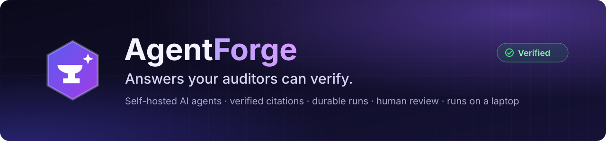
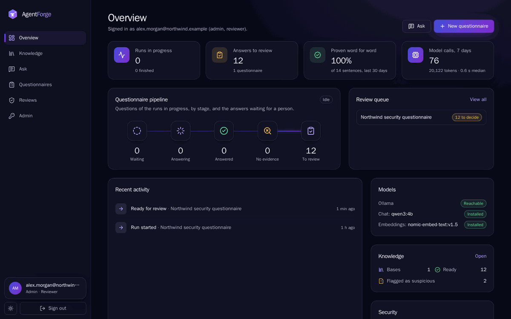

  
  
  
  
  
  

# 2026 AI Projects

AI engineering projects built in 2026. Each project lives in its own folder with its own
README, license, and tooling.

## ⭐ AgentForge: answers your auditors can verify

A self-hosted platform that answers security questionnaires and policy questions **only from
your own documents**. Every sentence carries the quote that proves it, unproven answers say
"insufficient evidence", and a person approves what goes out. It runs on a CPU-only laptop with
open-weight models.

*A real run on a CPU-only laptop, shown as a time-lapse (about 15 minutes in 8 seconds).*

- **Grounded answers:** hybrid retrieval in Postgres; every claim is checked against a verbatim
  quote, and anything unproven is dropped.
- **Durable agent runs:** questionnaires run on DBOS, chosen by measuring three engines against
  eight conformance gates. Runs survive `kill -9` (50/50 runs, worker killed 29 times).
- **Human in charge:** keyboard-driven review, and answers quoting suspicious documents are
  flagged.
- **Secure by design:** forced row-level security, scoped API keys, rate limits, an audit log,
  and a [15-item security baseline with evidence](agentforge/docs/security/r1-baseline.md).
- **Measured, not claimed:**
  - retrieval recall@5 100%;
  - 40-question run in 37 min on a laptop (3× faster after a measured fix);
  - [eval](agentforge/docs/evaluation/README.md) and [benchmarks](agentforge/bench/README.md).
- **Read-only MCP server**, so AI assistants can search the documents and get cited answers.

**Start here:** [AgentForge README](agentforge/) ·
[architecture](agentforge/docs/architecture/README.md) ·
[decision records](agentforge/docs/adr/README.md) ·
[release notes](agentforge/CHANGELOG.md)

## All projects

| Project | Description | Status |
|---|---|---|
| [agentforge](agentforge/) | Self-hostable platform for evidence-grounded, human-supervised AI workflows over private documents | **Release 1 (v0.1.0)**: complete, tested in CI |
| [production-rag](production-rag/) | "Ask My Cardiology Docs": CPU-only RAG with hybrid retrieval, reranking, verified citations, and a CI eval gate | Working prototype with measured fixture-set results |

<b>For contributors: repository conventions</b>

- Repository-wide hygiene lives at the root: `.gitignore`, `.gitattributes`, `.editorconfig`,
  `.gitleaks.toml` (secret scanning), and `.pre-commit-config.yaml`.
- Project tooling (Makefile, lockfiles, dependencies) lives inside each project folder.
- GitHub Actions only reads workflows at the root, so each project's workflows live in
  `.github/workflows/<project>-*.yml` and run with that project folder as the working directory.
- Clone into the Linux filesystem when using WSL2 (for example `~/src/2026AIProjects`), not under
  `/mnt/c` or a OneDrive folder.

