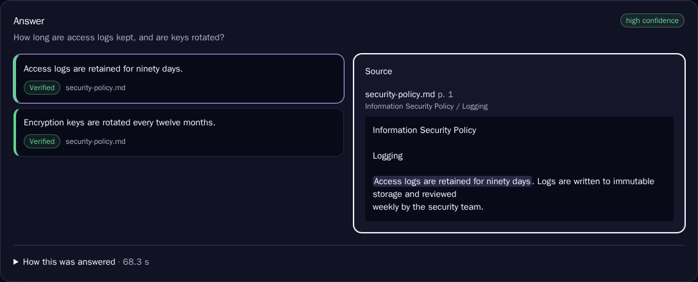
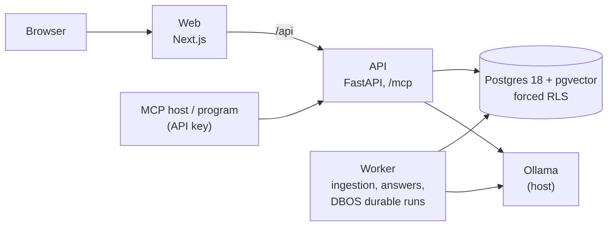

# AgentForge AI

**Self-hostable platform for evidence-grounded, human-supervised AI workflows over private documents.**

> Status: **Release 1 (pre-release, on `main`).** Everything below runs locally today.
> "AgentForge" is a working name, pending a trademark check before any public launch.

## The problem

Security questionnaires, RFPs and due-diligence checklists ask the same hundred questions in a
different spreadsheet every time. The answers are already in your policies, but finding them and
copying them takes days. Generic AI chat answers fast, and confidently invents a certification
you do not have.

AgentForge answers **only from your documents**, shows **the exact quote** behind every
sentence, says **"insufficient evidence"** instead of guessing, and puts **a person in charge**
of what gets sent. Everything runs on your own machine with open-weight models: no paid API, and
no document leaves the laptop.



*A real answer from the CPU-only reference laptop: each sentence is verified against the quote
shown on the right.*

## What it does

1. **Ask your documents.** Upload PDF, Word, Markdown or text. Ask a question and get an answer
   in which every sentence links to the passage that proves it. If the documents don't say, the
   answer says so.
2. **Fill a questionnaire.** Upload an Excel or CSV questionnaire. AgentForge answers every
   question in a durable background run that survives crashes. You can follow it live, step by
   step, then a reviewer approves, edits or rejects each answer with the keyboard, and you
   download the completed spreadsheet.
3. **Let AI assistants use it.** A read-only [MCP server](docs/mcp/README.md) lets Claude, or any
   MCP client with an API key, search your documents and get cited answers.

## Quickstart

You need Docker and [Ollama](https://ollama.com) with two models
(`ollama pull qwen3:4b && ollama pull nomic-embed-text:v1.5`). On Windows, follow the
[WSL2 guide](docs/guides/windows-wsl2.md) first.

```bash
git clone https://github.com/Kingslee1604/2026AIProjects.git && cd 2026AIProjects/agentforge
make up                                              # build and start; waits until healthy
make user-create EMAIL=you@example.com ROLE=admin    # asks for a password
```

Open <http://127.0.0.1:3000>, sign in, create a knowledge base, upload a document, and ask.
There is no Ollama yet? `AGENTFORGE_MODEL_PROVIDER=fake make up` runs with deterministic
offline models so you can explore the interface.

## Architecture



A modular monolith on Postgres only: relational data with forced row-level security, vectors,
full-text search, job queues, durable-run state and the audit log, all in one database. Read
[the architecture overview](docs/architecture/README.md) (C4 context and containers), the full
[design](docs/design/ARCHITECTURE_DESIGN.md), and the [decision records](docs/adr/README.md).

## Measured results

All numbers come from the reference machine: a Dell Inspiron 15 3520 laptop (Intel i7-1255U,
16 GB of RAM, **no GPU**). The raw data is linked.

| What | Result | Source |
|---|---|---|
| Retrieval on the 40-question Northwind gold set | recall@5 **100%**, MRR **0.94**, HNSW top 10 = exact search | [evaluation](docs/evaluation/README.md) |
| Answerable questions refused (`qwen3:4b`, 34 answerable) | **0** | [relevance report](docs/evaluation/2026-10-16-relevance/report.md) |
| Unanswerable questions answered (6) | 2, both from a planted adversarial document, which is now flagged for review | same |
| Kept sentences proven by a verbatim quote | 98% | same |
| Durability: 50 runs, worker `kill -9` 29 times, 10% model faults | **50/50** succeeded, 0 duplicate exports, 0 items answered twice; recovery p50 3.1 s, p95 6.6 s | [durability.json](bench/results/durability.json) |
| Prompt injection | 0 tool executions possible, 0 of 2 injected instructions followed | [report](docs/security/prompt-injection.md) |
| Questionnaire run, 12 questions | **15 min** end to end (12/12 answered, 0 timeouts), 16k tokens | [measurements](bench/results/2026-10-19-inspiron-3520-one-at-a-time/summary.md) |
| Questionnaire run, 40 questions | **37 min** end to end (40/40 answered, 0 timeouts), 55k tokens | same |
| Memory during a run | Ollama ≤ 4.4 GB; the stack in WSL2 ≤ 1.5 GB | same |
| Search latency | p50 150 ms, p95 248 ms | same |
| Run start overhead (no model time) | p95 1.8 s with 30 runs started at once | same |

These runs answer one question at a time, the default for a CPU-only Ollama. Up to eight at
once (the earlier default) took 31 and 110 minutes, because calls queued and timed out
([report](bench/results/2026-10-19-inspiron-3520/summary.md)). The laptop was on battery for
the faster runs, which slows the CPU.

## Security

The [R1 security baseline](docs/security/r1-baseline.md) has evidence for every item:
- loopback-only ports;
- forced RLS, with cross-tenant tests in every area;
- sessions with CSRF protection, and scoped API keys;
- upload hardening;
- rate limits;
- no secrets in logs;
- dependency and image scans with SBOMs;
- an audit log.

See also the [threat model](docs/security/threat-model.md). Report vulnerabilities privately:
[SECURITY.md](SECURITY.md).

## Documentation

- Guides: [Windows/WSL2 install](docs/guides/windows-wsl2.md), [models](docs/guides/models.md),
  [configuration](docs/guides/configuration.md), [MCP server](docs/mcp/README.md)
- Architecture: [overview](docs/architecture/README.md), [ADRs](docs/adr/README.md),
  [full design](docs/design/ARCHITECTURE_DESIGN.md)
- Quality: [evaluation](docs/evaluation/README.md), [benchmarks](bench/README.md),
  [accessibility](docs/accessibility/keyboard-checklist.md)
- Project: [Release 1 plan](docs/design/RELEASE_1_PLAN.md), [contributing](CONTRIBUTING.md),
  [code of conduct](CODE_OF_CONDUCT.md)

## Roadmap

| Release | Focus |
|---|---|
| **R1** (now) | Grounded Q&A and the security-questionnaire workflow, durable runs, human review, a read-only MCP server, and the security baseline. Local, single machine |
| R2 | Governed MCP client (agents use external tools with allowlists, approval and SSRF protection), a declarative workflow spec, and an invite-only hosted demo |
| R3 | A constrained visual workflow editor, SSO, and the pre-public security gate for open sign-up |

## License

[Apache-2.0](LICENSE). See [NOTICE](NOTICE). The demo corpus (`demo/`) is fictional and
self-authored, under CC-BY-4.0.
