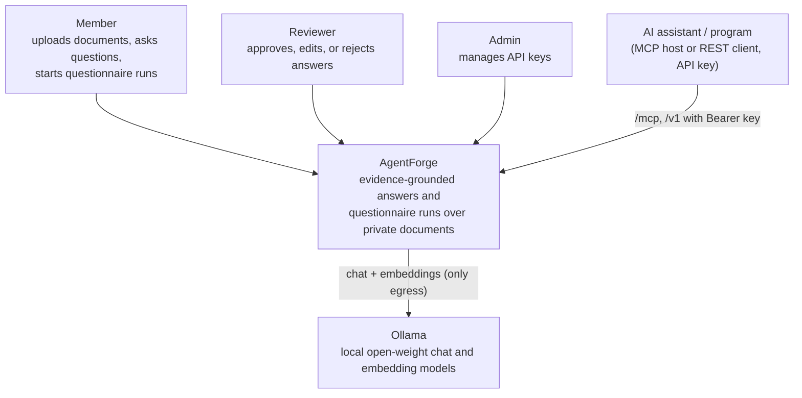
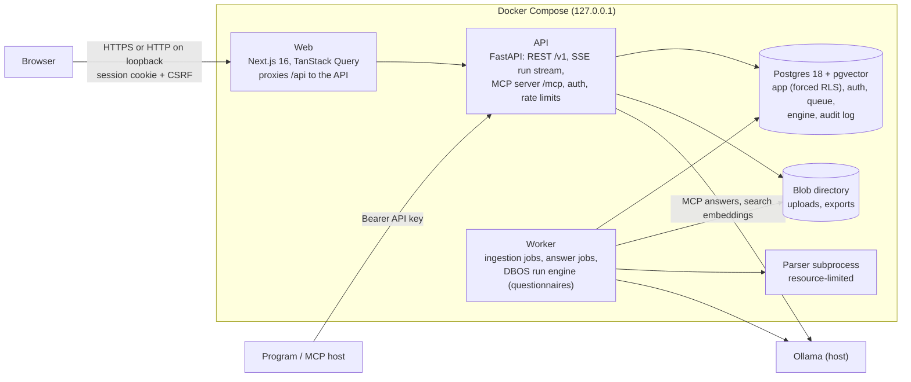

# Architecture (Release 1)

A short tour of R1 as built. The full design, including R2 and R3, is
[ARCHITECTURE_DESIGN.md](../design/ARCHITECTURE_DESIGN.md); decisions are in [ADRs](../adr/).

## Context (C4 level 1)

Who uses AgentForge, and what it depends on.

Everything runs on one machine. Ports are published on 127.0.0.1 only, and the only outbound
connection goes to the configured model endpoint (security baseline S1, S6).

## Containers (C4 level 2)

| Container | Responsibility | Notes |
|---|---|---|
| Web | Sign-in, Knowledge, Ask, Questionnaires (live run page), Reviews, Admin | Same origin as the API through the `/api` proxy, so cookies are first-party ([ADR-0006](../adr/0006-server-side-sessions.md)) |
| API | HTTP surface, authentication and authorisation, rate limits, MCP | Stateless; every request sets the tenant for RLS ([ADR-0003](../adr/0003-shared-schema-tenancy-with-forced-rls.md)) |
| Worker | Indexing, answering, and durable questionnaire runs | Job tables ([ADR-0012](../adr/0012-ingestion-job-table.md)) and DBOS ([ADR-0002](../adr/0002-durable-execution.md)) |
| Postgres | All state: data, vectors, full-text, queues, engine checkpoints, events, audit | The only infrastructure ([ADR-0001](../adr/0001-modular-monolith-on-postgres.md)) |

## How a grounded answer is made

1. **Retrieve**: hybrid search (vectors plus keywords, fused with RRF) in the chosen knowledge
   bases ([ADR-0004](../adr/0004-retrieval-inside-postgres.md)). If no passage is close enough,
   the answer is "insufficient evidence" without calling a model.
2. **Draft**: the model writes claims, each with the passage IDs it cites and an exact quote.
   Evidence is fenced as untrusted content.
3. **Check**: each quote must appear word for word in its cited passage and say what the claim
   says. Claims that fail go to the verifier model, or are dropped.
4. **Relevance**: one call checks that the answer responds to the question.
5. **Flag**: a claim that cites a document flagged as addressing AI assistants lowers confidence
   and shows "Check this source".

The answer is exactly the surviving claims, each with its quote. A questionnaire run does this
for every question, at most four at a time per run, then waits for a person to review and
exports the file.

## Module boundaries

`apps/server/src/agentforge/` is one package with enforced layers (`import-linter`, in CI):

| Layer | Modules |
|---|---|
| Entry points | `api`, `worker`, `cli` |
| Wiring | `services` |
| Domain | `qa`, `agents`, `runs`, `questionnaires`, `reviews`, `knowledge`, `models`, `auth`, `audit`, `evaluation` |
| Infrastructure | `db`, `core` (settings, logging, telemetry, health) |

Domain modules never import FastAPI, `api`, `worker` or `services`; `knowledge` and `models`
sit below `agents` and `qa`.
