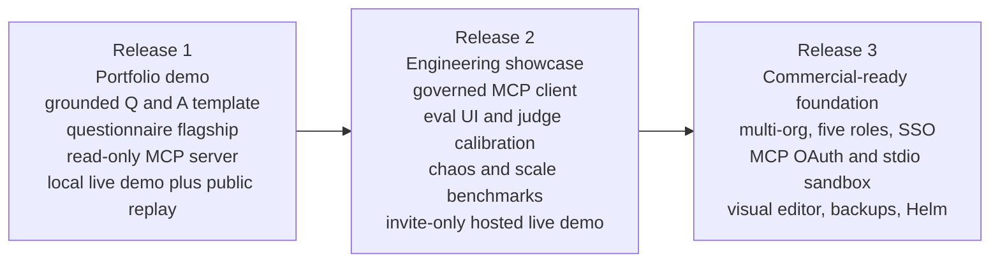
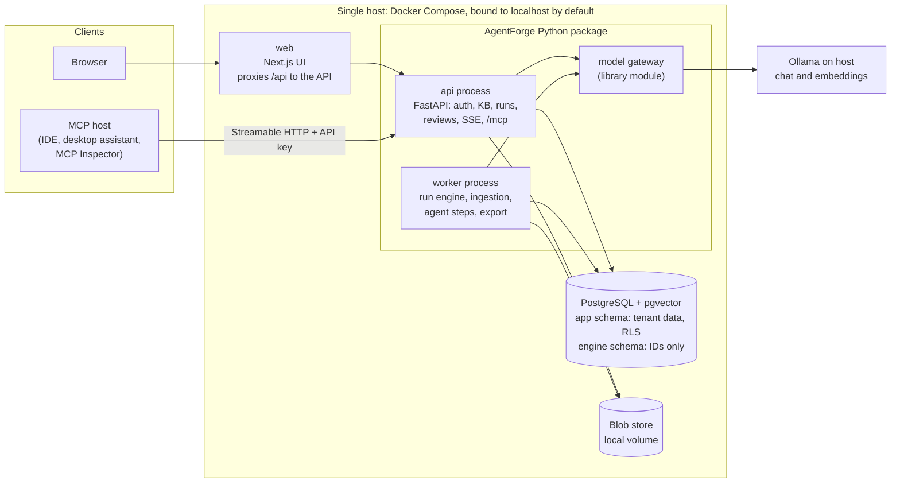
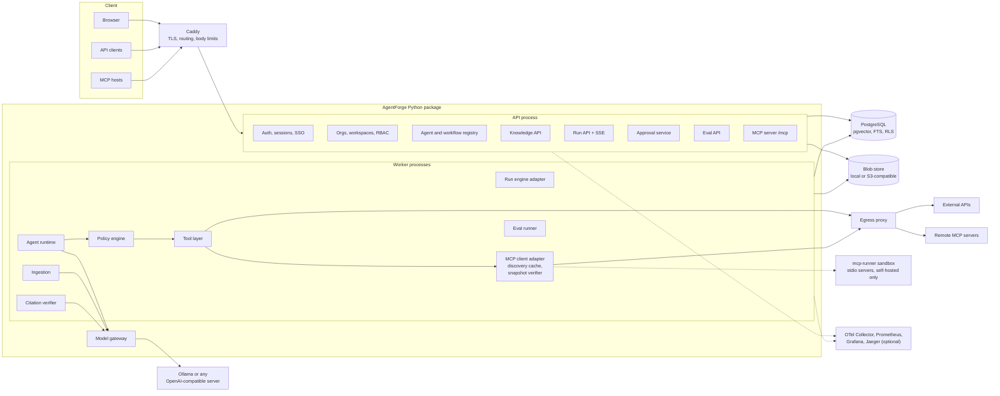
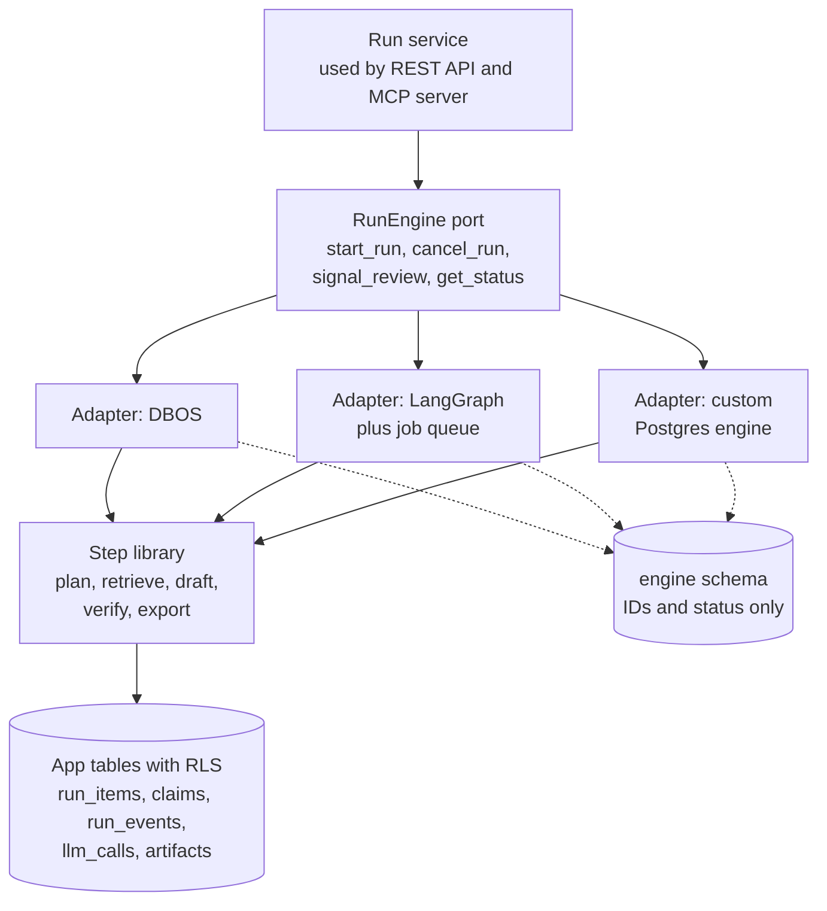
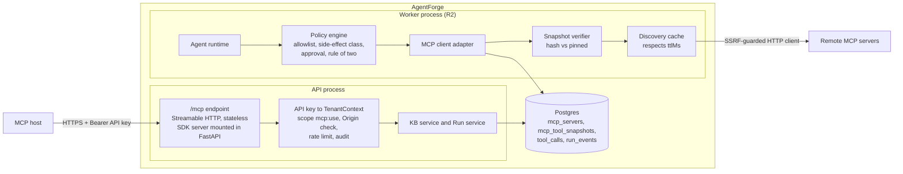
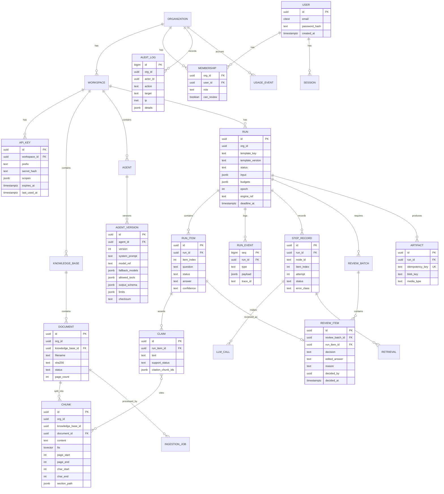
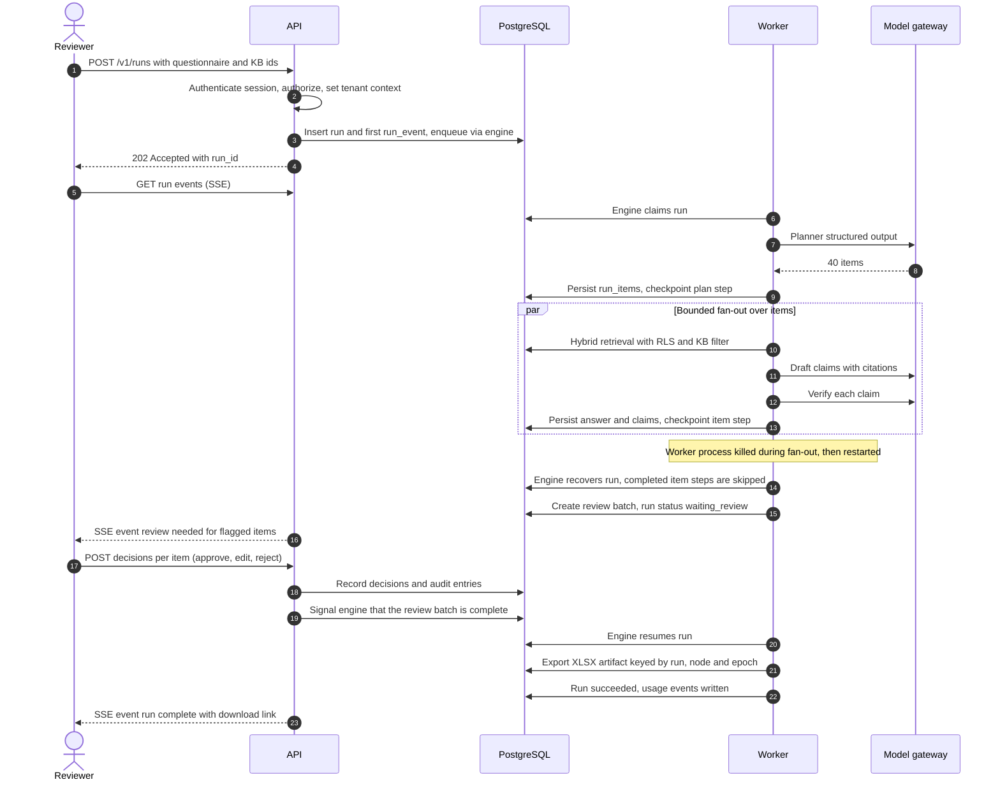
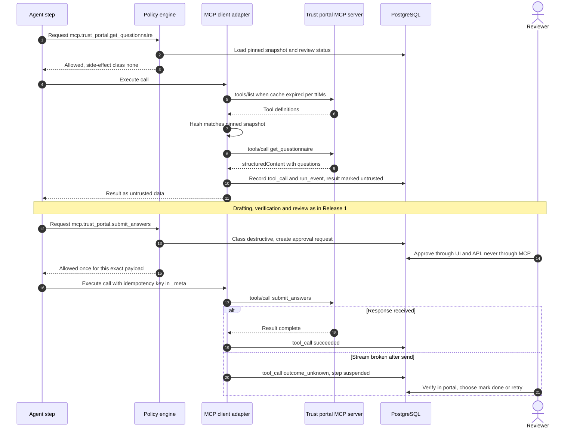
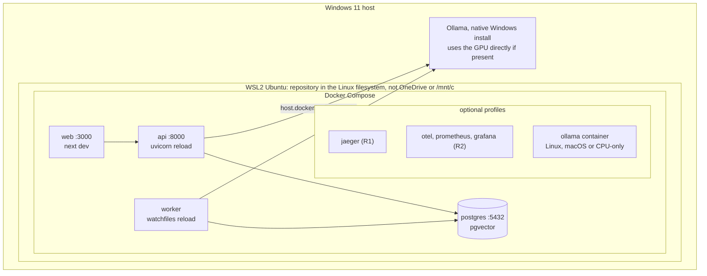

# AgentForge AI — Architecture & Product Design (v0.2, for review)

| Field | Value |
|---|---|
| Status | **APPROVED v0.2 (2026-10-12).** Implementation starts with Release 1 task R1-01. Decisions in §23 |
| Date | 2026-10-09 |
| Supersedes | v0.1 (archived at [archive/ARCHITECTURE_DESIGN_v0.1.md](archive/ARCHITECTURE_DESIGN_v0.1.md)) |
| Companion | [RELEASE_1_PLAN.md](RELEASE_1_PLAN.md): Release 1 backlog, estimates, demo walkthrough |
| Decision format | Decision → Alternatives → Trade-offs → Recommendation → Evidence required |

### How numbers are labeled in this document

Every quantitative statement carries one of three labels:

| Label | Meaning |
|---|---|
| **Target** | A design goal. It becomes a claim only after measurement. |
| **Estimate** | A planning guess with stated uncertainty (effort, calendar time, hardware sizing). |
| **Measured** | A result backed by a committed raw-data file, hardware manifest, command, git SHA, and model digest. **v0.2 contains no Measured values.** |

### How facts are labeled

- **Verified 2026-10-09**: checked against the named primary source on that date (§20).
- **[VERIFY]**: not yet checked against a primary source. Release 1 task R1-02 closes every [VERIFY] item that affects a shipped dependency before that dependency is added.

---

## 0. What changed from v0.1

| # | Review feedback | Change in v0.2 | Where |
|---|---|---|---|
| 1 | General-purpose, open-source, commercially usable platform | Vision restated around platform primitives. Apache-2.0 plus a CI license gate kept. Code-first workflows in R1 so the platform is general from day one | §1, §3 |
| 2 | Questionnaire is the first flagship, not the identity | Flagship is "template #1". R1 also ships a second, smaller template (grounded knowledge Q&A) to prove generality | §1.3, §3 |
| 3 | Preserve MCP client/server, RAG, Ollama, approvals, eval, observability, security | All preserved and assigned to releases. Nothing dropped, only sequenced | §3.2 |
| 4 | Three releases | R1 portfolio demo, R2 engineering showcase, R3 commercial-ready foundation | §3 |
| 5 | Earliest usable live demo, securely | R1 has two live-demo milestones (grounded Q&A, then the questionnaire). A localhost-first security baseline is in place from the first milestone. Hosted access is gated | §3.1, §14 |
| 6 | Re-evaluate the custom engine | Engine choice is now **pending a 3-way prototype** (DBOS, LangGraph, custom Postgres) with hard gates and a "simplest that passes" rule. All app code targets a `RunEngine` port | §7, ADR-2 |
| 7 | Defer visual editing, extensive RBAC, MCP stdio | Visual editor → R3 (R2 read-only viewer). RBAC: 2 roles in R1, 5 roles in R3. MCP stdio client and sandbox → R3 | §3.2 |
| 8 | MCP governance ships with MCP tool execution | MCP **client** (tool execution) ships only in R2, together with snapshot pinning, review, policy, and approvals. R1 has a **read-only MCP server** only | §9 |
| 9 | Fix the broken Mermaid diagram and validate every diagram | v0.1 §11 sequence diagram used `;` inside messages, which Mermaid parses as a statement separator. All 12 diagrams in v0.2 and the Release 1 plan pass `mermaid.parse()` (Mermaid 11.17.2). The v0.2 replacement for the v0.1 MCP sequence diagram also adds the missing policy-to-adapter step | §12, Appendix A |
| 10 | Consistent timelines, estimates vs. measured | A single source of truth for effort (§3.3, detailed in RELEASE_1_PLAN). Labels above | §3.3 |
| 11 | No mandatory paid services | Confirmed per component. DBOS Conductor and LangGraph Platform are explicitly not required | §19 |
| 12 | Verify licenses | Core candidates verified 2026-10-09 (§20). Remaining items listed as [VERIFY] with owner task R1-02 | §20 |
| 13 | Concrete R1 backlog | See RELEASE_1_PLAN.md | — |
| 14 | No code yet | Unchanged | — |

**New facts found during verification that change the design:**

1. **MCP's current revision is 2026-07-28** (Verified). It makes the protocol stateless: no `initialize` handshake, no `Mcp-Session-Id`, per-request version in `_meta`, a mandatory `server/discover`, a `subscriptions/listen` stream for list-changed notifications, required `ttlMs`/`cacheScope` on list results, no SSE resumability, and the Multi Round-Trip Request (MRTR) pattern replacing server-initiated requests. **Sampling, Roots, and Logging are deprecated.** v0.1's "session pool" design is replaced (§9).
2. The **official `mcp` Python SDK is at 2.3.0** (MIT, Verified). 2.x supports 2026-07-28 and still serves 2025-era clients. 1.x is security-fix-only.
3. **DBOS** (`dbos` 3.2.0, MIT, Verified) runs on `psycopg` 3 and SQLAlchemy. If DBOS is selected, AgentForge standardizes on `psycopg` 3 instead of `asyncpg` to keep a single Postgres driver.

---

## 1. Product vision

### 1.1 Positioning

**AgentForge AI is an open-source, self-hostable platform for building agentic AI workflows that are evidence-grounded, human-supervised, and auditable over private data.**

It is a general-purpose platform. Its primitives are:

| Primitive | What it is |
|---|---|
| **Knowledge base** | Ingested private documents with hybrid retrieval and span-level citations |
| **Agent** | A versioned, immutable definition: prompt, model, allowed tools, output schema, budgets |
| **Tool** | A capability with a declared side-effect class, executed only through a policy engine. Built-in tools, and MCP tools from R2 |
| **Workflow** | A durable multi-step process. Code-first in R1, declarative graph in R2, constrained visual editing in R3 |
| **Run / Step / Trace** | A durable execution with a complete, inspectable event trace |
| **Review / Approval** | A human decision point that the model cannot bypass |
| **Evaluation** | Datasets and metrics that turn quality into regressions you can see |
| **MCP endpoint** | AgentForge reachable from any MCP host, and (from R2) able to call MCP servers under governance |

### 1.2 The five promises

1. **Every output has evidence.** Claims link to source passages. Unsupported claims are flagged, not hidden.
2. **Every action is governed.** Tools run only under declarative permissions outside the model. Sensitive actions stop at a human gate.
3. **Every run is inspectable and recoverable.** Execution is durable. A crashed worker resumes; completed steps are not repeated.
4. **Runs fully local and free.** Postgres + Ollama + open-weight models. No paid service is required anywhere in the core.
5. **MCP-native in both directions.** AgentForge is an MCP server (R1, read-only) and a governed MCP client (R2).

### 1.3 Templates: how the platform goes to market

| Template | Release | Purpose |
|---|---|---|
| **#1 Security questionnaire / RFP response** (flagship) | R1 | The painful, measurable business workflow used for go-to-market and the demo |
| **#2 Grounded knowledge Q&A** | R1 | The smallest useful template. It proves the primitives are general and is the first live demo |
| #3 Contract review against a playbook | R3 | Second business template that exercises the same primitives |
| Community templates | R3+ | Once workflow definitions are declarative and documented |

**The identity is the platform. The flagship is how we prove it is valuable.** Commercial claims remain hypotheses until at least 10 discovery interviews are done (unchanged from v0.1 §3.2).

### 1.4 What AgentForge is not

It is not a LangChain/LangGraph UI wrapper, a chatbot builder, a no-code automation clone, or a vector database.

---

## 2. Competitive positioning (condensed from v0.1 §2, unchanged in substance)

| Category | Examples | Our differentiation |
|---|---|---|
| Agent frameworks | LangGraph, CrewAI, AG2, LlamaIndex, Pydantic AI | A product with tenancy, approvals, audit, eval, and UI. Frameworks leave those to you. AgentForge may use a framework internally (§7) |
| OSS LLM app builders | Dify, Flowise, Langflow, n8n | Durable execution, claim-level citation verification, policy-enforced tools, built-in eval, Apache-2.0. Several competitors use modified licenses [VERIFY per project] |
| Vertical SaaS (flagship domain) | Loopio, Responsive, Conveyor, SafeBase, Vanta/Drata features | Self-hosted, local models, no document egress, auditable pipeline |
| Hyperscaler agent services | Bedrock Agents, Vertex AI Agent Builder, Azure AI Foundry | No lock-in, air-gappable, predictable cost |

**Governed MCP** stays the narrow, defensible gap: hash-pinned tool snapshots with admin review, our own side-effect classification, approval gates, SSRF-guarded egress, and full traces.

**Where we lose:** integrations breadth, community size, and polish. A solo project wins on a narrow axis: trustworthy, auditable, self-hosted document workflows.

---

## 3. Release strategy

### 3.1 Three releases



| Release | Audience | Goal | Exit criteria (summary) |
|---|---|---|---|
| **R1 Portfolio demo** (`v0.1.0`) | Recruiters, interviewers, early users who run locally | A secure, working, honest demo of the platform and the flagship as early as possible | Both templates run live on a local machine. Public static replay of a real recorded run. Read-only `/mcp` works with MCP Inspector. R1 security baseline (§13.6) has evidence for every item. Retrieval baseline committed |
| **R2 Engineering showcase** (`v0.2.0`) | Senior engineering reviewers (applied AI, infra, distributed systems) | Depth: governed MCP client, measured durability and scale, calibrated evaluation | MCP adversarial-server suite passes (§9.6). Chaos and recovery benchmarks published. Judge calibrated (κ reported). Retrieval benchmarks at 10k/100k/1M chunks. Invite-only hosted live demo behind the hosted-demo gate (§13.7) |
| **R3 Commercial-ready foundation** (`v1.0.0`) | Design partners, self-hosting organizations | The non-negotiables a paying self-hosted customer needs | Multi-org with five roles and separation of duties. OIDC SSO. Backups with restore drill. Full pre-public gate (§13.8). Upgrade and migration guides. License, trademark, and contribution policy settled |

### 3.2 Capability × release matrix

| Capability | R1 | R2 | R3 |
|---|---|---|---|
| Auth | Email/password, server-side sessions, CSRF, invite-only (CLI-created users) | Self-service invitations, password reset by email (local outbox) | OIDC SSO. SAML/SCIM as paid-tier candidates |
| Tenancy | `org_id`/`workspace_id` on every tenant row, RLS forced, cross-tenant tests. **One org and workspace in the UI** | Multiple workspaces in the UI | Multiple orgs in the UI, org deletion |
| Roles | **2 roles:** Admin, Member (with `review` permission). Static permission matrix | — | 5 roles (Owner, Admin, Builder, Reviewer, Viewer), separation of duties, KB-level ACLs |
| Knowledge | PDF, DOCX, MD, TXT. Sandboxed parsing. Hybrid retrieval. Citations. Search tester | XLSX/CSV knowledge docs. Optional reranker (if eval shows gain) | Optional OCR image. Docling high-fidelity parser (optional image) |
| Agents | Versioned definitions from YAML templates, read-only in UI | Agent builder UI with test pane and version diff | — |
| Workflows | **Code-first** (Python step library on the selected engine). Read-only step view | Declarative workflow spec (YAML/JSON) + read-only React Flow graph viewer | **Constrained visual editor** |
| Execution | Durable runs, bounded fan-out, review wait, cancel, budgets, retry-from-step | Scheduled runs | — |
| Tools | Built-in only: `kb_search`, `export_xlsx` (local artifact). **No outbound tools** | `http_request` (SSRF-guarded), `webhook` (outbox), encrypted tool credentials | Egress proxy (e.g., Smokescreen [VERIFY]) as default in hosted mode |
| MCP server | **Read-only:** `search_knowledge`, `answer_with_citations`, `get_run`. API-key auth | `start_workflow_run`, `list_pending_approvals`. Local stdio bridge CLI. Optional tasks extension for long calls | OAuth 2.1 resource server. KB documents as MCP resources |
| MCP client | — (no MCP tool execution) | **Governed:** Streamable HTTP, snapshot pinning and review, policy and approvals, `outcome_unknown`, adversarial suite. Static-secret auth | OAuth 2.1 client. **stdio servers in the `mcp-runner` sandbox.** MRTR `input_required` mapped to the review UI |
| Approvals | Per-item review (approve, edit-and-approve, reject) gating export | Approvals for destructive tool calls (built-in and MCP), rule of two | Separation of duties, assignment, timeouts, notifications |
| Verification | Mechanical citation checks + LLM entailment. Mode: all claims, or low-confidence only | Verifier agreement vs. human labels reported | — |
| Evaluation | CLI harness, retrieval and grounding metrics, committed baseline | Eval UI, run comparison with confidence intervals, judge calibration, CI regression gate | Per-tenant eval datasets in UI |
| Observability | structlog JSON, OTel traces (console exporter, Jaeger optional), run trace UI | Compose profile with OTel Collector, Prometheus, Grafana, Jaeger. MCP `traceparent` propagation | Alerting guides |
| Metering | `usage_events` written (tokens, runs) | Analytics page | Quotas, `BillingProvider` interface |
| Audit | Append-only log: auth, reviews, API keys, deletions | Hash-chained entries | Export to SIEM, retention policies |
| Deployment | Docker Compose, host-native Ollama, localhost-first | Caddy + TLS profile, hosted-demo profile | Helm chart, HA guidance, backups and restore |
| Public demo | Recorded video + static replay of real runs | Invite-only, time-limited hosted live demo | — |

### 3.3 Effort and calendar (single source of truth)

All figures are **Estimates** for one experienced engineer at 15–20 focused hours/week. Uncertainty is about ±30%. These numbers replace every timeline in v0.1, including the inconsistent "22 weeks" and "25–27 weeks" figures.

| Release | Effort estimate | Calendar estimate at 15–20 h/week | Confidence |
|---|---|---|---|
| **R1** | **352 h** (task-level breakdown in RELEASE_1_PLAN) | 18–24 weeks | Medium (task-level) |
| R2 | ~250 h | 13–17 weeks after R1 | Low (feature-level) |
| R3 | ~300 h | 15–20 weeks after R2 | Low (feature-level) |

**First live demo:** R1 milestone M2 (grounded Q&A, live and local, authenticated) at about **165 h cumulative (~8–11 weeks)**. **Flagship live demo:** milestone M4 at about **279 h (~14–19 weeks)**. R2 and R3 are re-estimated at task level when the release before them ships, using R1's actual-vs-estimate ratio.

---

## 4. Requirements

### 4.1 Functional requirements

| ID | Requirement | Release |
|---|---|---|
| FR-01 | Email/password login, server-side sessions, logout everywhere. Users created by CLI or admin (no open sign-up) | R1 |
| FR-02 | Orgs, workspaces, memberships in the data model with RLS. R1 UI exposes one org/workspace | R1 (model), R2/R3 (UI) |
| FR-03 | Roles: R1 Admin/Member with a `review` permission. R3 five roles with separation of duties | R1 / R3 |
| FR-04 | Knowledge bases: upload PDF, DOCX, MD, TXT (XLSX/CSV in R2). Async ingestion with status, errors, re-index, hard delete | R1 |
| FR-05 | Hybrid retrieval (vector + full-text, RRF) with tenant and KB filters and span citations (doc, page, character span) | R1 |
| FR-06 | Agent definitions with immutable versions (YAML templates in R1, builder UI in R2) | R1 / R2 |
| FR-07 | Workflows: code-first in R1, declarative spec + viewer in R2, constrained visual editor in R3 | R1 / R2 / R3 |
| FR-08 | Durable execution: sequential steps, bounded fan-out/fan-in, conditional routing, review wait, cancel, retry from step, budgets | R1 |
| FR-09 | Human review: per-item approve, edit-and-approve, reject with reason. Gates export | R1 |
| FR-10 | Built-in tools: `kb_search`, `export_xlsx` (R1). `http_request`, `webhook` (R2) | R1 / R2 |
| FR-11 | Run trace UI: steps, LLM calls (prompt, response, tokens, latency), retrievals, reviews, live via SSE | R1 |
| FR-12 | Claim-level citation verification with unsupported-claim flags | R1 |
| FR-13 | Evaluation: CLI harness and baseline (R1). UI, comparison, judge calibration, CI gate (R2) | R1 / R2 |
| FR-14 | Usage events (R1). Analytics (R2). Quotas (R3) | R1 / R2 / R3 |
| FR-15 | Audit log of security-relevant actions | R1 |
| FR-16 | Templates #1 (questionnaire) and #2 (grounded Q&A) with seeded fictional demo corpus | R1 |
| FR-17 | Workspace API keys with scopes (`api:read`, `api:write`, `mcp:use`) | R1 |
| FR-18 | MCP server, read-only tools at `/mcp` (Streamable HTTP) | R1 |
| FR-19 | MCP server, run-starting and approval-listing tools. stdio bridge CLI | R2 |
| FR-20 | Governed MCP client (Streamable HTTP): registration, discovery, snapshot pinning and review, policy, approvals, `outcome_unknown` | R2 |
| FR-21 | MCP client stdio servers in `mcp-runner` sandbox (operator-configured, self-hosted only) | R3 |
| FR-22 | MCP OAuth 2.1 (client and resource server) | R3 |
| FR-23 | Model fallback chain (ordered list) | R1 |
| FR-24 | Scheduled workflows | R2 |
| FR-25 | OIDC SSO | R3 |
| FR-26 | Billing integration behind `BillingProvider` | R3 |
| FR-27 | Template marketplace | Post-R3 |

### 4.2 Non-functional requirements

All values are **Targets**, verified by measurement on the reference machine (§23.1). Latency targets for LLM-dependent work are set after the first Measured baseline, because this machine is CPU-only.

| ID | Category | Target | Verification | From |
|---|---|---|---|---|
| NFR-01 | Tenant isolation | Zero cross-tenant reads/writes. RLS forced on every tenant table | Cross-tenant suite in CI. Schema lint | R1 |
| NFR-02 | Durability | A worker killed at any point: the run completes and completed steps are not re-executed | Chaos test with fake LLM | R1 (basic), R2 (benchmark) |
| NFR-03 | Side-effect safety | **Built-in tools with idempotent targets:** effectively once per (run, step, epoch). **External calls without idempotency support, including MCP non-read tools:** at most one automatic attempt once the request may have been sent. An ambiguous result becomes `outcome_unknown` and goes to a human | Mock-counter tests. Fault-injection tests | R1 (built-in), R2 (external) |
| NFR-04 | API latency | Non-LLM endpoints p95 < 150 ms at target load | k6 report | R2 |
| NFR-05 | Scheduling latency | Enqueue → step start p95 < 500 ms with idle workers | Engine benchmark (fake LLM) | R1 (smoke), R2 (benchmark) |
| NFR-06 | Retrieval latency | Hybrid retrieval p95 < 200 ms at 100k chunks per workspace | Retrieval benchmark | R2 |
| NFR-07 | Availability | Single node. Restart without losing runs. No HA before R3 | Restart test | R1 |
| NFR-08 | Security | R1 security baseline (§13.6). Pre-public gate (§13.8) before any open public exposure | Checklists with linked evidence | R1 / R3 |
| NFR-09 | Accessibility | WCAG 2.2 AA on core flows | axe-core in Playwright + manual keyboard pass | R1 |
| NFR-10 | Portability | `make up` works on Windows 11 + WSL2, Linux, macOS. CPU-only path works | CI (Linux) + documented manual checks | R1 |
| NFR-11 | Observability | Every request and run correlated by trace ID | Propagation test | R1 |
| NFR-12 | Reproducibility | Lockfiles, images pinned by digest, deterministic seed (up to LLM output) | CI rebuild check | R1 |
| NFR-13 | Data deletion | Document/KB deletion removes rows, vectors, and blobs synchronously | Deletion test | R1 (doc/KB), R3 (org) |
| NFR-14 | Cost | No mandatory paid service for development, local inference, CI on a public repo, or the public replay demo | Dependency review (§19) | R1 |

---

## 5. System architecture

### 5.1 Release 1 logical architecture

R1 is a **modular monolith**: one Python package with two process types (API and worker), Postgres as the only stateful service, and Ollama on the host.



### 5.2 Target architecture (Release 3)



### 5.3 Deployment units by release

| Unit | R1 | R2 | R3 | Notes |
|---|---|---|---|---|
| `web` (Next.js, `output: "standalone"`) | ✓ | ✓ | ✓ | UI only. Proxies `/api` and `/mcp` so cookies are same-origin |
| `api` (FastAPI) | ✓ | ✓ | ✓ | Stateless |
| `worker` (same image, other entrypoint) | ✓ | ✓ | ✓ ×N | Engine, ingestion, eval |
| `postgres` (+ pgvector) | ✓ | ✓ | ✓ | Only stateful service |
| Ollama | Host-native (recommended on Windows for GPU) or `ollama` profile | ✓ | ✓ | Separate process |
| `caddy` | — | Hosted-demo profile | ✓ | TLS + routing |
| Observability stack | Optional Jaeger only | Profile | Profile | Never required to run |
| `demo-mcp-trust-portal` | — | Demo profile | Demo profile | Sample MCP server for the client demo |
| `mcp-runner` | — | — | Optional profile | stdio sandbox, self-hosted only |
| `worker-ml` (reranker, Docling) | — | Optional | Optional | Keeps torch out of the main image |

**R1 required: 4 containers + Ollama.** No Redis, broker, MinIO, separate vector DB, or reverse proxy.

### 5.4 Module boundaries

Package-per-domain with import-linter contracts (`api` → services only; `engine` adapters never import `api`; nothing outside `db/` opens raw sessions). These rules make later extraction mechanical. Extraction stays evidence-triggered, as in v0.1 §5.3.

---

## 6. Component responsibilities

| Component | Responsibilities | Must not | Release |
|---|---|---|---|
| Web app | UI, SSE consumption, accessibility | Hold secrets, call the DB, trust its own role checks | R1 |
| API | HTTP/OpenAPI, validation, authN/Z, tenant context, rate limits | Run long work inline | R1 |
| Auth | argon2id, sessions, CSRF, API keys, `authorize()` | Issue browser JWTs | R1 |
| Run service + `RunEngine` port | Start, cancel, signal, status. Hides the engine choice from callers (§7.4) | Leak engine types into API or UI | R1 |
| Step library | Plan, retrieve, draft, verify, export, as plain, engine-agnostic functions | Hold tenant content in engine state (§7.3 H6) | R1 |
| Agent runtime | Prompt assembly, untrusted-content wrapping, structured output, repair, budgets | Call tools directly. Everything goes through the tool layer | R1 |
| Tool layer + policy engine | Permission checks, side-effect class, approvals, idempotency keys, credentials (R2) | Expose credentials to model context | R1 (built-in), R2 (full) |
| Model gateway | Ollama, OpenAI-compatible, and fake providers. Structured outputs, fallback, accounting | Business logic | R1 |
| Knowledge service | KBs, ingestion, hybrid retrieval, citation assembly | Return chunks across tenant or KB boundaries | R1 |
| Ingestion | Validate, sandboxed parse, chunk, embed, index | Parse in the API process | R1 |
| Review/approval service | Review batches, per-item decisions, resume signal | Be exposed through MCP | R1 |
| MCP server | Curated tools mapped to `TenantContext` | Expose approvals, credentials, deletion, admin | R1 |
| MCP client adapter | Discovery, snapshot hashing and pinning, caching per `ttlMs`, circuit breaker, cancellation | Run unreviewed or changed tools. Forward AgentForge tokens | R2 |
| Eval framework | Datasets, metrics, comparison, judge calibration | Feed eval data into production indexes | R1 (CLI), R2 (UI) |
| Observability and audit | OTel, structlog, append-only audit | Log secrets or document content at INFO | R1 |
| Metering | Usage events, aggregates | Be the billing system | R1 |

---

## 7. Durable execution: compare, prototype, then choose

### 7.1 Why the decision changed

v0.1 committed to a custom engine and planned a spike only to confirm it. v0.2 reverses the burden of proof. **AgentForge adopts the simplest option that passes the demonstrated requirements, and builds custom only if the off-the-shelf options fail.** The engine is infrastructure. The product's value is grounding, governance, and the review experience.

### 7.2 Candidates (facts Verified 2026-10-09 unless marked)

| | **DBOS Transact (Python)** | **LangGraph** | **Custom Postgres engine** |
|---|---|---|---|
| Package / license | `dbos` 3.2.0, MIT | `langgraph` 1.2.14 + `langgraph-checkpoint-postgres` 3.1.2, MIT | Our code, Apache-2.0 |
| Model | Decorated Python workflows and steps. Each step's result is checkpointed in Postgres. Workflows resume from the last completed step after a crash | Graph of nodes over shared state. Checkpoints per super-step. `interrupt()` for human-in-the-loop | v0.1 design: leases with `SKIP LOCKED`, step state machine, checkpoints |
| Extra infrastructure | None (Postgres only). Queues need no broker | None for the checkpointer. **Background execution and crash recovery need our own job queue and re-invocation**, unless you use LangGraph Platform/Server, which we will not depend on [VERIFY its license] | None |
| Human wait | Durable messaging/events [VERIFY API: `send`/`recv`, `set_event`] | `interrupt()` + resume command | Our approval suspension |
| Fan-out | Queues with concurrency limits [VERIFY API] | `Send` API | Our `map`/`join` |
| Agent-loop ergonomics | Plain Python | Strongest (it is an agent framework) | Plain Python |
| Main risks | Crash recovery across *multiple* self-hosted processes may require restarting the same executor ID or using DBOS Conductor (hosted service) [VERIFY]. Engine state stored outside our RLS tables | Two systems to operate (graph runtime + our queue). Resuming re-runs the interrupted node from its start. Fast-moving API | Highest bug risk (durability is hard). Most code to maintain |
| Paid services needed? | **No** for the library. Conductor is optional and not used | **No** for the library. Platform is optional and not used | No |

### 7.3 Demonstrated requirements (prototype hard gates)

Each prototype implements the **same mini-flow** (plan → bounded fan-out over 20 items with the fake LLM → review wait → idempotent export) and runs the **same conformance tests**, written against the `RunEngine` port.

| ID | Hard gate | Test |
|---|---|---|
| H1 | **Crash recovery:** `kill -9` of the worker at random points across 50 runs → every run completes. No completed item step re-executes (fake-LLM call counter) | Chaos test |
| H2 | **Review wait without held resources:** 20 runs waiting for review for 10 minutes, then a worker restart. All resume after the signal. No worker thread or connection is pinned per waiting run | Test + process metrics |
| H3 | **Bounded fan-out:** 20 items with `max_parallelism = 4` never exceed 4 concurrent item steps | Concurrency probe |
| H4 | **Idempotent side effect:** the export runs exactly once per (run, node, epoch) under crash and retry. A user-initiated retry (new epoch) produces a new artifact | Mock counter |
| H5 | **Cancellation:** cancelling a running run stops scheduling new steps within 2 s (Target) and marks the run cancelled | Test |
| H6 | **Tenant-data containment:** engine-owned state contains IDs and status only. Step outputs live in RLS-protected app tables | Schema inspection + test that engine tables contain no content fields |
| H7 | **Start atomicity:** a run row is never orphaned without an execution, nor an execution without a run row (transactional enqueue, or a reconciler that is tested) | Fault-injection test |
| H8 | **Trace integration:** each step emits `run_events` that the SSE endpoint streams | Test |
| H9 | **No paid or extra services:** runs on Postgres + our processes only | Compose file review |
| H10 | **License:** MIT/Apache/BSD only, verified | License check |

**Scored criteria (when several pass all hard gates):** lines of code for the mini-flow and adapter; number of new concepts a contributor must learn; test ergonomics (deterministic fake LLM, time control); recovery time after a crash (Measured); fit with async FastAPI; dependency weight; upgrade and API-stability risk.

### 7.4 Engine-agnostic architecture



Rules that hold whatever engine is chosen:

- **Reference-only checkpoints.** Steps write content (answers, claims, LLM I/O) to RLS-protected app tables and return only IDs to the engine. This keeps tenant data under RLS (H6) and keeps engine state small.
- **Our own `run_events` table** is the trace source for the UI. The UI never reads engine-internal tables.
- **Tenant context per step.** Each step opens its own transaction with `SET LOCAL app.org_id` taken from the run row, which the engine passes by ID.
- **Idempotency key** = `H(run_id, node_id, item_index, epoch)`. `epoch` increments only on a user-initiated retry, so crash retries reuse the key and deliberate retries do not. This fixes a v0.1 defect.
- **Engine tables live in a separate `engine` schema**, owned by a dedicated role, excluded from the RLS schema lint, and covered instead by the H6 content check. This resolves the v0.1 conflict between "FORCE RLS on every table" and workers that must claim jobs across tenants.

### 7.5 Preliminary expectation (not a decision)

Based on documentation only, **DBOS is expected to pass the most gates with the least code**: Postgres-only, steps map one-to-one to our step library, and no queue to build. The main open question is H1 across several processes without Conductor; R1 runs a single worker, so this only becomes a scaling concern. **LangGraph** is expected to need a custom queue plus recovery, which adds a second system. A **custom** engine is expected to pass every gate at the highest cost. The decision is recorded in ADR-2 with Measured prototype results (RELEASE_1_PLAN milestone M3).

### 7.6 Execution semantics (all engines)

- **Run states:** `queued → running → waiting_review → running → succeeded | failed | cancelled | timed_out`.
- **Budgets:** max steps, max LLM calls, max tokens, max wall-clock per run. Exceeding a budget ends the run as `budget_exceeded`, a visible failure class.
- **Non-determinism:** LLM outputs are persisted once. A resume never re-calls the model for a completed step. Replay renders from `run_events`; it does not re-execute.
- **Live updates:** `run_events` insert → `pg_notify` with IDs only → SSE endpoint fetches and streams. Clients reconnect with `Last-Event-ID` set to the event sequence number.

---

## 8. Agent runtime and model gateway

### 8.1 Agent step

1. Assemble context: versioned system prompt, task input, retrieved evidence **wrapped and labeled as untrusted data**, and the catalog of tools this agent version may use.
2. Call the gateway with a JSON schema (`{"action": "tool_call" | "final", ...}`) using Ollama's schema-constrained `format` [VERIFY per default model].
3. Validate with Pydantic. On failure: one repair attempt with the error, then the next model in the fallback list, then fail the step with a retryable error class.
4. On `tool_call`: the policy engine (outside the model) checks permission, argument schema, and approval requirement. The result comes back as untrusted data.
5. Enforce budgets on every iteration.

### 8.2 Model gateway

Interface: `generate`, `generate_structured`, `embed`. Providers: `ollama`, `openai_compatible`, `fake` (deterministic, configurable latency and fault injection). Every call is written to `llm_calls` with tokens and latency. No LangChain or LiteLLM dependency (ADR-5, unchanged).

### 8.3 Default models (to finalize in R1-02 and R1-40)

The reference machine is CPU-only with 16 GB of RAM (§23.1), so **the defaults are the CPU tier**. The GPU tier is an optional profile for users with a discrete GPU.

| Role | Candidates | License status |
|---|---|---|
| **Chat, default (CPU, ~3–4B Q4)** | Qwen3 4B; Granite 4.x small; Phi-4-mini | [VERIFY each card] |
| Chat, optional (GPU or ≥ 32 GB RAM, ~8B Q4) | Qwen3 8B; IBM Granite 4.x; Qwen3.5 9B | Qwen3-8B Apache-2.0 **Verified** (Hugging Face card). Granite 4.x and Qwen3.5 small: Apache-2.0 per secondary reports, **[VERIFY]** on official cards |
| Embeddings | nomic-embed-text; bge-m3 | [VERIFY each card] |
| Not default | Llama, Gemma (custom licenses with use restrictions) | Selectable by user with a license notice |

The final choice is made on **Measured** retrieval and structured-output validity from the R1 eval harness, not on reputation.

---

## 9. Model Context Protocol (MCP)

### 9.1 Baseline (Verified 2026-10-09)

- **Spec revision 2026-07-28** (current). It is stateless: per-request `_meta` carries the protocol version, client capabilities, and client info. `server/discover` is mandatory for servers. `subscriptions/listen` delivers list-changed notifications. List results carry `ttlMs` and `cacheScope`. Streamable HTTP POSTs carry `Mcp-Method`/`Mcp-Name` headers. SSE resumability is removed. MRTR (`input_required`) replaces server-initiated requests. Sampling, Roots, and Logging are deprecated. The tasks feature moved to an official extension.
- **Backward compatibility:** hosts and servers on 2025-11-25 and earlier still use the `initialize` handshake. AgentForge must interoperate with both.
- **SDK:** official `mcp` Python SDK **2.3.0 (MIT)**, which supports 2026-07-28 and serves earlier clients. Pin `mcp>=2.3,<3`. The `mcp.server.fastmcp` import path changed in 2.x [VERIFY via migration guide].

### 9.2 Two roles, two releases

| Role | Release | Why then |
|---|---|---|
| **MCP server (read-only)** | **R1** | Exposes only governed, read-only capabilities. It adds no tool-execution risk to AgentForge and makes the platform usable from any MCP host early |
| **MCP server (run start, approval listing)** | R2 | Starting runs is a write. It needs idempotency keys and quotas |
| **MCP client (tool execution)** | **R2, with all governance controls in the same release** | Executing third-party tools is the riskiest capability. It ships only with snapshot pinning, admin review, our side-effect classes, policy and approval enforcement, `outcome_unknown` handling, SSRF-guarded transport, and the adversarial test suite (feedback item 8) |
| MCP client stdio + `mcp-runner` | R3 | Code execution by design, so it needs a sandbox. Deferred per feedback item 7 |

### 9.3 Architecture



### 9.4 MCP server design (R1)

| Tool | Behavior | Declared annotations | Release |
|---|---|---|---|
| `search_knowledge` | Hybrid retrieval over KBs the key can read. Passages with document, page, and span citations | read-only | R1 |
| `answer_with_citations` | Grounded Q&A pipeline (retrieve → draft → verify). Returns claims with support status. Progress notifications on the request's response stream | read-only. Rate-limited because it consumes inference | R1 |
| `get_run` | Status, outputs, citations, pending reviews for a readable run | read-only | R1 |
| `start_workflow_run` | Starts a published workflow. Requires a client-supplied idempotency key. Review gates still apply | not read-only, not destructive | R2 |
| `list_pending_approvals` | Lists items awaiting review, with UI links | read-only | R2 |

- **Never exposed:** approve/reject, credentials, tool registration, deletion, membership, admin. A human gate must not be satisfiable by another agent.
- **Auth:** workspace API key with `mcp:use`, sent as `Authorization: Bearer`. It maps to the same `TenantContext`, RBAC, and RLS as REST. OAuth 2.1 resource-server support is R3. Hosts that require OAuth will not connect before R3 (R16).
- **Transport security:** validate `Origin` (DNS-rebinding protection [VERIFY wording in the 2026-07-28 transport section]), bind to localhost by default, TLS required whenever not on localhost.
- **Stateless serving:** no per-connection state, so any API replica serves any request. `tools/list` returns tools in a deterministic order with `ttlMs`.
- **Audit and metering:** every call is audited with `clientInfo` from `_meta`, the key ID, and the tool name, and counts against usage.

### 9.5 MCP client design (R2)

1. **Registration (Admin):** slug, URL, auth secret (envelope-encrypted), timeouts, max result size, and the `may_receive_confidential_content` flag.
2. **Discovery:** `server/discover` first. Fall back to the `initialize` handshake for servers on 2025-11-25 or earlier. Record the negotiated protocol version.
3. **Snapshot → review:** each tool definition `(name, title, description, inputSchema, outputSchema, annotations)` is canonicalized (JSON Schema 2020-12 `$ref` resolved within bounds) and hashed into an immutable `mcp_tool_snapshot`. An Admin assigns **our** side-effect class (`none | reversible | destructive`). Server annotations are shown as hints only. Unreviewed tools are disabled and treated as `destructive`.
4. **Namespacing:** agents see `mcp.<server_slug>.<tool_name>`. Agent versions reference **snapshot IDs**, not names.
5. **Rug-pull defense:** the discovery cache honours `ttlMs` (capped by our own maximum). On every refresh, and when a `toolsListChanged` notification arrives via `subscriptions/listen`, definitions are re-hashed. A mismatch creates a pending snapshot, disables the tool, alerts admins, and fails the affected step with `mcp_tool_changed`.
6. **Call path:** policy engine → validate arguments locally against the **pinned** `inputSchema` → call with timeout → enforce result size cap → validate `structuredContent` against `outputSchema` → record `tool_calls` + `run_events` → return to the agent as untrusted data. Resource links and images are never auto-fetched.
7. **Retries and `outcome_unknown`:** MCP has no idempotency standard. 2026-07-28 also removed stream resumability, so **a broken response stream loses the in-flight request**. Therefore:
   - `none` class: retried with backoff.
   - `reversible`/`destructive`: never automatically retried once the request may have been sent. An ambiguous outcome marks the call `outcome_unknown`, suspends the step, and asks a human to verify and choose *retry* or *mark done*. Our idempotency key travels in `_meta` as a convention for cooperating servers, but we never rely on it.
8. **No sessions:** the v0.1 session pool is replaced by an HTTP connection pool, the discovery cache, and a per-server circuit breaker.
9. **Cancellation and progress:** run cancellation cancels in-flight requests. Progress notifications on the response stream become `run_events`.
10. **Trace context:** propagate `traceparent` in `_meta` per the spec's OpenTelemetry convention.
11. **Network:** SSRF-guarded client (§13.5). Private ranges blocked by default. An org Owner may allowlist a private address per server in self-hosted mode only.
12. **Deprecated or deferred features:** Sampling is not supported (deprecated in the spec, and it would hand our inference to external servers). MRTR `input_required` (elicitation) maps to the review UI in R3.

### 9.6 MCP threat model and acceptance criteria (R2 gate)

| Threat | Control |
|---|---|
| Tool poisoning (instructions hidden in descriptions) | Descriptions are untrusted: length-capped, shown verbatim to the reviewer, placed in a labeled catalog block, pinned by hash |
| Rug pull | Hash pinning, re-review on change, tool disabled on change |
| Shadowing / name collision | Namespacing + references by snapshot ID |
| Prompt injection via results | Results are untrusted. The rule of two blocks destructive calls without approval after untrusted input |
| Token passthrough / confused deputy | Never forward our tokens. Per-server credentials only |
| Exfiltration through arguments | `may_receive_confidential_content` flag. If false, calls to that server after reading a confidential KB require approval. Residual risk documented, not claimed solved |
| SSRF via URL or redirects | SSRF-guarded transport. Same-origin redirects only (also the SDK 2.2 default, Verified) |
| Resource exhaustion | Timeouts, result caps, notification rate limits, circuit breaker |
| Inbound abuse of `/mcp` | Scoped keys, Origin validation, rate limits, audit (R1) |
| Agent-to-agent approval bypass | Approval operations are not exposed through MCP |

**R2 acceptance:** interop with our demo server and at least two independent open-source MCP servers on both 2026-07-28 and 2025-11-25; poisoned, rug-pull, slow/huge, redirect-to-private, and injected-result fixture servers → **0 unauthorized tool executions**, changed tools disabled 100% of the time; fault-injected stream break after send never auto-retries a non-read tool (mock counter = 1); cross-tenant suite covers `/mcp`.

---

## 10. RAG architecture

### 10.1 Pipeline

```mermaid
flowchart LR
    U["Upload<br/>streamed"] --> V["Validate<br/>size, magic bytes,<br/>extension and MIME match,<br/>page and zip limits"]
    V --> S["Store blob<br/>random key, org prefix"]
    S --> Q["Enqueue ingestion job"]
    Q --> P["Parse in sandboxed subprocess<br/>timeout, memory limit,<br/>pypdfium2, pdfplumber, python-docx"]
    P --> N["Normalize<br/>text, page map, headings,<br/>tables as markdown"]
    N --> C["Chunk<br/>structure-aware,<br/>keep page and char spans"]
    C --> E["Embed via Ollama<br/>model and dimension recorded"]
    E --> I["Index<br/>pgvector HNSW and<br/>tsvector GIN"]
    I --> R["Ready"]
```



Chunk size (starting point: 400–800 tokens, 10–15% overlap) is an **Estimate** to tune with the eval harness.

**Ingestion jobs do not need the durable engine.** Ingestion is naturally idempotent (it re-runs from the blob), so R1 uses a simple `ingestion_jobs` table claimed with `FOR UPDATE SKIP LOCKED`. This also lets ingestion ship before the engine decision (M2 before M3).

### 10.2 Retrieval and answer generation

1. Optional query rewriting by the Planner (1–3 queries).
2. Hybrid retrieval: vector top-k₁ (HNSW, cosine) + FTS top-k₂ (`websearch_to_tsquery`, `ts_rank_cd`), filtered by RLS **and** an explicit `knowledge_base_id IN (...)`, fused with Reciprocal Rank Fusion (k ≈ 60). pgvector **0.8.7** supports iterative index scans (`hnsw.iterative_scan`) for filtered queries (Verified). Filtered recall is still measured explicitly.
3. Optional reranker (R2), only if eval shows a gain worth its latency.
4. **Abstention gate:** a low fused score → "Insufficient evidence", routed to review.
5. **Grounded generation:** structured `claims[]`, each with `text` and `citation_chunk_ids[]`, or marked `unsupported`.
6. **Verification:** mechanical (cited IDs must be in the retrieved set; quoted spans must string-match the source) + LLM entailment per claim → `supported | partially_supported | not_supported`. Mode: `all` or `low_confidence_only` (inference cost control).
7. **Presentation:** claims colored by status, hover shows the passage, click opens the document at the span. Unsupported claims block auto-approval.

RAG reduces hallucination but does not eliminate it. The verifier can be wrong; its agreement with human labels is measured in R2.

### 10.3 Metrics

Recall@k (k = 5, 10, 20), MRR, filtered recall vs. exact search, citation validity (mechanical), unsupported-claim rate, abstention precision/recall on unanswerable questions (R1). nDCG@10, citation precision against human labels, answer correctness with a calibrated judge (R2). Gold labels reference **document spans**, not chunk IDs, so they survive re-chunking.

---

## 11. Data model

### 11.1 Rules

- Tenant tables live in the `app` schema, carry `org_id` (and `workspace_id` where scoped), and have RLS **enabled and forced**. The app connects as `agentforge_app` (not the owner, no `BYPASSRLS`). Migrations run as a separate owner role.
- Engine tables live in the `engine` schema (§7.4) and hold IDs and status only.
- Primary keys are UUIDv7.
- **Embeddings:** an HNSW index needs a fixed-dimension column (pgvector HNSW supports up to 2,000 dimensions for `vector`, 4,000 for `halfvec`, Verified). Changing the embedding model creates a **new embedding table generation** (`chunk_embeddings_<model_key>`) with a reindex job and an atomic switch. Models are never mixed in one column.
- `audit_log` is append-only (`INSERT`, `SELECT` grants only). On org deletion (R3), audit rows are **retained with actor and target pseudonymized** for a documented retention period. This resolves the v0.1 conflict with NFR-13.

### 11.2 Release 1 entities



Per-model embedding tables (`chunk_embeddings_<model_key>`: `chunk_id`, `org_id`, `knowledge_base_id`, `embedding vector(n)`) are omitted from the diagram for readability.

**Per-item review (fixes a v0.1 gap):** a run that needs review creates one `REVIEW_BATCH` holding one `REVIEW_ITEM` per flagged `RUN_ITEM`. Decisions are recorded per item. When the batch is complete, the review service sends one `signal_review(run_id)` to the engine.

**R2 additions:** `mcp_servers`, `mcp_tool_snapshots`, `tool_credentials`, `tool_calls` (with `outcome` including `outcome_unknown`), `outbox`, `approval_requests` (for tool calls), `eval_*`. **R3 additions:** SSO identities, roles and ACLs, retention policies.

---

## 12. Execution sequences

### 12.1 Release 1: questionnaire run with crash recovery and review

This replaces the v0.1 §11 diagram, which failed to parse because its messages contained `;`.



### 12.2 Release 2: governed MCP tool calls

This replaces v0.1 §8A.7, which was missing the policy-to-adapter handoff.



---

## 13. Security architecture

### 13.1 Threat model summary

| Asset | Threats | Primary controls | Release |
|---|---|---|---|
| Tenant documents and chunks | Cross-tenant read, leakage via LLM context | RLS + app-layer authZ + retrieval filters + cross-tenant suite. Context built only from authorized KBs | R1 |
| Sessions | Hijacking, CSRF, fixation | HttpOnly, SameSite=Lax, Secure (under TLS), CSRF tokens, rotation, idle and absolute timeouts | R1 |
| File ingestion | Parser exploits, decompression bombs | Sandboxed subprocess, rlimits, timeouts, size and page caps, magic-byte checks | R1 |
| LLM output rendering | XSS, exfiltration via markdown images | Sanitized markdown, no raw HTML, **remote images disabled**, external links need a click | R1 |
| MCP server | Credential stuffing, DNS rebinding, quota abuse, cross-tenant reads | Scoped keys, Origin validation, rate limits, read-only tools, audit, cross-tenant tests | R1 |
| Tool execution | Injected destructive actions, SSRF | Policy outside the model, approvals, rule of two, SSRF guard | R2 (R1 has no outbound tools) |
| Tool credentials | Exfiltration | Envelope encryption, injected at execution, never in prompts, redacted in logs | R2 |
| Audit trail | Tampering | Append-only grants (R1). Hash chain (R2). Off-host export (R3) | R1–R3 |
| Availability | Inference abuse | Rate limits, per-run budgets, queue quotas | R1 (limits), R3 (quotas) |

### 13.2 Tenant isolation

1. **Application:** every repository method needs a `TenantContext`. No unscoped query APIs (import-linter enforced).
2. **Database:** forced RLS on `app` schema tables. `SET LOCAL app.org_id` per transaction, which is safe with transaction pooling. A CI test asserts that a query without context returns zero rows.
3. **Engine schema:** IDs and status only (§7.4, H6).
4. **Retrieval:** RLS **and** an explicit KB filter.
5. **Blobs:** keys under `org/{org_id}/`. Downloads only through the authorized API.
6. **Tests:** generated cross-tenant suite. Even with one org in the R1 UI, tests create two orgs. Requests for another org's resources return 404.

### 13.3 AuthN / AuthZ

argon2id passwords; opaque session IDs (hash stored), rotated on privilege change; API keys (prefix + hashed secret, scopes, expiry). A single `authorize(principal, permission, resource)` backed by a static matrix. Adding R3 roles changes data, not call sites.

**Separation of duties:** R1 has no destructive external tools, so separation of duties is not enforced. R2 enforces "initiator cannot approve their own destructive tool call" **when the workspace has at least two members with approval rights**. Single-approver workspaces see a persistent warning instead of a deadlock. R3 makes this configurable per policy.

### 13.4 Tool security (R2)

Side-effect classes (`none | reversible | destructive`), argument schemas, egress allowlists, timeouts. `destructive` always requires approval. **Rule of two:** a step that has ingested untrusted content cannot invoke a `destructive` tool without approval, whatever the workspace configuration. MCP tools are ordinary tools to the policy engine.

### 13.5 SSRF protection (R2)

HTTPS only (HTTP in dev). Resolve DNS once and connect to the resolved IP. Block loopback, RFC 1918, link-local (incl. `169.254.169.254`), CGNAT, IPv6 ULA/link-local, and multicast. Re-validate on every redirect; follow same-origin redirects only; cap redirects. Response size and time limits. Hosted mode adds an egress proxy (R3).

### 13.6 Release 1 security baseline (must pass before R1 ships and before any live demo)

| # | Control | Evidence |
|---|---|---|
| S1 | Services bind to `127.0.0.1` by default. The API refuses a non-local bind unless `AGENTFORGE_ENV=production`, secrets are non-default, and TLS is configured | Startup test |
| S2 | Every route except `/healthz` and login requires auth. No open sign-up | Route inventory test |
| S3 | Session cookie flags, CSRF on state-changing requests, rotation, timeouts | Integration tests |
| S4 | RLS forced on all `app` tables. Cross-tenant suite green (two orgs in tests). Engine schema content check (H6) | CI report |
| S5 | Upload hardening: size and page limits, magic bytes, sandboxed parse, decompression-bomb and malformed-file fixtures | Tests |
| S6 | No outbound network from tools. The only egress is the configured Ollama endpoint | Config review + test |
| S7 | Sanitized rendering. No remote images. No raw HTML | Tests |
| S8 | Login, upload, run, and `/mcp` rate limits | Tests show 429s |
| S9 | `/mcp`: scoped keys, Origin validation, read-only tools only, tool-list snapshot test, cross-tenant tests | Tests |
| S10 | Prompt-injection fixtures in the corpus: 0 unauthorized tool executions. Text-influence rate reported, not hidden | Eval report |
| S11 | No secrets in logs (log-scan test). gitleaks clean | CI |
| S12 | Dependency and image scans: no unresolved critical/high. SBOM generated. License allowlist green | CI |
| S13 | Audit entries for login, logout, review decisions, API key create/revoke, deletions | Tests |
| S14 | `SECURITY.md` with disclosure contact | File |
| S15 | Public replay contains only self-authored fictional content and has no backend | Build review |

### 13.7 Hosted-demo gate (R2: invite-only, time-limited live demo)

Everything in S1–S15, plus: TLS via Caddy; access through an identity-aware proxy (e.g., Cloudflare Tunnel + Access with an email allowlist, free tier [VERIFY terms and limits]) **in addition to** app auth; demo accounts without upload rights (seeded corpus only); per-account run quota and global inference concurrency cap; separate demo database, reset nightly; kill switch; scheduled windows only; security headers (CSP, HSTS, frame-ancestors) verified; OWASP ZAP baseline scan clean of high-risk findings; backups not required (disposable data).

### 13.8 Pre-public gate (R3: open sign-up or any customer data)

The v0.1 §12.9 checklist (14 items) applies in full, plus a tested backup/restore drill, envelope-key rotation, and the MCP R2 suite.

### 13.9 Prompt injection

Assume every document and tool output is attacker-controlled. Untrusted-content labeling lowers success rates but does not stop injection. **Capability containment is the real control:** permissions live outside the model. Exports are generated from structured fields, not raw model text. A red-team fixture set runs in CI. Prompt injection has no complete defense, and the public threat model says so.

---

## 14. Live demonstration strategy

**Principle (unchanged):** never present recorded or simulated output as live. Non-live screens carry a banner with capture date, hardware, and model tag.

| Demo | Release | Live? | Security posture | Cost |
|---|---|---|---|---|
| **Local one-command demo** (`make demo`) | R1 (M2: Q&A; M4: flagship) | **Yes** | Localhost only. R1 baseline | Free |
| **Live interview demo** (screen share of the local demo) | R1 (from M2) | **Yes** | Nothing exposed to the internet | Free |
| **Static replay** of real recorded runs (`make record-demo` → static export) | R1 | No (labeled) | No backend | Free hosting (GitHub Pages / Cloudflare Pages [VERIFY terms]) |
| **Recorded video** (3–5 min) | R1 | No (labeled) | — | Free |
| **Invite-only hosted live demo** (time-limited windows) | R2 | Yes | Hosted-demo gate (§13.7) | Free-ish: own hardware + tunnel [VERIFY]. Domain optional |
| Always-on public live backend | Not planned before R3 | Yes | Pre-public gate | Paid GPU or slow CPU. Not recommended |

**Why this is the earliest *safe* live demo:** the first live demo (M2, grounded Q&A) needs only foundations, ingestion, retrieval, the gateway, and the verifier. It does not wait for the engine decision, and it is never exposed beyond localhost or a screen share until the R2 gate passes.

**Demo content:** fictional "Northwind Analytics" corpus (~8–10 self-authored policy documents, CC-BY-4.0), a 40-question self-authored questionnaire (including about 6 deliberately unanswerable questions) with a **12-question live-demo subset** (D3: the full 40-question run is recorded and shown through the replay, because the reference machine is CPU-only), and 2 documents with embedded prompt-injection text. Do not copy proprietary questionnaires (SIG, CAIQ [VERIFY terms]). The cardiology corpus in this folder stays a secondary retrieval benchmark only (medical-advice liability).

---

## 15. Local development architecture



- **One command:** `make up` (compose up, migrate, seed, check models), `make demo` (seed Northwind + both templates), `make doctor` (Docker, RAM, WSL limits, Ollama reachable, models present, ports).
- **Fake LLM:** `MODEL_PROVIDER=fake` for tests, CI, UI work, and engine benchmarks. Most work needs no Ollama.
- **Windows:** keep the repository inside the WSL filesystem. The current folder is under OneDrive, which causes file-watcher and locking problems. Set `.wslconfig` memory and swap limits. Docker Engine inside WSL2 avoids Docker Desktop licensing questions for larger organizations [VERIFY Docker Desktop terms].

---

## 16. Repository structure

Unchanged from v0.1 §16, with these modifications:

```
agentforge/
├── apps/
│   ├── web/
│   ├── server/src/agentforge/
│   │   ├── engine/
│   │   │   ├── port.py            # RunEngine interface
│   │   │   ├── adapters/          # exactly one adapter after ADR-2
│   │   │   └── steps/             # engine-agnostic step library
│   │   ├── templates/             # code-first workflow templates (R1)
│   │   │   ├── questionnaire/
│   │   │   └── grounded_qa/
│   │   ├── mcp/
│   │   │   ├── server/            # R1
│   │   │   └── client/            # R2
│   │   └── ...                    # api, core, tenancy, auth, knowledge, models, reviews, evals, audit, storage, db
│   ├── demo-mcp-trust-portal/     # R2
│   └── mcp-runner/                # R3
├── spikes/engine/                 # R1 M3 prototypes; kept read-only for the ADR record
├── demo/{corpus,recordings}/
├── bench/
├── docs/{architecture,adr,security,guides,evaluation,benchmarks}/
└── ...
```

New standalone repository, created inside the WSL2 filesystem, outside OneDrive (decision D4).

---

## 17. Testing, evaluation, and benchmarking

| Layer | Tooling | R1 | R2 |
|---|---|---|---|
| Unit | pytest, Hypothesis | Chunker, RRF, policy matrix, budgets, idempotency keys | State machines, SSRF classifier, snapshot canonicalization |
| Integration | testcontainers (real Postgres + pgvector) | RLS, ingestion, retrieval, engine adapter | Outbox, MCP adapter |
| Security | Custom suites | Cross-tenant (incl. `/mcp`), upload fuzz, sessions, log-secret scan | SSRF, MCP adversarial servers, red team |
| Chaos | Fake LLM + process kill | Engine gates H1–H8 | Long nightly runs, recovery benchmark |
| E2E | Playwright + axe-core, fake LLM | Journeys: login → KB → ask; questionnaire → review → export | MCP journeys |
| Contract | Schemathesis, oasdiff [VERIFY] | OpenAPI conformance | Breaking-change gate |
| MCP interop | MCP Inspector [VERIFY license/version] | Server smoke | Client vs. third-party servers on two spec revisions |
| Eval | Harness on Northwind gold set | CLI + committed baseline | UI, bootstrap confidence intervals, judge κ, CI gate |
| Benchmarks | k6 or Locust, engine and retrieval harnesses | Smoke only. End-to-end run time Measured once | Full suite with hardware manifests |

**Benchmark rule (unchanged):** no published number without a committed raw result file, hardware manifest, exact command, git SHA, and model digest.

---

## 18. Engineering quality standards

Unchanged from v0.1 §21: import-linter contracts, pyright strict on core packages, ruff, TypeScript strict, Alembic migrations tested up/down, coverage ≥ 85% branch on engine adapter, policy, tenancy, and auth (Target), security scanning, SBOM, license allowlist, non-root pinned containers, `uv` and `pnpm` lockfiles, structlog with trace IDs, ADRs in MADR format, conventional commits.

---

## 19. Free vs. paid: confirmation

| Need | R1 default (free) | Mandatory paid? |
|---|---|---|
| Inference | Ollama on own hardware | No |
| Database, queue, vectors | Postgres + pgvector in Docker | No |
| Durable execution | Selected library (DBOS / LangGraph) or custom, **library only** | No. DBOS Conductor and LangGraph Platform are not used |
| Blob storage | Local volume | No |
| CI | GitHub Actions (public repository) | No. Real-model nightly eval runs locally with results committed |
| Container runtime | Docker Engine in WSL2 | No |
| Public demo | Static hosting | No [VERIFY current free-tier terms] |
| Hosted live demo (R2) | Own machine + free tunnel | No [VERIFY tunnel terms] |
| Domain name | Optional | The only realistic cost, and not required |

---

## 20. License and version verification

**Proposed project license: Apache-2.0** (unchanged; ADR-7). CI license allowlist: MIT, BSD-2/3, Apache-2.0, ISC, PSF, PostgreSQL, MPL-2.0 (file-level), Unicode, CC0. Anything else fails the build unless an ADR approves it.

### 20.1 Verified 2026-10-09

| Component | Version seen | License | Primary source |
|---|---|---|---|
| `mcp` (official Python SDK) | 2.3.0 (1.x security-fix-only) | MIT | pypi.org/pypi/mcp, github.com/modelcontextprotocol/python-sdk |
| MCP specification | Current revision 2026-07-28 | Open spec | modelcontextprotocol.io/specification/versioning, /2026-07-28/changelog |
| `dbos` (DBOS Transact) | 3.2.0. Depends on psycopg 3, SQLAlchemy 2 | MIT | pypi.org/pypi/dbos, github.com/dbos-inc/dbos-transact-py |
| `langgraph` | 1.2.14 | MIT | pypi.org/pypi/langgraph |
| `langgraph-checkpoint-postgres` | 3.1.2 | MIT | pypi.org/pypi/langgraph-checkpoint-postgres |
| Procrastinate (custom-engine alternative queue) | — (project seeking maintainers) | MIT | github.com/procrastinate-org/procrastinate |
| pypdfium2 | — | Apache-2.0 or BSD-3. Bundled PDFium BSD-style. Dependency notices must ship with binaries | github.com/pypdfium2-team/pypdfium2 |
| Ollama | — | MIT | github.com/ollama/ollama |
| pgvector | 0.8.7 (iterative scans; HNSW ≤ 2,000 dims `vector`, ≤ 4,000 `halfvec`) | License file not confirmed on the page: **[VERIFY]** (expected PostgreSQL License) | github.com/pgvector/pgvector |
| Qwen3-8B | — | Apache-2.0 | huggingface.co/Qwen/Qwen3-8B |

### 20.2 Still [VERIFY], closed in task R1-02 before the dependency is added

FastAPI, Pydantic, SQLAlchemy, Alembic, psycopg 3 / asyncpg, structlog, argon2-cffi, cryptography; Next.js, React, Tailwind, shadcn/ui, Radix, TanStack Query, @xyflow/react (R2); pdfplumber/pdfminer.six, python-docx, openpyxl; embedding model cards (nomic-embed-text, bge-m3); Granite 4.x and Qwen3.5 small model cards; MCP Inspector; Playwright, axe-core, testcontainers, Schemathesis, oasdiff; Trivy, gitleaks, Syft, pip-audit, OSV-Scanner; Jaeger, OTel; LangGraph Platform/Server license (to confirm we are not pulling it in); DBOS Conductor terms (to confirm optional). **Exclusions stand:** PyMuPDF (AGPL/commercial), MinIO (AGPL) and Redis ≥ 7.4 (RSAL/SSPL/AGPL) as defaults, Llama/Gemma as defaults.

---

## 21. Risk register (updated)

| # | Risk | Likelihood | Impact | Mitigation |
|---|---|---|---|---|
| R1 | Scope creep before the flagship works | High | High | Releases with exit criteria. Cut list in the R1 plan |
| R2 | Small local models produce poor structured output | High | High | Schema-constrained decoding, repair, fallback, small steps. Validity Measured per model |
| R3 | Local inference too slow for a live demo | High | Medium | Grounded Q&A demo first (one question). Questionnaire demo uses a 40-item set and shows fan-out. Replay for the public |
| R4 | Chosen engine fails at scale or upgrades break it | Medium | High | `RunEngine` port. Conformance tests H1–H8 stay in CI permanently, so a swap is testable |
| R5 | RLS misconfiguration | Low–Med | Critical | Forced RLS, schema lint, cross-tenant suite, H6 content check |
| R6 | License contamination | Medium | High | CI allowlist, SBOM, model license registry |
| R7 | Filtered pgvector recall degrades | Medium | Medium | Iterative scans, filtered-recall metric, ADR-4 revisit trigger |
| R8 | Prompt injection influences exported text | Medium | Med–High | Review before export, verifier, red-team set, structured export |
| R9 | Name/trademark conflict | Medium | Medium | Search before any public launch |
| R10 | WSL2/Docker friction | Medium | Low–Med | `make doctor`, fake LLM mode, guide |
| R11 | Commercial hypothesis wrong | Medium | High (commercial) | Interviews in parallel. Portfolio value does not depend on it |
| R12 | Solo maintainer burnout | High | High | Part-time plan, milestone-based demos, cut list, no dates on the public roadmap |
| R13 | Dependency churn | Medium | Low–Med | Thin adapters, Renovate, pinned versions |
| R14 | MCP spec churn (2026-07-28 was a breaking redesign) | High | Medium | Server in R1 is small. Client in R2 is built against 2026-07-28 with legacy fallback. All MCP code isolated in `mcp/` |
| R15 | Malicious MCP servers | Medium | High | R2 governance controls ship together with execution |
| R16 | MCP hosts require OAuth | Medium | Medium | MCP Inspector and API-key-capable hosts in R1–R2. OAuth resource server in R3 |
| R17 | Engine prototypes overrun their time box | Medium | Medium | 7 h per candidate hard cap. A candidate that cannot pass in its box is scored "fail" |
| R18 | DBOS multi-process recovery needs Conductor | Medium | Medium | Single worker in R1. Verify in M3. If it is a blocker for R2 scale, document the restart-with-same-executor-ID pattern or re-open ADR-2 |

---

## 22. Architecture decision records

| ADR | Decision | Status |
|---|---|---|
| ADR-1 | Modular monolith on Postgres-only infrastructure | **Accepted** (unchanged) |
| ADR-2 | Durable execution engine | **Pending:** decided at R1 milestone M3 by the prototype protocol in §7.3. Preliminary expectation: DBOS (§7.5) |
| ADR-3 | Shared-schema multi-tenancy with forced RLS, plus a separate `engine` schema holding IDs only | **Accepted** (amended) |
| ADR-4 | Retrieval inside Postgres (pgvector HNSW + FTS + RRF) behind a `Retriever` interface | **Accepted** (unchanged) |
| ADR-5 | Thin model gateway with schema-constrained outputs, no LangChain/LiteLLM | **Accepted** (unchanged) |
| ADR-6 | Server-side sessions over browser JWTs | **Accepted** |
| ADR-7 | Apache-2.0, AGPL runtime dependencies excluded | **Accepted** |
| ADR-8 | Embeddings via Ollama, torch only in an optional `worker-ml` image | **Accepted** |
| ADR-9 | Public demo = labeled replay of real runs. Hosted live demo only behind the R2 gate | **Accepted** (amended) |
| ADR-10 | MCP in both directions, phased: read-only server in R1; governed client in R2 with every governance control in the same release; stdio and OAuth in R3. Target spec 2026-07-28 with legacy interop | **Accepted** (amended) |
| ADR-11 | Code-first workflows in R1, declarative spec in R2, constrained visual editor in R3 | **Accepted** (D1) |
| ADR-12 | Ingestion uses a simple `SKIP LOCKED` job table, independent of the run engine | **Accepted** |

---

## 23. Decisions (approved 2026-10-12)

| # | Decision | Outcome |
|---|---|---|
| D1 | Workflow authoring | **Code-first in R1** (Python step library). Read-only workflow diagram in R2. Constrained visual editor in R3. ADR-11 accepted |
| D2 | R1 cut order if late | **The MCP server moves to R2 first. The static replay stays in R1**, because it is the primary public demo on CPU-only hardware. If R1 is on time, both ship |
| D3 | Reference machine | The developer laptop (§23.1). CPU-only defaults (§8.3). 12-question live demo subset, full 40-question run shown through the replay |
| D4 | Repository | **New standalone repository inside the WSL2 filesystem**, outside OneDrive |
| D5 | Hosted-demo tunnel | **Deferred to R2.** Decided when the hosted-demo gate (§13.7) is planned |

### 23.1 Reference machine

| Component | Value |
|---|---|
| Model | Dell Inspiron 15 3520 (laptop) |
| CPU | Intel Core i7-1255U, 10 cores (2 performance + 8 efficiency), 12 threads, low-power U-series |
| RAM | 16 GB (15.7 GB usable). About 11 GB was already in use by desktop apps when observed on 2026-10-12 |
| GPU | Intel Iris Xe (integrated). **No discrete GPU: inference is CPU-only** |
| Disk | ~930 GB SSD, ~490 GB free |
| OS | Windows 11 Home 26200, WSL2, Docker Desktop, Ollama 0.40.3 installed |

This matches the v0.1 "Minimum (CPU-only)" profile. Consequences:

- **Memory budget (Estimate):** Windows + editor + browser ~5–6 GB; WSL with the Compose stack ~3–4 GB; Ollama with a 3–4B Q4 chat model + embedding model ~3.5–4.5 GB. Total ~12–14 GB of 16 GB.
- **WSL memory cap:** a `.wslconfig` cap is recommended (6 GB memory, 4 GB swap) so WSL does not starve Ollama, which runs on Windows. Documented in the WSL2 guide (R1-03, R1-48).
- **8B models are not defaults.** At ~5–6 GB each they push this machine into paging.
- **Live demos:** close heavy desktop apps first.
- **Measured values recorded on this machine apply only to this machine,** and every benchmark carries its hardware manifest.

---

## 24. Self-review of v0.2

| Concern | Assessment |
|---|---|
| Is R1 still too big? | 352 h is substantial. Two live-demo milestones before the release bound the risk: if R1 stalls, M2 and M4 are still usable demos. The cut list removes up to ~46 h without touching security |
| Does deferring the MCP client weaken the story? | The R1 server proves MCP fluency safely. The R2 governed client is the differentiator, and it ships complete rather than early and partial |
| Does an engine library undercut the "original engineering" signal? | No. The signal comes from the conformance suite, reference-only checkpoints, the RLS design, idempotency epochs, and the measured comparison. Choosing the simplest passing option on evidence is itself a senior-engineering signal |
| Hidden risk in DBOS-style engines | Engine state is stored outside our RLS tables. The reference-only checkpoint rule (H6) is mandatory, and it is tested |
| Is the MCP design stable? | No. 2026-07-28 was a breaking redesign, and more change is likely. That is why the R1 server surface is small, and why the client waits for R2 |

---

## Appendix A. Diagram validation

On 2026-10-09, every Mermaid block in this document (10 diagrams) and in RELEASE_1_PLAN.md (2 diagrams) was checked with `mermaid.parse()` from Mermaid 11.17.2 (the version bundled with `@mermaid-js/mermaid-cli` 11.4.2), running in Node with a jsdom DOM. **Result: 12/12 parse without errors.**

The same check on v0.1 found exactly one failure: the §11 sequence diagram, at `API->>PG: BEGIN; SET LOCAL app.org_id; ...` (Mermaid treats `;` as a statement separator). The other six v0.1 diagrams parsed.

Limitation: this is a syntax check, not a visual render. Full SVG rendering with `mmdc` could not run in this environment (headless Chrome failed to load local resources), so layout quality was not checked. Diagrams use plain-text labels: no `;` in sequence messages, and quoted flowchart labels. Task R1-01 adds `make docs-check`, which runs both the parse check and an `mmdc` render in CI.

*End of v0.2, approved 2026-10-12. Changes after approval go through ADRs.*
