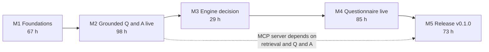
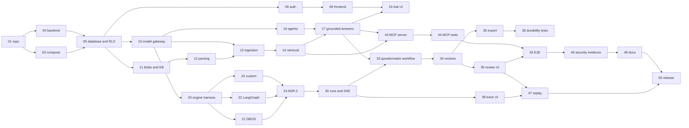

# AgentForge AI — Release 1 Implementation Plan (v0.2, for review)

| Field | Value |
|---|---|
| Status | **APPROVED (2026-10-12).** Start with R1-01. Decisions D1–D5 in architecture §23 |
| Reference machine | Dell Inspiron 15 3520: i7-1255U, 16 GB RAM, Intel Iris Xe (CPU-only inference). See architecture §23.1 |
| Date | 2026-10-09 |
| Architecture | [ARCHITECTURE_DESIGN.md](ARCHITECTURE_DESIGN.md) v0.2 |
| Release | R1 "Portfolio demo" → tag `v0.1.0` |
| Capacity assumption | One experienced engineer, 15–20 focused hours/week |

All hours and weeks below are **Estimates** (±30%). Nothing here is Measured. Measured values are produced by tasks R1-36, R1-40, and R1-49, and stored with raw data in `bench/results/`.

## Progress

| Task | Status | Date | Notes |
|---|---|---|---|
| R1-01 Repository bootstrap | ✅ Done | 2026-10-12 | Lives in `agentforge/` of the 2026AIProjects repository (decision D4) |
| R1-02 Dependency verification | ✅ Done | 2026-10-13 | License gate in `make check`; ADR-0013 (psycopg LGPL exception) accepted |
| R1-04 Backend skeleton | ✅ Done | 2026-10-13 | Done before R1-03, which needs something to run |
| R1-03 Compose stack | ✅ Done | 2026-10-13 | Postgres + API + worker healthy via `make up`; `make doctor`. **Deviations:** the `web` service joins in R1-08 (no web app yet); the optional Jaeger profile moves to the observability work in R2, since it needs an OTLP exporter. Linux-CI run of `make up` lands with R1-09 |
| R1-05 Database foundation | ✅ Done | 2026-10-13 | Roles owner/app/engine; schemas `app` (forced RLS) and `engine`; `tenant_session`; schema lint; migration 0001; 10 integration tests on real Postgres (testcontainers). Driver: psycopg 3 (ADR-0013). Note: in the dev container the owner is a superuser, which bypasses RLS; production should use a non-superuser owner (deployment guide, R1-48) |
| R1-06 Auth and RBAC | ✅ Done | 2026-10-13 | argon2id; server-side sessions (SHA-256 of token stored), HttpOnly/SameSite=Lax cookies (`__Host-`/Secure under TLS, required in production); CSRF header on unsafe methods; rotation on login; idle 2 h / absolute 12 h; logout-everywhere; lockout after 5 failures per email or 20 per IP in 15 min (HTTP 429); Admin/Member + `can_review`; route-inventory test; `make user-create`. **Design detail:** global identities and sessions live in an `auth` schema (no tenant column, read only by `agentforge.auth`); org memberships are RLS-protected in `app`, with a policy letting users see their own memberships |
| R1-07 Audit log | ✅ Done | 2026-10-13 | `app.audit_log`: app role has INSERT/SELECT only (UPDATE/DELETE/TRUNCATE denied, tested); sign-in success/failure/lockout, sign-out, sign-out-everywhere, and CLI user changes recorded with trace IDs, never secrets; pre-sign-in failures stored with no org (owner-only); `GET /v1/admin/audit` (Admin). Also fixed: container health checks timed out after R1-06 because the CLI imported heavy modules on every check; parser split out and a regression test added |
| R1-08 Frontend skeleton | ✅ Done | 2026-10-13 | Next.js 16 (standalone), React 19, Tailwind 4, TanStack Query, typed client generated from OpenAPI (`make api-client`; `make check` fails if stale); `/api` proxied same-origin; login, app shell, overview, admin (members + audit events); sanitized markdown renderer (no remote images, no raw HTML; 5 unit tests); security headers; `web` service in Compose (non-root, read-only rootfs); browser tests with Playwright in the official container (`make e2e`, 3 passing). **Versions:** TypeScript 5.9 (not 7), ESLint 9 (eslint-config-next 16 does not support ESLint 10 yet) |
| R1-09 CI pipeline | ✅ Done | 2026-10-13 | `.github/workflows/agentforge-ci.yml`: `make check` (incl. real-Postgres integration tests), pip-audit + OSV-Scanner, gitleaks history, Trivy image scan (HIGH/CRITICAL with fixes), Syft SPDX SBOMs as artifacts, Compose stack + Playwright browser tests. Actions pinned to commit SHAs; scanners checksum-verified. **Findings fixed on the way:** Next.js CVE-2026-94483 (→ 16.3.8 via dated exception), npm/corepack removed from web runtime image, 3 transitive npm CVEs overridden, braces ignored with expiry; license gate now covers the web app (666 packages), sharp/libvips (LGPL) excluded |
| R1-10 Model gateway | ✅ Done | 2026-10-13 | `agentforge.models`: Ollama (JSON-schema `format`, `think: false` with fallback for models without it), OpenAI-compatible, and deterministic fake providers (scripted faults, schema-valid default output, bag-of-words embeddings); one repair attempt with the validation error, ordered fallback, timeout/outage classification; exactly one `app.llm_calls` row per provider call (RLS); `MODEL_PROVIDER=fake`; `make models-smoke`. First live call on the reference machine: qwen3:4b valid JSON on attempt 1 in 16.6 s including model load (observation, not a benchmark; R1-49 measures) |
| R1-11 Blobs, KBs, upload validation | ✅ Done | 2026-10-13 | `BlobStore` (local volume shared by api/worker); KB + document API; uploads as the raw request body, streamed to disk **after** authentication; content-based type checks (magic bytes, DOCX zip-bomb limits, UTF-8 text); body-size limits enforced while streaming (413). **Deviation:** no `python-multipart` (raw-body upload is simpler and avoids parsing before auth) |
| R1-12 Sandboxed parsing | ✅ Done | 2026-10-13 | Separate process (`-I`, minimal env) with CPU, memory, file-write, open-file, core-dump, and wall-clock limits; pypdfium2 (PDF), python-docx (DOCX incl. tables as markdown), markdown/text; 500-page limit; malformed, blank, bomb, and oversized fixtures fail cleanly without crashing the worker. **Deviation:** pdfplumber not used yet (table extraction from PDFs deferred until the eval shows a need). Limitation documented: not a syscall/network sandbox (R3) |
| R1-13 Ingestion, chunking, embeddings | ✅ Done | 2026-10-13 | `queue.ingestion_jobs` (IDs only) with `SKIP LOCKED` leases, backoff, and retry; normalized text + page map stored for exact spans; chunk per section (headings start chunks), ~450-token target, overlap, page/char spans; embeddings carry the section path (contextual headers) and nomic task prefixes; chunks replaced atomically (crash/reindex never duplicates, tested); worker heartbeat runs as its own task |
| R1-14 Hybrid retrieval | ✅ Done | 2026-10-13 | pgvector HNSW (iterative scan) + Postgres FTS with OR semantics for questions (found live: AND semantics missed natural-language questions) fused by RRF (k=60); RLS + explicit KB filter; search API returns vector/text ranks and scores. Live check on the reference machine: 3 policy questions each returned the right section via both channels |
| R1-15 Northwind demo corpus | ✅ Done | 2026-10-13 | 10 fictional policies + 2 prompt-injection documents (CC-BY-4.0, Markdown source of truth); 40-question questionnaire (12-question demo subset; 6 unanswerable; 3 injection targets) kept separate from the gold set; `make demo-build` renders one policy as DOCX and one as PDF and builds the XLSX questionnaires; `make demo-check` (in `make check`) verifies the gold set and finds every evidence quote in the text the real parser extracts. PDF parsing now rejoins wrapped lines |
| R1-16 Agent definitions, prompt assembly, budgets | ✅ Done | 2026-10-13 | Agents defined as TOML in the package (deviation from YAML: `tomllib` is in the standard library, so no new dependency); each distinct definition becomes an immutable `app.agent_versions` row keyed by checksum (app role has INSERT/SELECT only; UPDATE denied, tested; a changed file appends version N+1). Evidence fenced in `<evidence>` blocks with closing tags neutralized and attributes escaped (file names and headings are untrusted too). `Budget` (steps, LLM calls, tokens, wall clock) raises `budget_exceeded` |
| R1-17 Grounded answer pipeline | ✅ Done | 2026-10-13 | `POST /v1/answers` (202) queues `queue.answer_jobs`; the worker answers; `GET /v1/answers/{id}` returns status, claims, evidence snapshot, agent versions, timings. Retrieve → abstain gate (vector distance) → drafter (claims with citations + exact quotes; no free-text answer) → mechanical checks (cited ids ∈ evidence, quote found in a cited passage, claim restates its quote, claim numbers present in the evidence, no truncation, "evidence does not mention…" claims treated as abstention) → LLM verifier per claim (`low_confidence_only` default, `all`, `off`). The answer is the verified claims only; restated claims are shown as the verbatim quote. Every model call carries the answer id as `run_id`. **Live (qwen3:4b, CPU):** 3/3 policy questions answered with verified citations in 14–26 s; the unanswerable question abstained. The first live run found 3 defects the fake-LLM tests could not (garbled number in unverified prose, a "not mentioned" claim passing via a heading quote, truncated claim text); all fixed with regression tests. Abstain threshold (0.5) to be tuned in R1-40 (live: answers 0.25–0.31, unanswerable 0.46) |
| R1-18 UI: knowledge bases | ✅ Done | 2026-10-13 | KB list and create; KB page with drag-and-drop (and keyboard "Choose files") upload, per-file upload results, document table with live status (polls only while a document is unsettled), re-index, inline delete confirmation (focus moves to Cancel, Escape backs out); search tester showing fused score, vector rank and distance, keyword rank. Status colours darkened to meet 4.5:1. Playwright: create → upload → Ready → search → delete document → delete KB, plus a rejected upload; axe (WCAG 2.2 A/AA) 0 serious/critical on both pages. `AGENTFORGE_MODEL_PROVIDER` passes through Compose; CI's browser tests run with `fake` (no Ollama in CI), whose drafter quotes the top passage so answers are deterministic |
| R1-19 UI: Ask page | ✅ Done | 2026-10-14 | Knowledge-base selector (default: every KB with ready documents, fixed once the fresh list loads), question box (Ctrl+Enter), live waiting state with elapsed time; answer as sentences colour-coded by verification (Verified / Checked by AI / Partly supported) with removed sentences and reasons behind a disclosure; selecting a sentence moves focus to the source panel showing file, page, section, and the quote highlighted in the passage; "Insufficient evidence" state; "How this was answered" lists every model call (purpose, model, latency, tokens, prompt and reply) via new `GET /v1/answers/{id}/calls`; recent questions; answer id in the URL. Playwright against the **real model** on the reference machine: ask → coloured claims → cited passage highlighted; keyboard-only flow; unanswerable → insufficient evidence; axe 0 serious/critical. Found by the browser tests: answers stored before the 2026-10-13 claim fields broke the recent list (fixed with defaults + regression test); the ask waited on a background refetch; a stale cached KB list fixed the default selection too early |
| **M2 exit** | ✅ Met (recording pending) | 2026-10-14 | With Ollama on the host, a Northwind-style policy question returns verified, cited claims in the UI and an unanswerable question abstains (browser tests above, real model). Screen recording for the user to make |
| R1-20 Conformance harness | ✅ Done | 2026-10-14 | `spikes/engine/`: shared step library, `RunEngine` port, worker process killed with SIGKILL, RLS'd `conformance` schema, tests H1–H8 (one each). Validated on a deliberately broken stub: fails H1–H5, passes H6–H8. H2 re-measured as growth from 20 to 40 parked runs after the first version counted a normal thread-pool size as pinning |
| R1-21 DBOS prototype | ✅ Done | 2026-10-14 | DBOS 3.1.0, tables in `engine` schema, per-run limit via partitioned queue. All gates pass. Needed `max_executor_threads` (default pool unbounded: 653 threads) and the async API inside async code. Recovery without Conductor covers the restarting worker's own executor id only |
| R1-22 LangGraph prototype | ✅ Done | 2026-10-14 | LangGraph 1.2.12 + Postgres checkpointer + own job queue. All gates pass only after `durability="sync"`, restarting checkpoints with nothing scheduled, and verifying progress against our run table: default settings stopped runs silently mid-flow under kills. 270 lines, ~25 extra packages |
| R1-23 Custom prototype | ✅ Done | 2026-10-14 | `engine.jobs` with SKIP LOCKED leases, heartbeats, per-run slot check under a run-row lock, successors enqueued in the completing transaction, parked review job. All gates pass first time, 0 dependencies, 232 lines |
| R1-24 ADR-2 decision | ✅ Done | 2026-10-14 | [ADR-0002](../adr/0002-durable-execution.md) **accepted by the owner: DBOS** (simplest that passes every gate; custom engine as fallback). Raw results in `spikes/engine/results/`. The conformance tests move into CI against the DBOS adapter in R1-30 |
| **M3 exit** | ✅ Met | 2026-10-14 | ADR-2 accepted with measured evidence; no M4 re-estimate needed |
| R1-30 Runs, run events, SSE | ✅ Done | 2026-10-14 | Migration 0007: `runs`, `run_items` (claims and evidence stored per item, like answers: a deviation from a separate claims table), `step_records`, `run_events` (append-only, `pg_notify` with `run_id:seq` only), `artifacts` (unique idempotency key), `llm_calls.step_id`, and a narrow SECURITY DEFINER `stale_queued_runs` for the start reconciler. Run service on the `RunEngine` port; DBOS adapter (client in the API, `launch_worker` in the worker with capped threads and a stable executor id); `/v1/runs` list/detail/items/events/cancel and `/v1/runs/{id}/stream` (SSE, `Last-Event-ID`, re-reads under RLS, keep-alives, ends with `end`). DBOS moved from the spike group to a product dependency. Tests: catch-up from `Last-Event-ID`, live delivery, reconnect while live with no gaps and no duplicates, IDs-only notifications, append-only events, cancel, lost-start query, other org → 404. CI job `engine` runs H1–H8 against DBOS on every push |
| R1-31 Questionnaire import | ✅ Done | 2026-10-15 | `POST /v1/questionnaires` (raw-body upload, streamed size limit), `GET`, and `PUT …/columns` to choose columns by letter. XLSX and CSV (delimiter sniffed, UTF-8 with or without BOM). Header row found in the first 30 rows from common names (Question/Requirement/Control…, ID/Ref…, Section/Category…, Answer/Response…) with name priority; answer column remembered for the export (none → export adds one); first visible sheet with a question header. Limits: 500 questions, 4,000 characters per cell, 5,000 rows, 60 columns; zip-bomb check shared with DOCX; macro-enabled workbooks refused; formulas never evaluated; `defusedxml` added so openpyxl parses XML safely. Northwind imports 40 items. Original file kept as a blob for the export. Found while testing: openpyxl judged the format by file extension, which stored uploads lack (fixed: read from an open file; regression test) |
| R1-32 Planner step | ✅ Done | 2026-10-15 | `planner` agent (versioned TOML) classifies items (`question` / `instruction` / `not_a_question`), splits compound questions into standalone parts, and suggests up to 3 search phrases; 8 items per model call. Output validated (unknown indexes ignored, skipped items fall back to answering as written, one-part "splits" dropped) and stored in `run_items.plan` (migration 0009); the engine sees indexes only. The answerer now searches every phrase and fuses rankings (RRF), tells the drafter about parts, and tags model calls with the step id. Questionnaire text is fenced like evidence. Tests: split, pass-through, instruction, skipped item, fake mode, fusion, parts in prompt, step ids. **Live (qwen3:4b, CPU):** 8 items in 84.5 s; both compound questions split correctly, instruction and heading recognised, an injected "ignore all previous instructions" item did not affect the others. Planning costs ~10 s per item on CPU (≈7 min for 40) |
| R1-33 Questionnaire workflow on DBOS | ✅ Done | 2026-10-15 | `questionnaire.run` DBOS workflow: begin → plan (batches) → one child workflow per item on the run-partitioned queue (`run_item_parallelism`, default 4) → join → budget check → route (verified high-confidence answers are bulk-approval candidates, the rest need review) → durable review wait (`DBOS.recv`) → export → finish. Engine-independent step library (`runs/questionnaire.py`) with step records, events, and idempotent steps (answered items never re-answered; one artifact per (run, epoch) by idempotency key). Retries: transient model errors retried by DBOS (3 attempts), then the item fails and the run carries on; user retry of one item (new epoch, only that item) and re-export (new epoch, new artifact, earlier kept). Run budgets (model calls, wall clock) → `failed` / `budget_exceeded`. Cancel cancels the workflow and its children. Exporter writes answers and sources into a copy of the customer's XLSX/CSV, never overwriting their columns, guarding against formula injection, and skipping merged cells. `POST /v1/runs`, item retry, export retry, and an interim `review/complete` (reviewer permission; R1-34 adds per-item decisions). Tests with a real worker process running DBOS and the fake model: 40 Northwind items answered with peak concurrency ≤ 4, every draft call linked to its step, review → export (answers in D, sources in a new column, the customer's "Notes" column untouched), re-export → epochs [1, 2], item retry re-answers only item 3, a 12-call budget fails the run, cancel → no item starts > 2 s later. Found by these tests: the exporter would have overwritten the customer's next column |
| R1-34 Review service | ✅ Done | 2026-10-15 | Migration 0010: `review_batches` (one per review round, unique per run and epoch) and `review_items` (decision approved / edited / rejected, edited answer, reason, who, when; database checks require an edited answer and a rejection reason). The route step opens the batch in the same transaction that moves the run to `waiting_review`; verified high-confidence answers are bulk-approval candidates; skipped items need no review. `GET /v1/runs/{id}/review`, per-item decisions, `approve-supported`, and `complete` (all items decided; the batch row is locked and closed once, so the engine is signalled exactly once). Retrying an item clears its decision. The export uses decisions: edited text replaces the answer, rejected answers are left blank for a person. Audited: `review.decide`, `review.bulk_approve`, `review.complete`; events `review_decided`, `review_bulk_approved`, `review_completed`. Tests: batch contents, validation, Member without `can_review` → 403, bulk approval count, two simultaneous completes → one 200 + one 409 and exactly one signal, audit rows, other org → 404; end to end with a real worker: edit + reject + approvals → exported file shows the edit and a blank for the rejection; item retry clears the earlier decision |
| R1-35 Export tool and download | ✅ Done | 2026-10-15 | Export itself was built in R1-33 (one artifact per (run, epoch) by idempotency key, a new epoch gives a new artifact). Added: `GET /v1/runs/{id}/artifacts` (newest version first, storage paths never returned) and `GET /v1/runs/{id}/artifacts/{artifact_id}/download` (read under the caller's tenant, so another organization's file is 404; sent as an attachment with `Cache-Control: private, no-store` and `nosniff`; audited as `artifact.download`). Blob writes now use a unique temporary file per write, so two writers of the same key (a recovered worker racing the original) cannot interleave. H4 tests: crash while writing the workbook → no artifact, retry → one, step records `failed`, `succeeded`; crash after the file is stored but before the artifact row → retry gives one artifact and one file, no orphan; export re-run after commit → same artifact; two overlapping exports of a new epoch → the same single artifact, epochs [1, 2]. Download tests: content, headers, unknown artifact or wrong run → 404, other org → 404 for list and download, audit row |
| R1-36 Durability and fault injection | ✅ Done | 2026-10-15 | `make durability` (also in CI's `engine` job): 50 questionnaire runs × 6 items on a real worker process that is SIGKILLed at random moments and restarted with the same executor id, while 10% of fake model calls time out, are unavailable, or return invalid JSON (seeded fault injection in the fake provider, `AGENTFORGE_FAKE_FAULT_RATE`). **Measured** (`bench/results/durability.json`): 50/50 runs succeeded through review and export, 29 kills, 0 duplicate artifacts, 0 completed items answered twice, 0 items failed, peak 8 items in flight; recovery (kill → first progress of the new worker) p50 3.1 s, p95 6.6 s, max 7.8 s. Found and fixed: (1) no worker-wide limit on items in flight: 50 runs meant up to 200 concurrent model calls, so each kill threw away up to 200 answers and the first chaos run finished 12/50 in 15 min; new `run_worker_concurrency` (default 8) caps one worker across runs, and the worker's DB pool follows it; (2) a planner that kept failing would leave the run "running" forever: planning now falls back to answering items as written, and any step that gives up after its retries fails the run visibly; (3) step attempts cut off by a crash stayed "running" in the trace: closed as `WorkerInterrupted` when the step is retried or the run ends. Tests: fault injection seeded and off by default; planner fallback; interrupted attempts closed |
| R1-37 UI: new run and run list | ✅ Done | 2026-10-15 | "Questionnaires" in the navigation. `/app/runs`: runs with status chips (Queued, Answering…, Needs review, Done, Failed, Cancelled, Timed out), questions answered, start time, and filters with counts; the list refreshes every 2 s while any run is moving. `/app/runs/new` in three steps: upload the XLSX/CSV (drag and drop or choose), check the detected columns with a preview of the first questions and any import warnings, choose the columns yourself if detection was wrong (re-read on the server), then pick knowledge bases and an optional name and start. There is one template (security questionnaire), so no template picker yet. A minimal run page (status, progress, download when done) so list links work; R1-38 turns it into the full trace view. The knowledge-base picker is now one component shared with Ask. Overview cards link to Ask and Questionnaires. Playwright (real model locally, 1.2 min): upload a CSV with a customer "Notes" column → columns detected (questions C, answers D) → answers moved to a new column and saved → start → the run appears in the list and reaches "Needs review" without a reload → filters → run page; axe on the new-run page (before and after the column change), the list, and the run page |
| R1-38 UI: run detail / trace view | ✅ Done | 2026-10-15 | API: `GET /v1/runs/{id}/trace` (every step attempt, plus model calls, tokens, and wall-clock time used against the run's limits; default limits now come from settings) and `GET /v1/runs/{id}/steps/{step_id}/calls`; run items include their plan. The stream sends `Cache-Control: no-transform` so a proxy does not compress (and buffer) it. Run page: header with status, a live indicator (Live / Reconnecting… / Finished), Cancel run (confirm) and Export again; budget used (model calls of max, tokens, time of max); steps grouped by phase (Plan, Answer, Review, Export) with one lane per question showing its status, attempts (retries numbered), and a timeline bar so parallel answering is visible; a side panel with tabs Input (question, section, row, planned kind, split parts, search phrases), Output (status, answer, confidence, reason, every checked sentence), Model calls (prompt and reply, tokens, latency, model), Retrievals (passages with score and vector distance), and Events; "Answer again" on a question while the run waits for review; the full event log. Live via SSE: events refresh the page's data (at most every 300 ms); after a dropped connection the stream resumes from the last event received, and going offline shows "Reconnecting…" at once instead of a stale "Live". The model-call list is shared with Ask. Playwright (real model locally): open a question → its draft call with prompt and reply → its retrieved passages; "Answer again" → the new answer arrives without a reload; offline → "Reconnecting…", progress made meanwhile, online → caught up with every event exactly once in order (compared with the API); cancel → Cancelled and the stream ends; axe on the run page. Found by these tests: going offline left the page showing "Live" (the browser kept the dead connection open) |
| R1-41 Deletion (pulled forward for R1-18) | ✅ Done | 2026-10-13 | `DELETE /v1/documents/{id}` and `DELETE /v1/knowledge-bases/{id}`: rows, chunks, vectors, queued jobs, and blobs; copies of the text are redacted from answer evidence, claim quotes, and the draft/verify prompts in `llm_calls` (answers themselves remain). Audited (`document.delete`, `knowledge_base.delete`). Verification query `residuals()` asserted empty in tests. Ingestion locks the document row before writing chunks, so a delete during indexing cannot leave orphans |

---

## 1. Release 1 goal

> A person can clone the repository, run one command, and use AgentForge **live on their own machine**: ingest private documents, ask grounded questions with verified citations, run the security-questionnaire workflow with durable fan-out, review flagged answers, and export the result. An MCP host can query the same knowledge base read-only. Anyone can browse a labeled replay of a real recorded run on a public static site. Every item in the R1 security baseline has evidence.

### 1.1 In scope

- Foundations: repository, CI with security and license gates, Compose stack, Postgres with forced RLS, auth with 2 roles, audit log.
- Knowledge: PDF/DOCX/MD/TXT upload, sandboxed parsing, chunking, Ollama embeddings, hybrid retrieval with RRF, search tester.
- Model gateway: Ollama + fake provider, structured outputs, repair, fallback, call accounting.
- Template #2 **Grounded knowledge Q&A** (first live demo).
- Engine decision: prototypes of DBOS, LangGraph, and a custom Postgres engine against shared hard gates → ADR-2.
- Template #1 **Security questionnaire** (flagship): durable fan-out, verification, per-item review, idempotent XLSX export, cancel, retry from step.
- Trace UI with live SSE, review queue.
- **Read-only MCP server** (`search_knowledge`, `answer_with_citations`, `get_run`) with API keys.
- Eval CLI and committed retrieval/grounding baseline.
- Static replay site, demo video, docs, `v0.1.0` release.

### 1.2 Explicitly not in R1

MCP client and any MCP tool execution (R2, shipped together with its governance controls); MCP stdio and the stdio bridge; outbound tools (`http_request`, `webhook`); visual workflow editing or graph viewer; agent builder UI; more than 2 roles; multi-org UI; SSO; eval UI and judge calibration; observability stack beyond optional Jaeger; reranker; XLSX/CSV knowledge documents; hosted live demo; billing.

---

## 2. Milestones

| Milestone | Outcome | Effort (Estimate) | Cumulative | Calendar at 15–20 h/wk |
|---|---|---|---|---|
| **M1 Foundations** | Secure skeleton: repo, CI, Compose, RLS, auth, UI shell | 67 h | 67 h | weeks 4–5 |
| **M2 Grounded Q&A live** | **First live demo:** upload Northwind docs, ask a question, get verified, cited claims | 98 h | 165 h | weeks 8–11 |
| **M3 Engine decision** | Three prototypes measured against hard gates. ADR-2 accepted | 29 h | 194 h | weeks 10–13 |
| **M4 Questionnaire live** | **Flagship live demo:** 12-question live run (full 40 recorded), crash recovery, review, export | 85 h | 279 h | weeks 14–19 |
| **M5 Release v0.1.0** | MCP server, eval baseline, E2E tests, security evidence, replay, docs, release | 73 h | 352 h | weeks 18–24 |

Each milestone ends with a short demo recording (private) and a re-estimate of the remaining milestones using the actual/estimated ratio so far.

---

## 3. Backlog

Conventions:
- **ID** `R1-nn`. **Est** = focused hours (Estimate). **Deps** = tasks that must be done first.
- Every task also meets the global Definition of Done (§6).
- Acceptance criteria are written to be checkable by a test, a script, or a file in the repository.

### 3.1 M1 Foundations (67 h)

| ID | Task | Est | Deps | Acceptance criteria |
|---|---|---|---|---|
| R1-01 | **Repository bootstrap.** New repo inside the WSL2 filesystem. Monorepo layout (§16 of the architecture). `uv` (Python 3.12/3.13), `pnpm`, ruff, pyright, ESLint/Prettier, pre-commit, `.editorconfig`, Apache-2.0 `LICENSE` + `NOTICE`, `SECURITY.md`, README skeleton. `make docs-check` runs the Mermaid validator over `docs/` | 5 | — | `make check` runs lint + type + tests green on the empty project. `make docs-check` passes on both design docs. Pre-commit blocks a planted fake secret (gitleaks) |
| R1-02 | **Dependency verification and pinning.** Close every [VERIFY] in architecture §20.2 for R1 dependencies. Record version, license, and source URL. Pin versions in lockfiles. License allowlist job (`pip-licenses`, `license-checker`). Model license registry file | 6 | R1-01 | `docs/licenses/verification-<date>.md` lists every R1 dependency with license + source. CI fails when a test adds a GPL package. `models.yaml` records the upstream license per default model |
| R1-03 | **Compose stack.** `postgres` (pgvector image pinned by digest), `api`, `worker`, `web`. Health checks, named volumes, ports bound to `127.0.0.1`. Host Ollama via `host.docker.internal`. Optional `ollama` and `jaeger` profiles. `make up/down/logs/doctor` | 8 | R1-01 | Fresh clone → `make up` → all services healthy on Linux CI and documented Windows/WSL2. `make doctor` reports Docker, RAM, WSL limits, Ollama reachability, and missing models with actionable messages. It warns when `.wslconfig` has no memory cap or when free RAM is below what the selected model needs |
| R1-04 | **Backend skeleton.** FastAPI app factory, settings (pydantic-settings), structlog JSON with `trace_id`, OTel SDK (console exporter, OTLP optional), error model, `/healthz`, `/v1` router, OpenAPI. Worker entrypoint with graceful shutdown | 5 | R1-01 | `/healthz` 200. A request log line carries `trace_id`. The worker stops cleanly on SIGTERM within 10 s (Target) |
| R1-05 | **Database foundation.** SQLAlchemy 2 + Alembic. Roles: `agentforge_owner` (migrations), `agentforge_app` (no BYPASSRLS), `agentforge_engine` (engine schema). Schemas `app` and `engine`. `TenantContext` + transaction helper doing `SET LOCAL app.org_id`. RLS policy template. **Schema lint:** every `app` table with `org_id` has RLS enabled and forced. Seed of one org and workspace | 12 | R1-03, R1-04 | Lint test fails when a test creates an `app` table without forced RLS. A query without tenant context returns 0 rows (test). Migrations run up/down in CI. Driver choice (psycopg 3 vs asyncpg) recorded, defaulting to psycopg 3 unless R1-02 finds a blocker |
| R1-06 | **Auth and RBAC.** Users, argon2id, server-side sessions (hashed opaque IDs), CSRF tokens, session rotation, idle and absolute timeouts, logout-everywhere, login rate limit. Roles Admin/Member + `can_review`. Static permission matrix + `authorize()`. CLI: `agentforge user create/disable/reset-password`. No open sign-up | 12 | R1-05 | Integration tests: cookie flags, CSRF rejection, rotation on login, lockout/rate limit returns 429, Member cannot call admin routes, route inventory test shows every non-public route requires auth (S2, S3) |
| R1-07 | **Audit log.** Append-only table (INSERT/SELECT grants only). Writer used by auth, API keys, reviews, deletion | 3 | R1-05 | UPDATE/DELETE as the app role fails (test). Login and logout produce audit rows (test) |
| R1-08 | **Frontend skeleton.** Next.js (App Router, standalone output), Tailwind, shadcn/ui, auth pages, app shell, TanStack Query, generated API client from OpenAPI, Next rewrites so `/api` is same-origin. Sanitized markdown renderer with remote images disabled | 10 | R1-04, R1-06 | Log in/out works in the browser. Type-check passes against the generated client. Renderer test: `` and raw HTML are not rendered (S7) |
| R1-09 | **CI pipeline.** GitHub Actions: lint, type, unit, integration (testcontainers Postgres + pgvector), migrations, gitleaks, pip-audit, OSV-Scanner/npm audit, Trivy image scan, Syft SBOM, license job, docs-check | 6 | R1-01, R1-03 | Pipeline green on main. A planted vulnerable dependency on a branch fails the scan job. SBOM artifact attached to the CI run |

**M1 exit:** `make up` → log in as a CLI-created admin → empty app shell. CI green with all gates.

### 3.2 M2 Grounded Q&A live (98 h)

| ID | Task | Est | Deps | Acceptance criteria |
|---|---|---|---|---|
| R1-10 | **Model gateway.** `generate`, `generate_structured`, `embed`. Providers: `ollama` (chat with JSON-schema `format`, embeddings), `fake` (deterministic per prompt hash, configurable latency, fault injection: timeout, invalid JSON, error), `openai_compatible` (minimal). Pydantic validation, one repair retry, ordered fallback list. `llm_calls` rows with tokens, latency, model digest | 12 | R1-05 | Unit tests: repair path, fallback on invalid output, timeout classification. With Ollama running, a smoke test returns schema-valid JSON from the default model. Each call writes one `llm_calls` row |
| R1-11 | **Blob store and KB model.** `BlobStore` interface + local volume implementation (keys under `org/{org_id}/`). `knowledge_bases`, `documents` tables with RLS. Streamed upload API with size limit, magic-byte and extension checks | 6 | R1-05, R1-06 | Oversized, mismatched-type, and empty files are rejected with clear errors (tests). Cross-tenant fetch of a document returns 404 |
| R1-12 | **Sandboxed parsing.** Parse in a subprocess with timeout, CPU/memory rlimits, no network (Linux container). pypdfium2 + pdfplumber (PDF), python-docx (DOCX), MD, TXT. Output: normalized text, page map, headings, tables as markdown | 10 | R1-11 | Fixtures: decompression bomb, malformed PDF, 2,000-page PDF, and a 0-byte file are rejected or time out **without crashing the worker** (S5). Page numbers are correct on the fixture set |
| R1-13 | **Ingestion jobs, chunking, embedding, indexes.** `ingestion_jobs` table claimed with `FOR UPDATE SKIP LOCKED` (ADR-12). Structure-aware chunker keeping page and character spans. Batch embeddings via the gateway. `chunk_embeddings_<model_key>` with HNSW. `tsvector` GIN index. Status events | 10 | R1-10, R1-12 | Upload of the Northwind corpus reaches `ready` end-to-end. A worker restart mid-ingestion leaves no duplicate chunks (test). Re-index replaces chunks atomically |
| R1-14 | **Hybrid retrieval.** Vector top-k + FTS top-k, KB filter + RLS, RRF fusion, `hnsw.iterative_scan` enabled. `Retriever` interface. Search API returning vector, FTS, and fused ranks with scores | 10 | R1-13 | Unit tests for RRF. Integration test: results never include another org's or another KB's chunks. Search API returns per-channel ranks |
| R1-15 | **Northwind demo corpus.** ~8–10 self-authored policy documents (CC-BY-4.0, clearly fictional), a 40-question questionnaire (XLSX) including ~6 unanswerable questions, a 12-question live-demo subset (includes 2 unanswerable questions and 1 question that retrieves the injected document), 2 documents with embedded prompt-injection text, and a gold set (answer + evidence spans) | 12 | — (can start any time) | Files under `demo/corpus/` with license headers. Gold set validates against its JSON schema. Every gold span resolves to text in a parsed document (script) |
| R1-16 | **Agent definitions and prompt assembly.** YAML agent templates → immutable `agent_versions` on seed (checksum). Prompt assembly with labeled untrusted-content blocks. Budget object (steps, LLM calls, tokens, wall clock) enforced by the runtime | 6 | R1-10 | Changing a YAML file creates a new version rather than mutating the old one. A budget overrun raises `budget_exceeded` (test) |
| R1-17 | **Grounded answer pipeline (template #2).** Retrieve → draft structured `claims[]` with `citation_chunk_ids` → abstention gate → verifier: mechanical checks (cited IDs ∈ retrieved set, quote string-match) + LLM entailment per claim. Modes `all` / `low_confidence_only`. Persist `claims` | 16 | R1-14, R1-16 | Fabricated citation IDs are flagged (test with fake LLM). Unanswerable gold questions produce "Insufficient evidence" at the configured threshold. All outputs are persisted with links to `llm_calls` and retrievals |
| R1-18 | **UI: knowledge bases.** KB list and create, drag-and-drop upload with live ingestion status, document table, delete, search tester showing vector/FTS/fused ranks | 8 | R1-08, R1-14 | Playwright (fake LLM): create KB → upload → status reaches ready → search shows results. axe: no serious or critical issues |
| R1-19 | **UI: Ask page.** Question box, KB selector, answer with claims colored by support status, source panel with document, page, and highlighted span, "insufficient evidence" state, link to call details | 8 | R1-08, R1-17 | Playwright: ask → colored claims → clicking a claim shows the cited passage. Keyboard-only flow works |

**M2 exit (first live demo):** with Ollama on the host, a Northwind question returns verified, cited claims in the UI. An unanswerable question abstains. Recording saved privately. **The R1 security baseline items relevant so far (S1–S7, S11) are already enforced.**

### 3.3 M3 Engine decision (29 h)

Prototype protocol: architecture §7.3. Each prototype lives in `spikes/engine/<candidate>/`, implements the `RunEngine` port for the **same mini-flow**, and runs the **same conformance tests**. Each candidate gets a hard cap of 7 h. A candidate that cannot pass a hard gate within its cap is scored "fail" for that gate.

| ID | Task | Est | Deps | Acceptance criteria |
|---|---|---|---|---|
| R1-20 | **Conformance harness.** `RunEngine` port (start, cancel, signal_review, status). Mini-flow spec: plan → 20 items (fake LLM) with `max_parallelism=4` → review wait → idempotent export. Tests for hard gates H1–H8 (kill -9 loop, review wait + restart, concurrency probe, export counter with epochs, cancel timing, engine-table content check, start atomicity fault injection, run_events emission) | 5 | R1-05, R1-10 | The harness runs against a stub adapter and fails in the expected places. The test list maps 1:1 to H1–H8 |
| R1-21 | **DBOS prototype.** Workflow + steps, queue with concurrency limit, durable wait for the review signal, cancel. Verify: multi-process recovery behavior without Conductor; async support; where step outputs are stored (must hold IDs only) | 7 | R1-20 | Conformance report: pass/fail per gate with logs. Notes on recovery semantics and on psycopg 3 coexistence |
| R1-22 | **LangGraph prototype.** StateGraph + Postgres checkpointer, `Send` fan-out, `interrupt()` for review, plus the minimal job queue/lease needed to resume after a crash. No LangGraph Platform | 7 | R1-20 | Conformance report as above. Lines of code split into graph vs. custom queue |
| R1-23 | **Custom Postgres prototype.** `engine.jobs` with `SKIP LOCKED` leases and heartbeats, step checkpoints, successor enqueue in the same transaction, approval suspension, cancel flag | 7 | R1-20 | Conformance report as above |
| R1-24 | **ADR-2 decision.** Score table (hard gates, LOC, concepts, test ergonomics, Measured recovery time, async fit, dependency weight, API stability). **Rule:** choose the simplest candidate that passes every hard gate. Delete the losing adapters from the main code path (spikes kept for the record) | 3 | R1-21, R1-22, R1-23 | `docs/adr/0002-durable-execution.md` accepted, with raw test output committed. The conformance tests (H1–H8) move into permanent CI against the chosen adapter |

**M3 exit:** ADR-2 accepted with measured evidence. If no candidate passes every gate, the fallback is the custom engine, with a re-estimate of M4 (+15–25 h Estimate) recorded in the ADR.

### 3.4 M4 Questionnaire live (85 h)

| ID | Task | Est | Deps | Acceptance criteria |
|---|---|---|---|---|
| R1-30 | **Runs, run events, SSE.** `runs`, `run_items`, `step_records`, `run_events` (RLS). `pg_notify` with IDs only. SSE endpoint with `Last-Event-ID` resume. Run service on the `RunEngine` port | 10 | R1-24 | SSE reconnect with `Last-Event-ID` gets no gaps and no duplicates (test). Another org's run stream returns 404 |
| R1-31 | **Questionnaire import.** XLSX/CSV → validated items (question text, optional section and ID column mapping). Limits on rows and cell size | 4 | R1-11 | Northwind questionnaire imports 40 items. Malformed and oversized files are rejected (tests) |
| R1-32 | **Planner step.** Classifies items (answerable type, compound question split, search-query rewrite) with structured output | 5 | R1-16, R1-30 | Fake-LLM test covers split and passthrough. Planner output persisted as references only |
| R1-33 | **Questionnaire workflow on the chosen engine.** Plan → bounded fan-out (per item: retrieve, draft, verify) → join → route (supported and high-confidence → auto-accept candidate; others → review) → review wait → export. Budgets, cancel, retry from step (new epoch) | 12 | R1-17, R1-30, R1-32 | With the fake LLM, a 40-item run completes. Cancel stops new steps within 2 s (Target, measured in test). Retry from a failed item step re-runs only that subtree |
| R1-34 | **Review service.** `review_batches`, `review_items`. Per-item approve, edit-and-approve, reject with reason. "Approve all supported" bulk action. Batch completion sends `signal_review`. Audit entries | 8 | R1-07, R1-33 | Decisions are recorded per item. Signal is sent exactly once per batch (test). A Member without `can_review` gets 403. Audit rows written |
| R1-35 | **Export tool.** `export_xlsx` writes answers, status, and citations into a copy of the questionnaire. Artifact keyed by `H(run, node, epoch)` (unique). Authorized download endpoint | 5 | R1-33, R1-34 | Crash during export → exactly one artifact (H4 test). New epoch → new artifact. Download by another org → 404 |
| R1-36 | **Durability and fault-injection tests.** Kill the worker at random points across 50 fake-LLM runs. Inject Ollama timeouts and invalid JSON. Record recovery time | 8 | R1-33, R1-35 | 50/50 runs complete. 0 duplicate artifacts. 0 re-executed completed item steps (counter). Recovery time distribution saved to `bench/results/` (Measured) |
| R1-37 | **UI: new run and run list.** Choose template, KB, upload questionnaire, start. Run list with status chips and filters | 5 | R1-08, R1-30 | Playwright: start a run → it appears in the list with live status |
| R1-38 | **UI: run detail / trace view.** Header with budgets used. Step list grouped by phase, with parallel item lanes. Side panel tabs: input, output, LLM calls (prompt, response, tokens, latency, model), retrievals (chunks + scores), events. Live via SSE. Cancel and retry-from-step buttons | 14 | R1-30, R1-37 | Playwright: live updates appear without reload. Opening a step shows its LLM calls. Cancel and retry work from the UI |
| R1-39 | **UI: review queue and item review.** Queue with counts. Split view: question + answer with colored claims / cited passages at page. Approve, edit and approve, reject with reason. Keyboard shortcuts (A, E, R, J/K). Bulk "approve all supported" | 14 | R1-34, R1-19 | Playwright: review 3 items with keyboard only → export becomes available. axe: no serious or critical issues |

**M4 exit (flagship live demo):** live Ollama run of the 12-question demo subset on the reference machine (the full 40-question run completes and is recorded, without a time limit), worker killed mid-run and recovered visibly in the trace, review of flagged items, export downloaded. Recording saved privately.

### 3.5 M5 Release v0.1.0 (73 h)

| ID | Task | Est | Deps | Acceptance criteria |
|---|---|---|---|---|
| R1-40 | **Eval harness and baseline.** CLI `agentforge eval run --dataset northwind`: recall@5/10/20, MRR, filtered vs. exact recall, citation validity, unsupported-claim rate, abstention precision/recall, structured-output validity per model. JSON + Markdown report. Model selection for defaults | 6 | R1-17, R1-15 | Baseline committed under `docs/evaluation/` with hardware manifest, model digests, and git SHA (Measured). Default chat and embedding models chosen and justified from this report |
| R1-41 | **Deletion.** Delete document and KB: rows, chunks, embeddings, blobs. Verification query | 3 | R1-13 | Test asserts no residual rows or blobs after deletion. Audit entry written |
| R1-42 | **API keys.** Workspace-scoped, prefix + hashed secret, scopes (`api:read`, `api:write`, `mcp:use`), expiry, last-used, revoke. Settings UI to create (secret shown once) and revoke | 5 | R1-06, R1-07 | Revoked or expired key → 401. Scope enforcement tests. Create and revoke are audited |
| R1-43 | **MCP server (read-only).** Official `mcp` SDK 2.x mounted at `/mcp` (Streamable HTTP, stateless). Supports 2026-07-28 and legacy (2025-11-25) clients via the SDK. Tools: `search_knowledge`, `answer_with_citations` (progress notifications), `get_run`. Deterministic tool order and `ttlMs`. Bearer API key with `mcp:use` → `TenantContext`. Origin validation. Rate limit. Audit with `clientInfo` | 12 | R1-14, R1-17, R1-30, R1-42 | MCP Inspector connects, lists exactly 3 tools, and gets cited results (screenshot + log in `docs/`). A request with a bad Origin is rejected. A key without `mcp:use` → 401/403 |
| R1-44 | **MCP server security tests.** Cross-tenant suite over `/mcp`. Tool-list snapshot test (fails if any non-read-only tool appears). Rate-limit test. Legacy-client and 2026-07-28 client smoke tests using the SDK client | 5 | R1-43 | All tests in CI (S9) |
| R1-45 | **E2E and accessibility.** Playwright journeys with the fake LLM: (1) login → KB → upload → ask; (2) questionnaire → review → export; (3) API key → MCP search. axe-core on core pages. Manual keyboard pass recorded | 8 | R1-39, R1-43 | Journeys green in CI. 0 serious/critical axe violations. Keyboard checklist committed |
| R1-46 | **Security baseline evidence.** Fill the S1–S15 table (architecture §13.6) with links to tests and CI runs. Prompt-injection report from the eval set (S10). Threat model doc for R1 | 6 | R1-44, R1-45, R1-40 | `docs/security/r1-baseline.md` has evidence for every item. Any gap blocks the release |
| R1-47 | **Record-demo and static replay.** `make record-demo` runs both templates live and captures `run_events`, claims, and documents to `demo/recordings/` with hardware, model, and date stamps. Static export of the trace and review components in read-only replay mode. Persistent "Recorded run" banner. Deploy workflow to static hosting | 10 | R1-38, R1-39 | Replay site builds with no backend calls (network test). Banner present on every page. Deployed URL works |
| R1-48 | **Documentation.** README (problem → GIF → architecture → 3-command quickstart → Measured results with links → ADRs → roadmap). Guides: Windows/WSL2 install, models, configuration. Architecture docs (C4 context and container), ADRs 1–12. CONTRIBUTING (DCO), CODE_OF_CONDUCT | 8 | R1-46 | A fresh reader following the quickstart reaches the Ask page (tested once on a clean WSL2 instance; time-to-demo recorded) |
| R1-49 | **Measurements.** On the reference machine (Inspiron 15 3520, CPU-only): end-to-end run time for the 12-question subset and the full 40 questions, peak memory (WSL + Ollama), tokens per run, per-step latency, retrieval p50/p95 at demo scale, enqueue→start p95 (fake LLM). Hardware manifest auto-collected | 4 | R1-36, R1-40 | `bench/results/<date>-<machine>/` with raw JSON + summary. The README cites only these numbers |
| R1-50 | **Demo video and release.** 3–5 minute video following the walkthrough (§7). Tag `v0.1.0`, GHCR images with SBOM, CHANGELOG | 6 | R1-47, R1-48, R1-49 | Release page with images, SBOM, changelog, and video link |

**M5 exit = R1 done:** see §5.

### 3.6 Effort summary

| Milestone | Tasks | Effort (Estimate) |
|---|---|---|
| M1 | R1-01 … R1-09 | 67 h |
| M2 | R1-10 … R1-19 | 98 h |
| M3 | R1-20 … R1-24 | 29 h |
| M4 | R1-30 … R1-39 | 85 h |
| M5 | R1-40 … R1-50 | 73 h |
| **Total** | 45 tasks | **352 h** |

---

## 4. Dependencies and critical path

**Critical path (Estimate):** 01 → 03 → 05 → 10 → 13 → 14 → 17 → 20 → 21/22/23 → 24 → 30 → 33 → 34 → 39 → 45 → 46 → 48 → 50. Because there is only one engineer, "parallel" tasks are sequenced in the order of the tables above. The graph shows which reorderings are safe.

**Safe to do any time:** R1-15 (corpus writing) is the best task for low-energy sessions. R1-02 (verification) must be done before each dependency is added.

---

## 5. Release 1 exit criteria

| # | Criterion | Evidence |
|---|---|---|
| E1 | Fresh clone → `make up && make demo` → both templates run live on Windows/WSL2 and Linux | Recorded time-to-demo (Measured) in the README |
| E2 | Engine hard gates H1–H8 pass in CI against the chosen adapter | CI report |
| E3 | 50-run chaos test: 0 lost runs, 0 duplicate artifacts, 0 re-executed completed steps | `bench/results/` |
| E4 | Security baseline S1–S15 has evidence for every item | `docs/security/r1-baseline.md` |
| E5 | MCP Inspector interop with the read-only server. Cross-tenant suite covers `/mcp` | Log + CI |
| E6 | Eval baseline committed. Default models justified by it | `docs/evaluation/` |
| E7 | E2E journeys green. 0 serious/critical axe violations | CI |
| E8 | Public replay live with banners. Video published | URLs |
| E9 | Every number in the README is backed by a raw result file | Link check |
| E10 | License allowlist green. SBOM published. No unresolved critical/high CVEs | CI + release assets |

---

## 6. Definition of Done (every task)

- Code reviewed against the acceptance criteria. For a solo developer this is a self-review checklist in the PR description, plus the `/code-review` pass.
- Tests added at the right layer. CI green, including security and license gates.
- Tenant context respected. Any new `app` table has forced RLS and is in the cross-tenant suite.
- No secrets or document content in logs.
- Docs updated (README section, guide, or ADR) when behavior or a decision changed.
- Actual hours recorded next to the estimate (for re-estimation at each milestone).

---

## 7. End-to-end demo walkthrough (R1, about 8 minutes, live)

**Setup before the demo (not shown):** reference machine with heavy desktop apps closed (browser down to the demo tabs; chat and Discord apps closed) to free about 2–3 GB of RAM; Ollama running with the default CPU-tier models pulled and warmed up by one question; `make up && make demo` done; browser logged in as `demo-admin`; second tab with MCP Inspector; terminal ready to kill the worker. **Fallback:** if live inference is too slow on the day, switch to the static replay and say so explicitly.

| # | Time | Action | What the audience sees | What is real |
|---|---|---|---|---|
| 1 | 0:00 | Open the landing page in the app. One sentence: "self-hosted, evidence-grounded, human-supervised agent workflows. Everything you'll see runs locally on this machine with open-weight models." | Dashboard with the Northwind KB and two templates | Live |
| 2 | 0:30 | Knowledge → Northwind KB → upload one more policy PDF | Live ingestion status: parsing → chunking → embedding → ready | Live (sandboxed parse, Ollama embeddings) |
| 3 | 1:15 | Search tester: "encryption at rest" | Vector rank, FTS rank, fused rank per passage | Live hybrid retrieval |
| 4 | 1:45 | Ask page: "How long are access logs retained?" | Claims colored green/amber. Click a claim → the policy page with the highlighted span | Live generation + verification |
| 5 | 2:30 | Ask: "Do you hold FedRAMP authorization?" (deliberately unanswerable) | "Insufficient evidence in knowledge base" | Live abstention |
| 6 | 3:00 | Templates → Security questionnaire → upload the 12-question demo XLSX → Start. (Mention that the full 40-question run is in the public replay) | Trace view: plan step, then parallel item lanes filling in live | Live durable fan-out |
| 7 | 3:45 | In the terminal: `docker compose kill worker` and then `docker compose up -d worker` (or the compose restart policy) | Trace pauses. Then a `recovered` event, and only unfinished items continue. Completed items keep their original timestamps | Live crash recovery |
| 8 | 4:45 | Open an item's step → LLM calls tab | Prompt (with labeled untrusted evidence), response, tokens, latency, model digest | Live trace data |
| 9 | 5:15 | Review queue (flagged items) | Item with a red, unsupported claim. Item from the injected document, where the injection did not trigger any action | Live |
| 10 | 5:45 | Review with keyboard: approve one, edit and approve one, reject one with reason, then "approve all supported" | Batch complete → run resumes → export step | Live |
| 11 | 6:30 | Download the XLSX | Answers, status, and citations per question | Live, idempotent artifact |
| 12 | 7:00 | MCP Inspector → connect to `/mcp` with an `mcp:use` key → `answer_with_citations` | The same cited, verified answer through MCP. Tool list shows only 3 read-only tools | Live |
| 13 | 7:40 | Close: "Approvals are deliberately not available through MCP. In Release 2, AgentForge also calls MCP servers, with hash-pinned tool snapshots and approval gates." Show the eval baseline page in the docs | Committed Measured baseline | Recorded data, labeled |

**Numbers to have ready (Measured in R1-49, not before):** end-to-end run time for the 12-question subset and the full 40 questions on the demo machine, recovery time after the kill, recall@10 baseline.

---

## 8. Cut list if R1 runs late (in order)

Security and correctness items are never cut: S1–S15, H1–H8, RLS, cross-tenant tests.

**Decision D2 (2026-10-12):** the MCP server (order 4) is cut before the static replay (order 5). The replay is the primary public demo, because the reference machine is CPU-only. If R1 is on time, both ship.

| Order | Cut | Saves (Estimate) | Consequence |
|---|---|---|---|
| 1 | R1-38 trace view → simple step table without parallel lanes | ~6 h | Less visual. Data unchanged |
| 2 | R1-19/R1-39 polish: keyboard shortcuts, bulk action | ~5 h | Slower reviews in the demo |
| 3 | R1-12 DOCX parsing (keep PDF, MD, TXT) | ~3 h | Corpus authored in MD/PDF only |
| 4 | R1-43/R1-44 MCP server → moves to R2 | ~17 h | R1 demo loses step 12. R2 delivers the server and client together |
| 5 | R1-47 static replay → video only | ~8 h | Public demo is the video only |
| 6 | R1-22 or R1-23 prototype → paper evaluation if the first two prototypes clearly separate | ~7 h | Weaker ADR-2 evidence. Only allowed if DBOS passes every gate with margin |

Maximum saving ≈ 46 h → R1 ≈ 306 h.

---

## 9. Risks specific to Release 1

| Risk | Signal | Response |
|---|---|---|
| Local model too slow even for the 12-question live run (**expected risk: CPU-only reference machine**) | Measured E2E > ~8 min for the subset | Verifier in `low_confidence_only` mode. Reduce the subset to 8 questions. Pre-warm the model. Full run always available in the replay |
| Memory pressure (16 GB shared by Windows, WSL, and Ollama) | Paging or Ollama out-of-memory during runs | `.wslconfig` cap (6 GB + 4 GB swap). CPU-tier models only. Close desktop apps for real-model work. Fake LLM for daily development |
| Structured output invalid too often on the CPU model | Validity < 95% (Target) in R1-40 | Switch default model per the eval. Smaller steps. Stronger repair prompt |
| Engine prototypes all fail a gate | M3 report | Custom engine with re-estimated M4. Gate failures documented in the ADR |
| Windows/WSL2 setup friction | `make doctor` failures | Document fixes. Keep the fake-LLM path working without Ollama |
| Corpus writing takes longer than planned | R1-15 > 16 h | Reduce to 6 documents and 30 questions. Keep the unanswerable and injection items |
| Motivation dips mid-release | Two weeks with < 8 h | Milestones are demoable on their own. Pick an M2 or M4 recording to share |

---

## 10. After Release 1

At the R1 retrospective: compute the actual/estimate ratio, re-estimate R2 at task level, and confirm R2's order. Proposed R2 order: governed MCP client with demo trust portal and adversarial suite → eval UI and judge calibration → chaos and scale benchmarks → hosted-demo gate and invite-only live demo.
