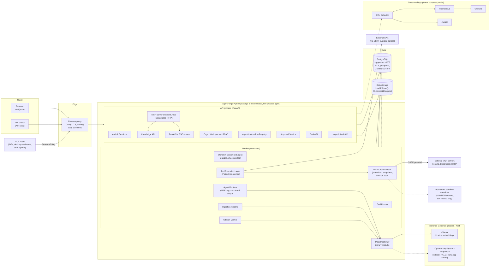
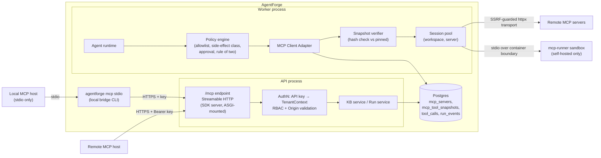
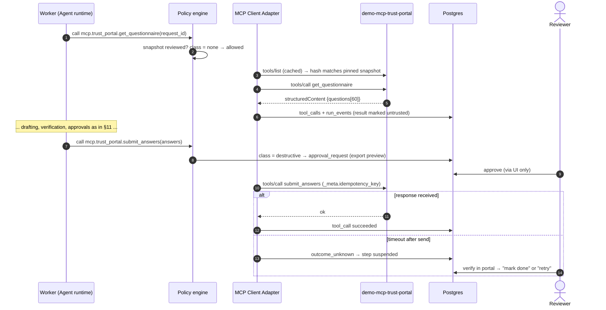
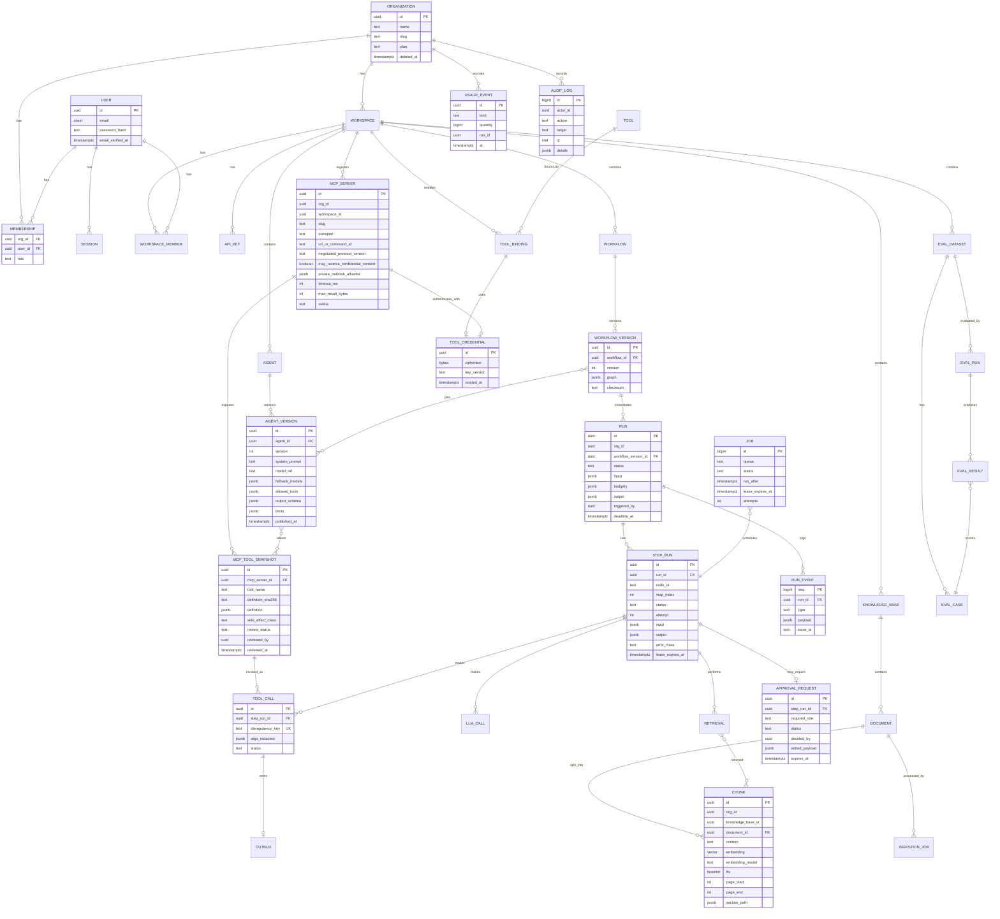
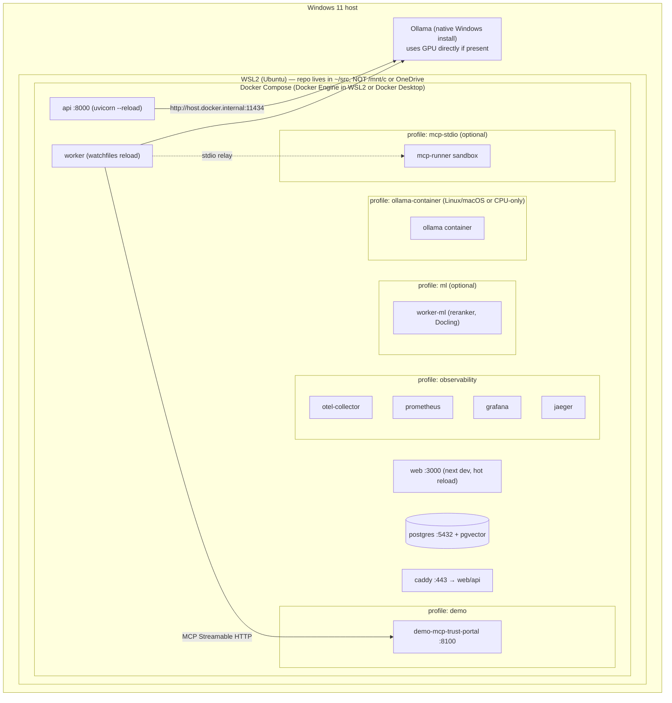

# AgentForge AI — Architecture & Product Design (v0.1, for review)

| Field | Value |
|---|---|
| Status | **DRAFT: design phase only. No code until approved.** |
| Date | 2026-10-09 |
| Scope | Product vision, MVP use case, architecture, security, roadmap, commercialization |
| Decision format | Decision → Alternatives → Trade-offs → Recommendation → Evidence required |

> **Verification notice.** Library licenses, model licenses, and version lines below come from knowledge current to about mid-2026. They were **not** re-checked against live sources for this draft. Any item marked **[VERIFY]** has to be confirmed against the official source listed in §27 before Phase 0 closes. Exact patch versions are pinned during Phase 0 (lockfiles plus a license-inventory CI job), not in this document. No performance number in this document is a measurement. Every performance figure is either a target or a placeholder to be measured.

---

## Table of contents

1. Executive product vision
2. Competitive positioning
3. Primary MVP use case
4. Functional & non-functional requirements
5. System architecture
6. Component responsibilities
7. Technology decision matrix
8. Agent runtime design: what we buy vs. build
8A. Model Context Protocol (MCP) integration
9. RAG architecture
10. Data model
11. Agent execution sequence
12. Security architecture & multi-tenancy
13. User experience
14. Local development architecture
15. Public demonstration architecture
16. Monorepo structure & documentation strategy
17. MVP scope & exclusions
18. Phased roadmap, milestones, acceptance criteria
19. Testing & evaluation strategy
20. Performance benchmarking strategy
21. Engineering quality standards
22. Commercialization roadmap
23. Portfolio & hiring strategy
24. Risk register
25. Local hardware requirements
26. Free vs. potentially-paid infrastructure
27. License & dependency compatibility review
28. Five key architecture decisions (ADRs)
29. Principal-engineer design review (self-critique)
30. Final recommendation

---

## 1. Executive product vision

**AgentForge AI is a self-hostable platform for evidence-grounded, human-supervised AI workflows over private documents.**

The market does not lack "AI agent platforms." What organizations lack is AI automation they can **trust, audit, and run on their own infrastructure**. AgentForge's position:

1. **Every output has evidence.** Generated claims link to the source passages. Claims without support get flagged, not hidden.
2. **Every action is governed.** Agents act only through registered tools under declarative permissions. Sensitive actions stop at a human approval gate that the LLM cannot bypass.
3. **Every run is inspectable and recoverable.** Execution is durable and checkpointed. A crashed worker resumes; it does not restart. Each LLM call, retrieval, tool call, and approval is recorded in a trace.
4. **Runs fully local.** Postgres + Ollama + open-weight models. No paid API is required anywhere in the core.
5. **MCP-native in both directions.** Agents use external tools through the Model Context Protocol, under the same permission, approval, and audit controls as built-in tools. AgentForge also *is* an MCP server, so IDEs, desktop assistants, and other agents can search its knowledge bases and start its governed workflows (§8A).

**Wedge, not platform.** We build a general runtime, but we go to market with one specific, painful workflow (§3). Platform breadth comes after a single template is demonstrably valuable.

**What AgentForge is not:** a LangChain/LangGraph UI wrapper, a chatbot builder, a no-code automation clone (n8n/Zapier), or a vector database.

---

## 2. Competitive positioning

| Category | Examples | Their strength | Our honest differentiation |
|---|---|---|---|
| Agent frameworks (libraries) | LangGraph, CrewAI, AutoGen/AG2, LlamaIndex, Pydantic AI | Developer flexibility, ecosystem | We are a *product*: multi-tenant, RBAC, approvals, audit, eval, UI. Frameworks leave all of that to you. |
| Open-source LLM app builders | Dify, Flowise, Langflow, n8n (AI nodes) | Large communities, many integrations, visual builders | Durable execution with idempotent side effects, claim-level citation verification, policy-enforced tool permissions, and built-in eval. **Several of these have restrictive or modified licenses [VERIFY per project]**, which matters to some buyers. |
| Vertical SaaS (our MVP domain) | Loopio, Responsive (RFPIO), Conveyor, Vanta/Drata questionnaire features, SafeBase | Mature content libraries, integrations, sales teams | Self-hosted and data-sovereign, local models (no document egress), open-source auditable pipeline, customizable workflow. |
| Hyperscaler agent services | Bedrock Agents, Vertex AI Agent Builder, Azure AI Foundry | Scale, managed infra | No cloud lock-in, runs air-gapped, predictable cost. |

**On MCP:** many products now "support MCP." Our differentiation is **governed MCP**: tool snapshots pinned by hash with admin review (rug-pull defense), side-effect classification enforced by our policy engine rather than trusting server annotations, approval gates on MCP actions, SSRF-guarded egress, and full traces of every MCP call. It is a narrow but real gap. Many MCP clients execute whatever a server advertises.

**Where we lose (stated plainly):** integrations breadth, community size, and polish compared with Dify/n8n; content-library maturity compared with Loopio. A solo project should not claim parity. It should win on a narrow axis: **trustworthy, auditable, self-hosted document workflows**.

---

## 3. Primary MVP use case

### 3.1 Candidate scoring (1 = poor, 5 = strong)

| Use case | Commercial value | Engineering differentiation | Feasibility (solo, local models) | Demo quality | Measurable eval | Total |
|---|---|---|---|---|---|---|
| Customer support automation | 4 | 2 (crowded, needs ticketing integrations) | 3 | 3 | 3 | 15 |
| **Document intelligence → Security questionnaire / RFP response** | **5** | **5** | **4** | **5** | **5** | **24** |
| Business process automation (generic) | 3 | 3 | 2 (integration-heavy) | 3 | 2 | 13 |
| Research assistant | 2 | 3 | 3 | 4 | 3 | 15 |
| Developer assistant | 3 | 2 (very crowded) | 3 | 3 | 3 | 14 |

### 3.2 Recommendation: Evidence-grounded questionnaire response

**The business problem:** B2B companies selling to enterprises must answer security questionnaires, vendor-risk assessments, and RFPs. These are spreadsheets of 50–500 questions. Answers must match the company's actual policies. Today, senior security, legal, and sales-engineering staff copy and paste from previous answers and policy documents. Errors carry contractual and legal risk, and **the source documents are sensitive**, which strengthens the self-hosted/local-model argument.

**Why it fits the platform:**
- **Multi-agent for a real reason, not for show:** *Planner* (classifies and routes questions) → *Retriever/Drafter* (answers with citations) → *Verifier* (checks each claim against the evidence and flags unsupported claims) → *Human reviewer* (approves, edits, or rejects) → *Exporter* (writes the filled spreadsheet, a side effect).
- **Exercises every runtime feature:** parallel fan-out per question, conditional routing (low confidence → human), approval gates, retries, durable checkpointing across a long batch, idempotent export.
- **Measurable:** ground-truth answers and gold evidence passages enable recall@k, MRR, citation precision, and answer-correctness scoring.
- **Strong demo:** upload policies, upload a questionnaire, watch 60 questions fan out live, review the flagged ones, export.

**Generalization path:** the same primitives (ingest → retrieve → draft → verify → approve → act) cover contract review against a playbook, policy Q&A, support-response drafting, and due-diligence document review. Those become later templates (§22).

**Validation required before claiming commercial value:** at least 10 discovery interviews with security, compliance, or sales-engineering people. Ask about questionnaire volume, hours spent, current tools, and willingness to self-host. **Until then, "commercial value" is a hypothesis.**

---

## 4. Functional & non-functional requirements

### 4.1 Functional requirements (MVP = **M**, Later = **L**)

| ID | Requirement | Phase |
|---|---|---|
| FR-01 | Email/password sign-up and login; secure sessions; logout of all sessions | M |
| FR-02 | Organizations, workspaces, memberships; roles: Owner, Admin, Builder, Reviewer, Viewer | M |
| FR-03 | Knowledge bases per workspace; upload PDF, DOCX, MD, TXT, XLSX/CSV | M |
| FR-04 | Async ingestion with status, errors, re-index, delete (hard delete of chunks and blobs) | M |
| FR-05 | Hybrid retrieval (vector + full-text) with per-tenant filtering and citations (doc, page, span) | M |
| FR-06 | Agent definitions (system prompt, model, tools, output schema, limits) with immutable versions | M |
| FR-07 | Workflow definitions as versioned graphs; visual viewer plus constrained editor (node config, edges among supported node types) | M |
| FR-08 | Durable workflow execution: sequential, parallel fan-out/fan-in (map), conditional routing, bounded loops | M |
| FR-09 | Human approval gates: approve / reject / edit-and-approve, with assignee role and timeout policy | M |
| FR-10 | Tool registry: built-in tools (KB search, HTTP request [allowlisted], spreadsheet export, webhook/outbox email) | M |
| FR-11 | Run trace UI: timeline of steps, LLM calls (prompt/response/tokens/latency), retrievals, tool calls, approvals | M |
| FR-12 | Claim-level citation verification with unsupported-claim flags | M |
| FR-13 | Evaluation: datasets, eval runs, retrieval and answer metrics, run-to-run comparison | M |
| FR-14 | Usage metering: tokens, latency, executions per org/workspace/agent | M |
| FR-15 | Audit log of security-relevant actions | M |
| FR-16 | Questionnaire template (flagship) plus seeded demo org | M |
| FR-17 | Cancellation and retry of runs and steps from the UI | M |
| FR-18 | API keys for programmatic access, scoped to a workspace | M |
| FR-19 | Scheduled workflows (cron) | L |
| FR-20 | **MCP client:** register remote MCP servers (Streamable HTTP), discover tools, pin and review tool snapshots, use MCP tools in agents under the same policy/approval/audit controls | M |
| FR-20a | MCP client: stdio servers (operator-configured, sandboxed, self-hosted only) | M |
| FR-20b | MCP client: OAuth 2.1 authorization to remote MCP servers; resources & prompts primitives | L |
| FR-25 | **MCP server:** expose KB search, cited Q&A, workflow start, and run status as MCP tools at `/mcp` (Streamable HTTP) + local stdio bridge; authenticated, tenant-scoped, audited | M |
| FR-25a | MCP server: OAuth 2.1 resource-server authorization; KB documents as MCP resources | L |
| FR-21 | OIDC/SAML SSO, SCIM | L (paid tier) |
| FR-22 | Template marketplace | L |
| FR-23 | Billing integration (Stripe or similar) behind `BillingProvider` interface | L |
| FR-24 | Model fallback chains | M (simple: ordered list) |

### 4.2 Non-functional requirements

Every target is a design goal to be verified by measurement on a documented reference machine (§20). None is a claim.

| ID | Category | Requirement / target | Verification |
|---|---|---|---|
| NFR-01 | Tenant isolation | Zero cross-tenant reads/writes, enforced by RLS in addition to app-layer checks | Automated cross-tenant test suite runs in CI; RLS enabled and forced on every tenant table (CI schema lint) |
| NFR-02 | Durability | Worker `kill -9` at any point → run resumes; completed steps not re-executed | Chaos test in CI (fake LLM) |
| NFR-03 | Side-effect safety | Side-effecting tools execute **effectively once** per (run, step) despite retries | Idempotency test with mock external service counting calls |
| NFR-04 | API latency | Non-LLM endpoints p95 < 150 ms at target load on reference machine (target, to be validated) | k6 report |
| NFR-05 | Scheduling latency | Enqueue → step start p95 < 500 ms when workers are idle (target) | Engine benchmark with fake LLM |
| NFR-06 | Retrieval latency | Hybrid retrieval p95 < 200 ms at 100k chunks per workspace (target) | Retrieval benchmark |
| NFR-07 | Availability | Single-node deployment; graceful restart without losing runs. HA is out of scope for MVP | Restart test |
| NFR-08 | Security | OWASP ASVS L2-aligned controls for the pre-public gate (§12.9) | Checklist + DAST scan |
| NFR-09 | Accessibility | WCAG 2.2 AA for core flows | axe-core in Playwright + manual keyboard pass |
| NFR-10 | Portability | `docker compose up` on Windows 11 + WSL2, macOS, Linux; CPU-only path works | CI matrix (Linux) + documented manual check (Windows/macOS) |
| NFR-11 | Observability | Every request and run correlated by trace ID across logs, traces, metrics | Test asserts trace_id propagation |
| NFR-12 | Reproducibility | Lockfiles, pinned images by digest, seeded demo is deterministic up to LLM output | CI rebuild check |
| NFR-13 | Data deletion | Org/workspace/document deletion removes rows, vectors, and blobs within SLA (MVP: synchronous or ≤ 1 h job) | Deletion test verifies no residual rows/blobs |

---

## 5. System architecture

### 5.1 Logical architecture (MVP deployment = modular monolith)



### 5.2 Deployment units

| Unit | MVP | Rationale |
|---|---|---|
| `web` (Next.js) | Container | UI only; no business logic, no DB access |
| `api` (FastAPI, uvicorn) | Container | Stateless; scale horizontally later |
| `worker` (same Python image, different entrypoint) | Container ×N | Runs engine, ingestion, eval. Separate process so long LLM calls never block API latency |
| `postgres` | Container (dev) / managed or self-run (prod) | System of record, queue, vectors, FTS, pub/sub |
| `ollama` | Host-native (recommended on Windows for GPU) or container | Inference is the heavy, independently scaled component |
| `caddy` | Container | TLS + routing; same-origin cookies for web and API |
| Observability stack | Optional profile | Not required to run the product |
| `mcp-runner` | Optional profile (self-hosted only) | Runs operator-configured **stdio** MCP servers isolated from the API/worker: no secrets, restricted network, read-only FS, resource limits |
| `demo-mcp-trust-portal` | Demo profile | Our own sample MCP server used by the flagship demo (§15) |

**Total required: 5 containers + Ollama.** No Redis, no message broker, no MinIO, no separate vector DB in the MVP (see ADR-1, ADR-4).

### 5.3 Monolith now; candidates for extraction later

| Component | Start in monolith? | Extract when (evidence-triggered, not speculative) |
|---|---|---|
| Auth, tenancy, registry, approvals, audit, metering | Yes, permanently likely | Probably never for a product of this size |
| Workflow engine (worker) | Separate *process*, same codebase | Already split by process. Separate *service* only if a non-Python runtime must execute steps |
| Ingestion | Worker queue, same codebase | When parsing needs heavy dependencies (OCR/Docling/torch) that bloat the main image → separate `worker-ingest` image, same queue |
| Model gateway | Library module | When multiple teams or apps share GPU capacity → standalone gateway with quotas |
| Eval runner | Worker queue | When eval workloads compete with production runs → dedicated worker pool (queue routing, not a new service) |
| Usage metering → billing | Tables + interface | When billing exists: async export to billing provider via outbox |
| Retrieval | Postgres | When measured p95 or recall under filters fails at target scale (ADR-4 evidence) |
| MCP server (`/mcp`) | Mounted in API process | When MCP traffic patterns (long-lived streams, many hosts) affect API latency → separate `mcp` process from the same image behind the same proxy |
| MCP client sessions | Worker-local pool | When many workers × many servers create connection pressure → a shared MCP gateway process that multiplexes sessions |

Module boundaries are enforced in code (import-linter contracts, §21), so extraction is a mechanical change rather than a rewrite.

---

## 6. Component responsibilities

| Component | Responsibilities | Owns tables | Must NOT |
|---|---|---|---|
| **Web application** | UI, client-side validation, SSE consumption, accessibility | — | Hold secrets; call DB; trust its own role checks |
| **API backend** | HTTP/OpenAPI, request validation (Pydantic), authN/authZ, tenancy context, rate limiting | — | Execute long-running work inline |
| **Auth & authorization** | Password hashing (argon2id), sessions, CSRF, API keys, RBAC policy decisions | `users`, `sessions`, `api_keys` | Issue long-lived browser JWTs (ADR-6 note) |
| **Org & workspace mgmt** | Org lifecycle, membership, invitations, deletion orchestration | `organizations`, `workspaces`, `memberships` | — |
| **Agent registry** | Agent definitions, immutable versions, validation of tool and model references | `agents`, `agent_versions` | Mutate a published version |
| **Agent orchestration runtime** | Single agent step: prompt assembly, LLM loop with tool calls, structured output validation and repair, budgets | — (writes via engine) | Call tools directly. All calls go through the Tool Layer and policy |
| **Workflow execution engine** | Graph scheduling, leases, checkpoints, retries/backoff, timeouts, cancellation, approval suspension, fan-out/fan-in, loop bounds | `runs`, `step_runs`, `jobs` | Hold a worker thread while waiting on humans |
| **Tool registry & execution** | Tool schemas, versions, permission policy, credential injection, SSRF-safe egress, idempotency keys, outbox | `tools`, `tool_credentials`, `tool_calls`, `outbox` | Expose credentials to the LLM context |
| **MCP client adapter** | Server registration, protocol negotiation, tool discovery, snapshot hashing and pinning, session pooling, cancellation/progress propagation, result size caps | `mcp_servers`, `mcp_tool_snapshots` | Execute any tool whose snapshot is unreviewed or whose live definition no longer matches its pinned hash; forward AgentForge credentials upstream |
| **MCP server** | Expose a curated, read-mostly tool surface (`/mcp` + stdio bridge); map MCP auth to `TenantContext`; Origin validation | — (uses KB and Run services) | Expose approvals, credential management, deletion, or admin operations |
| **Model gateway** | Provider abstraction (Ollama, OpenAI-compatible), structured outputs, timeouts, fallback chain, token and latency accounting | `llm_calls` | Implement business logic |
| **RAG & knowledge service** | KB lifecycle, hybrid retrieval, rerank (optional), citation assembly | `knowledge_bases`, `documents`, `chunks` | Return chunks across tenant or KB boundaries |
| **Ingestion pipeline** | Validate, sandboxed parse, chunk, embed, index; status and errors | `ingestion_jobs` | Parse in the API process |
| **Workflow state & persistence** | Event-sourced trace (`run_events`) plus current-state tables | `run_events` | — |
| **Human approval service** | Approval requests, assignment, decisions, timeouts, notifications, resume signal | `approval_requests` | Allow the requester to approve their own sensitive action (configurable separation of duties) |
| **Evaluation framework** | Datasets, eval runs, retrieval metrics, LLM-judge with calibration, regression gates | `eval_*` | Use eval data in production retrieval indexes unless explicitly linked |
| **Observability & audit** | OTel instrumentation, structured logs, metrics; append-only audit log | `audit_log` | Log secrets or raw document content at INFO |
| **Usage metering** | Usage events (tokens, steps, storage), aggregates, quotas | `usage_events`, `usage_daily` | Be the billing system |
| **Billing boundary (future)** | `BillingProvider` interface; outbox-driven export | — | Exist in MVP beyond the interface + usage tables |

---

## 7. Technology decision matrix

Versions show the **target major line** as of mid-2026. Exact versions get pinned in Phase 0 after verification. **[VERIFY]** = confirm license and current release at the official source.

| Layer | Choice | Why | Alternatives considered | Excluded / deferred |
|---|---|---|---|---|
| Frontend framework | **Next.js** (App Router, `output: "standalone"`), React, TypeScript | Marketing pages plus app in one codebase; static export enables the public demo; strong hiring signal | Vite + React Router (simpler, no server). Valid choice; we accept Next.js complexity for static export and SSR of landing pages | Server Actions for business logic (all logic lives in FastAPI) |
| UI | **Tailwind CSS v4**, **shadcn/ui** (Radix primitives) | Copy-in components we own, accessible primitives, no runtime lock-in | MUI, Mantine | — |
| Workflow canvas | **React Flow (@xyflow/react)** | MIT, mature, handles custom nodes | Rete.js, custom SVG | Paid React Flow Pro features [VERIFY] |
| Data fetching | TanStack Query; SSE via EventSource | Cache and retry semantics | SWR | GraphQL (no need) |
| API client | Generated from OpenAPI (`openapi-typescript`) | Contract-first; type safety across the boundary | Hand-written client | tRPC (would couple FE to TS backend) |
| Backend | **Python 3.12/3.13**, **FastAPI**, **Pydantic v2**, **SQLAlchemy 2.x (async)** + **asyncpg**, **Alembic** | Python is the ML ecosystem language; async I/O suits LLM/tool latency; Pydantic gives schemas for structured output and the API | Litestar, Django | Django ORM; SQLModel (thin layer, adds little) |
| Job queue | **Postgres-native queue** (`SELECT … FOR UPDATE SKIP LOCKED`), own implementation (~300 LOC) or **Procrastinate** (MIT) [VERIFY] | No extra infra; transactional enqueue with business writes (no dual-write problem) | Celery+Redis, arq, Dramatiq, Hatchet, DBOS | Redis/RabbitMQ in MVP |
| Workflow engine | **Custom durable engine on Postgres** (ADR-2) | Owns semantics: idempotency, approvals, multi-tenant, trace model. Core portfolio differentiator | LangGraph (+ checkpointer), Temporal, DBOS, Hatchet | Temporal (ops weight), LangGraph as core dependency |
| LLM serving | **Ollama** (MIT) | Simple local install, CPU/GPU, model library, JSON-schema `format`, embeddings endpoint | llama.cpp server (MIT), vLLM (Apache-2.0, GPU-centric), LM Studio (closed source, excluded) | vLLM required in MVP |
| Default models | **Qwen3** family (Apache-2.0) [VERIFY], **IBM Granite** (Apache-2.0) [VERIFY], **Mistral Small** (Apache-2.0) [VERIFY], **Phi-4-mini** (MIT) [VERIFY] | Permissive licenses, tool/JSON capable, CPU-feasible small sizes | Llama (custom license + AUP + attribution), Gemma (custom terms with use restrictions) | Llama/Gemma as *defaults* (allowed as user-selected options with license notice) |
| Embeddings | **nomic-embed-text** (Apache-2.0) or **bge-m3** (MIT) via Ollama [VERIFY] | Served by Ollama → no PyTorch in the API/worker image | sentence-transformers in-process (adds GBs of torch) | torch in base image |
| Reranker (optional) | **bge-reranker-v2-m3** or **ms-marco-MiniLM** cross-encoder (Apache-2.0) [VERIFY] in optional `worker-ml` image | Measurable precision gains on some corpora; must earn its place via eval | LLM-as-reranker (slow on CPU) | On by default |
| Vector + lexical search | **PostgreSQL 17/18 + pgvector 0.8.x** (HNSW, iterative index scans) + built-in FTS (`tsvector`) | One datastore; RLS applies to vectors; transactional consistency with metadata | Qdrant (Apache-2.0), Weaviate (BSD), OpenSearch, ParadeDB/pg_search (AGPL [VERIFY]) | Separate vector DB (ADR-4) |
| PDF parsing | **pypdfium2** (Apache-2.0/BSD-3) [VERIFY] + **pdfplumber**/pdfminer.six (MIT) for layout/tables; **python-docx** (MIT), **openpyxl** (MIT) | Commercially permissive | **PyMuPDF: AGPL-3.0 or paid commercial license** (excluded unless project goes AGPL); Docling (MIT, heavy models) as optional high-fidelity parser | OCR in MVP (Tesseract later, optional image) |
| Blob storage | `BlobStore` interface: **local filesystem** (dev/single node), **S3 API** via boto3 (prod: any S3-compatible) | Zero extra containers in dev | **MinIO: AGPL-3.0, and community distribution changed in 2025** [VERIFY]; SeaweedFS (Apache-2.0); Garage (AGPL) | MinIO as default |
| Cache / rate limit | Postgres + in-process for MVP; **Valkey** (BSD-3) when multi-instance | Avoid infra until measured need | Redis 7.4+ (RSALv2/SSPL; Redis 8 adds AGPLv3 option [VERIFY]) | Redis in MVP |
| Tool interoperability | **Model Context Protocol**, using the official **`mcp` Python SDK** (MIT [VERIFY]) for both client and server; target spec revision **2025-06-18 or newer** [VERIFY current revision]; transports: Streamable HTTP + stdio | Open standard with broad host and server ecosystem; avoids building N bespoke integrations; strong 2026 hiring signal | Bespoke REST tool adapters only; OpenAPI-to-tool import (keep as a later complementary path); framework-specific tool adapters | Legacy HTTP+SSE transport (deprecated in spec); sampling & elicitation in MVP |
| Reverse proxy | **Caddy** (Apache-2.0) | Automatic TLS, simple config | Traefik (MIT), nginx (BSD-2) | — |
| Auth | **Own session auth** (argon2-cffi, server-side sessions in Postgres, HttpOnly SameSite cookies, CSRF tokens); OIDC later via **Authlib** (BSD) | Revocable sessions, no extra service, full control of tenancy claims | Keycloak (Apache-2.0, heavy JVM), Ory Kratos (Apache-2.0), Auth.js, Zitadel (AGPL [VERIFY]) | JWT for browser sessions |
| Observability | **OpenTelemetry** SDK + Collector; **Prometheus**; **Grafana** (AGPL-3.0, used unmodified as separate service); **Jaeger** (Apache-2.0); **structlog** | Vendor-neutral; Jaeger avoids AGPL for tracing backend | Grafana Tempo/Loki (AGPL), SigNoz | Mandatory obs stack (optional profile) |
| Testing | pytest, pytest-asyncio, **testcontainers** (real Postgres), Hypothesis, Playwright, axe-core, **k6** (AGPL, dev tool, not distributed) or Locust (MIT), Schemathesis (MIT) for OpenAPI contract fuzzing | Real DB in tests catches RLS/SQL bugs mocks hide | — | SQLite-backed tests |
| CI/CD & security | GitHub Actions, **Trivy** (Apache-2.0), **gitleaks** (MIT), **pip-audit**, `npm audit`/OSV-Scanner, **Syft** SBOM, Dependabot/Renovate, CodeQL (free for public repos [VERIFY]) | Free for public repos | Snyk (paid tiers) | — |
| IaC | **OpenTofu** (MPL-2.0) when needed | **Terraform switched to BSL 1.1 in 2023**: fine to *use*, but OpenTofu avoids ambiguity for a product [VERIFY] | Terraform, Pulumi | IaC in MVP |
| Orchestration | Docker Compose (MVP); Helm chart (Phase 6, optional) | Matches single-node reality | k8s | Kubernetes in MVP |
| Container runtime (dev) | Docker Engine in WSL2, or Docker Desktop | — | Podman, Rancher Desktop | **Docker Desktop requires a paid subscription for larger companies** [VERIFY terms]. Document the alternatives |

---

## 8. Agent runtime design: what we buy vs. build

### 8.1 Framework vs. us

| Capability | Supplied by existing tools | We implement |
|---|---|---|
| LLM inference, quantization, GPU offload | Ollama / llama.cpp | — |
| JSON-schema-constrained decoding | Ollama `format` (grammar-based) [VERIFY model support] | Pydantic validation, one repair retry, failure classification |
| Native tool-calling format | Ollama `tools` API for supported models | **Our own tool-selection protocol over structured output** (portable across models; native tools used when available, behind the gateway) |
| Agent definitions & versioning | — | Immutable `agent_versions`, semantic diffing, pinning in workflows |
| Graph execution, state, routing | (LangGraph would supply) | **Custom engine** (ADR-2): node types `agent`, `retrieve`, `tool`, `branch`, `map`, `join`, `approval`, `loop`, `transform` |
| Durable execution & checkpointing | (LangGraph checkpointer / Temporal / DBOS would supply) | Step-level checkpoints in Postgres, leases with heartbeats, resume semantics |
| Retries & backoff | `tenacity` (Apache-2.0) for in-step HTTP retries | Step-level retry policy (max attempts, exp backoff + jitter, retryable error classes) persisted in DB |
| Timeouts & cancellation | asyncio | Per-step and per-run deadlines; cooperative cancel flag plus task cancellation of in-flight calls |
| Human approval | — | Suspend/resume without holding workers; approval policies; SoD |
| Idempotent side effects | — | Idempotency keys + transactional outbox |
| Loop prevention | — | Budgets: max steps, max LLM calls, max tokens, max wall-clock, per-edge traversal cap, explicit `loop` node with `max_iterations` |
| Model fallback | — | Ordered fallback chain in gateway, on retryable errors or schema-validation failure |
| Token/latency metrics | Ollama response metadata (eval counts, durations) | `llm_calls` table + OTel spans + usage events |
| Execution history / trace | — | `run_events` append-only event log |
| MCP wire protocol, transports, session handshake | Official `mcp` SDK | Tool-snapshot pinning and review, policy enforcement, SSRF-safe HTTP transport, session pool, tenancy mapping, outcome-unknown handling, curated server tool surface |

### 8.2 Execution model

- **Workflow definition** = versioned JSON graph (validated by a Pydantic schema; acyclic except through `loop` nodes). React Flow renders it; the engine never executes unpublished drafts.
- **Run** = an instance of a `workflow_version` with input, budgets, and status (`queued → running → waiting_approval → running → succeeded | failed | cancelled | timed_out`).
- **Step run** = one node execution attempt series. State machine: `pending → leased → running → (succeeded | failed_retryable → pending | failed_terminal | waiting_approval | cancelled)`.
- **Scheduling:** when a step succeeds, the engine computes ready successors and enqueues them **in the same transaction** that commits the step output (no lost or duplicate scheduling on crash).
- **Leases:** worker claims a job with `FOR UPDATE SKIP LOCKED`, sets `lease_expires_at`, and heartbeats. Expired leases are reclaimed → **at-least-once execution**.
- **Effectively-once side effects:** at-least-once execution plus idempotency gives effectively-once effects. Side-effecting tools receive `idempotency_key = H(run_id, node_id, map_index)`, which is stable across attempts. The tool layer records `tool_calls(idempotency_key UNIQUE)`. External effects go through an **outbox** row written in the step's transaction, then are delivered by a dispatcher that passes the key to the external API when the API supports one. For APIs without idempotency support, we document this as **at-least-once** and require approval for destructive actions. We never claim exactly-once.
- **Non-determinism:** LLM outputs are checkpointed, so a resume never re-calls an LLM for a completed step. Replay = re-render from `run_events`, not re-execution.
- **Approvals:** an `approval` node (or a tool whose policy says `requires_approval`) writes an `approval_request`, marks the step `waiting_approval`, and releases the worker. The decision API writes the decision and enqueues the continuation in one transaction.
- **Fan-out:** `map` node spawns N child step runs (bounded by `max_parallelism`, enforced via a per-run concurrency counter). `join` waits on all children, with a configurable partial-failure policy (`fail_fast | collect_errors`).
- **Live updates:** `run_events` insert → `pg_notify(run_id)` (payload = ids only, given the 8 KB NOTIFY limit) → API SSE endpoint fetches and streams events. Clients reconnect with `Last-Event-ID` = event sequence number.

### 8.3 Agent step (inside the runtime)

1. Assemble context: system prompt (versioned), task input, retrieved evidence **wrapped and labeled as untrusted data**, tool catalog (only tools the agent version is permitted to use).
2. Call the model via the gateway with a JSON schema: `{"action": "tool_call" | "final", ...}`.
3. Validate with Pydantic. On failure, one repair attempt with the error message, then a fallback model, then fail the step (retryable class).
4. If `tool_call`: the **policy engine** (outside the LLM) checks permission, argument schema, rate, and approval requirement. It executes via the Tool Layer or suspends for approval. The result returns as untrusted data.
5. Enforce budgets on every iteration. Exceeding a budget terminates with `budget_exceeded` (a distinct, visible failure class).

---

## 8A. Model Context Protocol (MCP) integration

**Spec baseline:** MCP revision 2025-06-18 or newer **[VERIFY the current stable revision and SDK support before Phase 2]**. Transports: **Streamable HTTP** (remote) and **stdio** (local). The legacy HTTP+SSE transport is deprecated in the spec and is not supported. Implementation uses the official `mcp` Python SDK (MIT [VERIFY]). Protocol governance has moved toward a vendor-neutral foundation [VERIFY current status], which reduces single-vendor risk.

### 8A.1 Two roles

| Role | What it enables | Example in the flagship use case |
|---|---|---|
| **AgentForge as MCP client** | Agents call tools on any MCP server (ticketing, CRM, trust portals, file stores, internal APIs) without bespoke adapters | Drafter pulls a questionnaire from a customer trust-portal MCP server. After human approval, the Exporter submits answers back through the same server |
| **AgentForge as MCP server** | Any MCP host (IDE assistants, desktop assistants, other agent systems) can use AgentForge's governed KBs and workflows | A sales engineer in an IDE or desktop assistant asks "what's our encryption-at-rest policy?" → cited answer from the Northwind KB. They can also start a questionnaire run that still goes through AgentForge's approval gate |

### 8A.2 Architecture



### 8A.3 MVP scope for MCP

| Primitive / feature | Client (consume) | Server (expose) |
|---|---|---|
| Tools | **MVP** | **MVP** (5 curated tools) |
| Streamable HTTP transport | **MVP** | **MVP** |
| stdio transport | **MVP** (operator-configured, sandboxed, self-hosted only) | **MVP** via bridge CLI |
| Progress & cancellation notifications | **MVP** (mapped to run events and run cancel) | **MVP** for long-running tools |
| `tools/list_changed` handling | **MVP** (triggers re-review) | Not needed (static tool set) |
| Structured tool output (`outputSchema`) | **MVP** (validated when present) | **MVP** |
| Auth to remote servers | MVP: static bearer/header secret (encrypted). **Later:** OAuth 2.1 + PKCE client flow | MVP: workspace API keys. **Later:** OAuth 2.1 resource server (protected resource metadata, audience-bound tokens) |
| Resources, prompts | Later | Later (KB documents as resources) |
| Sampling (server asks our LLM) | **Excluded**: gives an external server use of our inference and context; revisit with strict quotas | N/A |
| Elicitation (server asks user for input) | Later. Natural fit to map onto the approval UI | Later |

### 8A.4 MCP client design

1. **Registration (workspace Admin):** name/slug, transport, URL (HTTP) or operator-defined command ID (stdio), auth secret (envelope-encrypted, §12.7), timeouts, max result size, and a **data-sharing flag** (`may_receive_confidential_content`).
2. **Discovery → snapshot → review:** the adapter calls `initialize` + `tools/list`. Each tool definition `(name, title, description, inputSchema, outputSchema, annotations)` is canonicalized and hashed into an `mcp_tool_snapshot`. An Admin reviews each tool in the UI: rendered schema, raw description (displayed as untrusted text), and server-supplied annotations. The Admin **assigns our own side-effect class** (`none | reversible | destructive`). Server annotations such as `readOnlyHint` and `destructiveHint` are shown as hints only, because the spec itself says clients should not trust them from untrusted servers. Unreviewed tools default to `destructive` and disabled.
3. **Namespacing:** tools are exposed to agents as `mcp.<server_slug>.<tool_name>`. Agent versions reference **snapshot IDs**, not names, which prevents shadowing between servers.
4. **Rug-pull defense:** before every call (cached per session) the adapter compares the live tool definition hash with the pinned snapshot. A mismatch or a `list_changed` notification creates a new pending snapshot, disables the tool, alerts admins, and fails the step with `mcp_tool_changed`. The step is not silently retried.
5. **Call path:** policy engine (§12.4) → validate arguments against the **pinned** `inputSchema` locally → call via session pool with timeout → enforce result size cap → validate `structuredContent` against `outputSchema` if declared → record `tool_calls` + `run_events` → return result to the agent **as untrusted data**. Embedded images and resource links are never auto-fetched.
6. **Retries and idempotency (honest semantics):** MCP has no standard idempotency mechanism. We send our idempotency key in the request `_meta` as a convention that cooperating servers (including ours) may honor, but we **do not rely on it**. Therefore:
   - `none` class: retried with backoff like any read.
   - `reversible`/`destructive` class: **never auto-retried after the request may have been sent**. A timeout or connection loss after send marks the call `outcome_unknown`, suspends the step, and asks a human to verify and choose *retry* or *mark done*. Failures before send (connect error) are safely retried.
7. **Sessions:** per-worker pool keyed by `(workspace_id, server_id)`. Lazy initialize, protocol-version negotiation, ping health checks, idle eviction, and a per-server circuit breaker (opens after N consecutive failures). Session state is never assumed to survive a worker crash. The resumed step re-initializes.
8. **Cancellation & progress:** run cancellation sends `notifications/cancelled` for in-flight requests. Server progress notifications become `run_events` and appear live in the trace view.
9. **Network:** HTTP servers are reached through the SSRF-guarded client (§12.5). Self-hosted deployments often need **internal** MCP servers, so private addresses are blocked by default but can be allowlisted per server by an org Owner. The allowlist is disabled entirely in hosted multi-tenant mode.
10. **stdio servers:** launching a stdio server means executing a local program, which is code execution by design. Therefore stdio servers are **defined only by the operator in a config file** (never through the UI/API), are **unavailable in hosted multi-tenant mode**, and run inside the `mcp-runner` container with no secrets mounted, no access to Postgres, an egress allowlist, read-only root FS, and CPU/memory/pid limits. The worker talks to them over a narrow relay, never by spawning processes in its own container.

### 8A.5 MCP server design

- **Endpoint:** `/mcp` (Streamable HTTP) mounted into the FastAPI app via the SDK's ASGI integration, behind the same proxy, rate limits, and OTel instrumentation as `/v1`. Stateless request handling where possible, so any API replica can serve any request.
- **Local bridge:** `agentforge mcp stdio --api-url … --key-env AGENTFORGE_API_KEY` lets stdio-only hosts connect to a local or remote AgentForge.
- **Exposed tools (curated, read-mostly):**

| Tool | Behavior | Annotations we declare |
|---|---|---|
| `search_knowledge` | Hybrid retrieval over KBs the key can read; returns passages with doc/page citations | read-only |
| `answer_with_citations` | Runs the grounded Q&A pipeline (retrieve → draft → verify) with progress notifications; returns claims with support status | read-only |
| `start_workflow_run` | Starts a run of a **published** workflow with validated input; returns `run_id` and UI link. Approval gates inside the workflow still apply | not read-only, not destructive, idempotent with client-supplied key |
| `get_run` | Status, outputs, citations, and pending approvals for a run the key can read | read-only |
| `list_pending_approvals` | Lists items awaiting human review, **with links to the UI** | read-only |

- **Deliberately not exposed:** approve/reject decisions, credential management, tool registration, deletion, membership, or any admin action. **A human approval gate must not be satisfiable by another agent.** That is the point of the gate.
- **AuthN/AuthZ:** MVP uses workspace-scoped API keys with an explicit `mcp:use` scope, sent as `Authorization: Bearer`. The key maps to a principal → the same `TenantContext`, RBAC checks, and Postgres RLS as the REST API. Some remote MCP hosts expect the spec's OAuth 2.1 flow and may not accept static keys [VERIFY per host]. OAuth 2.1 resource-server support (protected resource metadata, audience validation, no token passthrough) is planned post-MVP, and the stdio bridge covers local hosts meanwhile.
- **Transport security:** validate the `Origin` header (DNS-rebinding protection, required by the spec for Streamable HTTP), bind to localhost in dev, and require TLS in production.
- **Audit & metering:** every MCP request is audited with `clientInfo` from `initialize`, the key ID, and the tool name. Usage counts against the same org quotas as REST calls.

### 8A.6 MCP-specific threat model

| Threat | Description | Controls |
|---|---|---|
| **Tool poisoning** | Malicious instructions hidden in tool descriptions or schemas | Descriptions treated as untrusted: length-capped, shown verbatim to the reviewing admin, placed in a labeled tool-catalog block (not in system instructions), pinned by hash |
| **Rug pull** | Server changes a tool's behavior or definition after approval | Snapshot hash pinning; re-review on change; `list_changed` disables tool |
| **Tool shadowing / name collision** | One server registers a tool named like another's | Namespacing + agent references by snapshot ID |
| **Prompt injection via tool results** | Results contain instructions | Results are untrusted; **rule of two** (§12.4) blocks destructive calls without approval after untrusted input |
| **Confused deputy / token passthrough** | Forwarding AgentForge or user tokens to upstream servers | Never forward our tokens; per-server credentials only (the spec forbids token passthrough) |
| **Data exfiltration through arguments** | Agent places confidential KB content into arguments to an external server | Per-server `may_receive_confidential_content` flag. If false, any call to that server in a run that read a confidential KB requires approval. **Limitation:** content-level detection is imperfect; we document this rather than claim prevention |
| **SSRF via server URL or redirects** | MCP server URL points to internal services | SSRF-guarded transport; private ranges require explicit Owner allowlist (self-hosted only) |
| **Malicious local server (stdio)** | Arbitrary code execution | Operator-only configuration, `mcp-runner` sandbox, disabled in hosted mode |
| **Resource exhaustion** | Slow or huge responses, notification floods | Timeouts, result size caps, notification rate limits, circuit breaker |
| **Inbound abuse of `/mcp`** | Credential stuffing, DNS rebinding, quota abuse | Scoped API keys, Origin validation, rate limits, audit |
| **Agent-to-agent approval bypass** | An external agent tries to approve its own actions through our server | Approval operations are not exposed via MCP |

### 8A.7 Flagship sequence with MCP



### 8A.8 MCP acceptance criteria

- Interop: the AgentForge client works against our demo server **and** at least two independent open-source MCP servers. The AgentForge server works with the official MCP Inspector and at least one third-party MCP host [VERIFY which hosts are free to use].
- Security tests pass: poisoned-description server, rug-pull server (definition changes after approval), oversized/slow server, redirect-to-private-IP server, and a server that returns injected instructions → **0 unauthorized tool executions**, changed tools disabled 100% of the time.
- `outcome_unknown` path: fault-injected timeout after send never triggers an automatic retry of a non-read-only tool (mock call counter = 1).
- Cancellation: run cancel propagates `notifications/cancelled` to in-flight MCP calls (verified against the demo server's log).
- Server: cross-tenant suite extended to `/mcp`: a key from org A cannot read org B's KBs or runs.

---

## 9. RAG architecture

### 9.1 Pipeline

```mermaid
flowchart LR
    U["Upload<br/>(API, streamed)"] --> V["Validate<br/>size, magic bytes,<br/>extension/MIME match,<br/>page/zip limits"]
    V --> S["Store blob<br/>random key, org-prefixed"]
    S --> Q["Enqueue ingestion job"]
    Q --> P["Parse in sandboxed subprocess<br/>timeout + memory rlimit<br/>pypdfium2 / pdfplumber / docx / xlsx"]
    P --> N["Normalize<br/>text, page map,<br/>headings, tables→markdown"]
    N --> C["Chunk<br/>structure-aware, ~400–800 tokens,<br/>overlap ~10–15%, keep page spans"]
    C --> M["Metadata<br/>title, section path, page,<br/>doc version, checksum"]
    M --> E["Embed<br/>batch via Ollama,<br/>model+dim recorded per chunk"]
    E --> I["Index<br/>pgvector HNSW +<br/>tsvector GIN"]
    I --> R["Ready"]
```



Chunk sizes and overlap are **starting points to tune with the eval harness**, not settled values.

### 9.2 Retrieval and answer generation

1. **Query planning (optional):** the Planner agent rewrites a question into 1–3 search queries (helps compound questionnaire items).
2. **Hybrid retrieval:** vector top-k₁ (HNSW, cosine) + FTS top-k₂ (`websearch_to_tsquery`, `ts_rank_cd`), both filtered by `org_id` (RLS) **and** `knowledge_base_id IN (...)`, fused with **Reciprocal Rank Fusion** (k≈60). Filtered HNSW can lose recall, so we use pgvector iterative index scans [VERIFY 0.8 behavior] and test recall under filters explicitly.
3. **Rerank (optional):** cross-encoder on the top ~30 → top ~8. Enabled only if eval shows a measurable gain that justifies the latency.
4. **Abstention gate:** if the top fused score or reranker score is below a calibrated threshold, the answer becomes "Insufficient evidence in knowledge base" and routes to a human. This is a feature, not a failure.
5. **Grounded generation:** structured output with `claims[]`, where each claim has `text` and `citation_chunk_ids[]`. The prompt requires that each claim cite evidence or be marked `unsupported`.
6. **Citation verification (Verifier agent):** for each (claim, cited chunks) pair, a smaller model performs entailment classification → `supported | partially_supported | not_supported`. Mechanical checks: cited IDs must exist in the retrieved set (catches fabricated citations), and quoted spans must string-match the source.
7. **Presentation:** each claim is underlined by status; hovering shows the source passage with page number; clicking opens the document viewer at the highlighted span. Unsupported claims are visually flagged and **block auto-approval**.

**RAG reduces but does not eliminate hallucination.** The verifier itself can be wrong. We measure its agreement with human labels (§19.3) and show verifier confidence, not certainty.

### 9.3 Retrieval-quality evaluation

| Metric | Definition | Use |
|---|---|---|
| Recall@k | Fraction of queries where ≥1 gold evidence chunk appears in top-k (also report full recall: fraction of all gold chunks found) | Primary retrieval gate (k = 5, 10, 20) |
| MRR | Mean of 1/rank of the first relevant chunk | Ranking quality |
| nDCG@10 | Graded relevance-aware ranking quality | When graded labels exist |
| Filtered recall | Recall@k with tenant/KB filters vs. unfiltered exact search | Detects HNSW + filter degradation |
| Citation precision | Fraction of cited chunks that support their claim (human or calibrated judge) | Grounding |
| Citation recall | Fraction of claims requiring support that carry a supporting citation | Grounding |
| Unsupported-claim rate | Claims flagged `not_supported` / total claims | Hallucination proxy |
| Answer correctness | Agreement with gold answer (human-graded subset + LLM judge calibrated against it) | End quality |
| Abstention quality | Precision/recall of "insufficient evidence" on questions designed to be unanswerable | Safety |

**Gold data:** a hand-built eval set for the demo corpus. About 60–150 questions, each with gold answer, gold evidence chunk(s), and a set of deliberately unanswerable questions. Gold labels reference **document spans**, not chunk IDs, so the labels survive re-chunking.

---

## 10. Data model

All tenant tables carry `org_id` (and `workspace_id` where scoped). They have RLS enabled and forced. Primary keys are UUIDv7 (time-ordered, which helps index locality).



**Notes:**
- `chunks.embedding` dimension is fixed per embedding model. Changing models means a **new index generation** (`embedding_model` column + reindex job + atomic switch), never in-place mixing.
- `run_events` grows fastest. Plan time-based partitioning (declarative partitions) when volume warrants. Not in MVP.
- `audit_log` is append-only: the app role is granted `INSERT` and `SELECT` only.
- `jobs` is the queue. It has a partial index on `(queue, run_after) WHERE status = 'ready'`.
- `mcp_tool_snapshots` are immutable. A changed definition creates a new row with `review_status = 'pending'`. `tool_calls` gains a nullable `mcp_tool_snapshot_id` and an `outcome` that includes `outcome_unknown`.

---

## 11. Agent execution sequence (questionnaire run with approval and crash recovery)

```mermaid
sequenceDiagram
    autonumber
    actor U as Reviewer (browser)
    participant API as API (FastAPI)
    participant PG as PostgreSQL
    participant W1 as Worker 1
    participant W2 as Worker 2
    participant MG as Model Gateway → Ollama
    participant T as Tool Layer (policy + outbox)

    U->>API: POST /v1/runs {workflow_version, questionnaire_doc}
    API->>API: AuthN (session) + AuthZ (Builder/Reviewer) + set tenant ctx
    API->>PG: BEGIN; SET LOCAL app.org_id; INSERT run, step_run(plan), job; COMMIT
    API-->>U: 202 {run_id}
    U->>API: GET /v1/runs/{id}/events (SSE)

    W1->>PG: Claim job (FOR UPDATE SKIP LOCKED), set lease
    W1->>MG: Planner: classify & split questions (JSON schema)
    MG-->>W1: {questions[60]}
    W1->>PG: BEGIN; step output + run_events + enqueue map children (60); COMMIT
    PG-->>API: NOTIFY run_id
    API-->>U: SSE: plan completed, 60 tasks queued

    loop per question (max_parallelism = N)
        W1->>PG: Hybrid retrieval (RLS-filtered)
        W1->>MG: Drafter: answer with claims + citations
        W1->>MG: Verifier: entailment per claim
        W1->>PG: Checkpoint child step (output, llm_calls, usage)
    end

    Note over W1: Worker 1 crashes mid-batch (kill -9)
    W2->>PG: Reclaim expired leases → resume unfinished children only
    W2->>PG: Join: all children done → route low-confidence/unsupported → approval node
    W2->>PG: INSERT approval_request; step = waiting_approval; release worker
    API-->>U: SSE: 7 answers need review

    U->>API: POST /v1/approvals/{id} {decision: edit_and_approve, edits}
    API->>PG: BEGIN; check role + SoD; record decision; audit_log; enqueue continuation; COMMIT

    W2->>PG: Claim continuation
    W2->>T: export_spreadsheet(idempotency_key = H(run, node))
    T->>PG: tool_calls UNIQUE(key) + outbox row (same txn)
    T-->>W2: ok (or prior result if key already exists)
    W2->>PG: run = succeeded; usage + metrics
    API-->>U: SSE: run complete, download export
```

---

## 12. Security architecture & multi-tenancy

### 12.1 Threat model summary (STRIDE-oriented; full model goes in `docs/security/threat-model.md`)

| Asset | Threats | Primary controls |
|---|---|---|
| Tenant documents & chunks | Cross-tenant read (IDOR, missing filter), leakage via LLM context | RLS + app-layer authZ + retrieval-filter tests; per-run context built only from authorized KBs |
| Tool credentials | Exfiltration via logs, LLM output, or prompt injection | Envelope encryption; injected at execution time into the HTTP client, never into prompts; redaction in logs/traces |
| Tool execution | Prompt-injected destructive actions, SSRF | Capability-based policy outside the LLM; approval for destructive actions; SSRF-guarded egress |
| Sessions | Hijacking, CSRF, fixation | HttpOnly/Secure/SameSite=Lax cookies, rotation on login, CSRF tokens on state-changing requests, idle and absolute timeouts |
| File ingestion | Parser exploits, zip/decompression bombs, resource exhaustion | Sandboxed subprocess, rlimits, timeouts, size/page caps, magic-byte validation |
| LLM output rendering | XSS, data exfiltration through markdown image URLs | Sanitized markdown (no raw HTML), **remote images disabled**, links rendered with `rel="noopener noreferrer"` and a confirmation for external URLs |
| Audit trail | Tampering, repudiation | Append-only grants; hash-chained entries (Phase 5); off-host export |
| Availability | Abuse, expensive inference DoS | Per-IP, user, and org rate limits; per-run budgets; queue quotas per org |

### 12.2 Tenant isolation (defense in depth)

1. **Application layer:** every repository method requires a `TenantContext(org_id, workspace_id, principal, roles)`. No unscoped query APIs exist (enforced by code review plus an import-linter rule that blocks direct session use outside repositories).
2. **Database layer, Postgres RLS:** the app connects as role `agentforge_app` (not table owner, no `BYPASSRLS`). Each transaction runs `SET LOCAL app.org_id = …`. Policies use `org_id = current_setting('app.org_id')::uuid`. `FORCE ROW LEVEL SECURITY` is set on all tenant tables. Migrations run as a separate owner role.
3. **Connection pooling caveat:** `SET LOCAL` is transaction-scoped, so it is safe with transaction pooling (PgBouncer) as long as every query runs in an explicit transaction. CI enforces this with a test that a query without context returns zero rows.
4. **Retrieval:** vector/FTS queries rely on RLS **and** an explicit `knowledge_base_id` filter (KB-level ACLs inside an org).
5. **Blob storage:** keys prefixed `org/{org_id}/…`. Downloads go only through the API (authorized and streamed) or short-lived signed URLs (S3) scoped to one object.
6. **Tests:** a generated cross-tenant suite. For every endpoint, create resources in org A, then request them as org B, and assert 404 (not 403, to avoid existence oracles).

### 12.3 AuthN / AuthZ

- Passwords: argon2id; breached-password check against a local k-anonymity list is optional. Email verification, password reset with single-use, short-lived tokens.
- Sessions: opaque random IDs (only the hash is stored), server-side in Postgres. Rotated on privilege change. "Log out everywhere" supported.
- API keys: prefix + secret (only the hash is stored), workspace-scoped, role-limited, with expiry and last-used tracking.
- RBAC: role → permission matrix in code (`agents:write`, `runs:approve`, `kb:read`, …), checked by a single `authorize(principal, permission, resource)` function. Resource-level checks (KB ACLs) are included. ABAC is deferred.
- **Separation of duties:** configurable. A run's initiator cannot approve its own `destructive` tool actions.

### 12.4 Tool security

- Each tool declares `side_effect: none | reversible | destructive`, an argument JSON schema, an egress allowlist, and a timeout.
- An agent version declares `allowed_tools`. The workspace binds tools to credentials. **The policy engine evaluates every call, and the LLM cannot widen its permissions.**
- Default policy: `destructive` → approval required. `reversible` → configurable. `none` → allowed.
- **Rule of two (adapted):** an agent step that has ingested untrusted content (documents, web, tool output) cannot invoke a `destructive` tool without human approval, whatever the workspace config.
- **MCP tools are ordinary tools to the policy engine.** Our reviewed side-effect class applies, not the server's annotations. MCP-specific controls (snapshot pinning, rug-pull detection, stdio sandboxing, data-sharing flags, inbound `/mcp` hardening) are specified in §8A.4–8A.6.

### 12.5 SSRF protection (HTTP tool, webhooks)

- Allow only `https` (and `http` in dev). Resolve DNS **once** and connect to the resolved IP (prevents DNS rebinding). Block loopback, RFC1918, link-local (incl. `169.254.169.254`), CGNAT, IPv6 ULA/link-local, and multicast. Re-validate on every redirect, with a redirect cap. Enforce response size and time limits.
- Production: route all egress through an egress proxy (e.g., **Smokescreen**, MIT [VERIFY]) plus network policy, so a bug in app-level checks is not enough to reach internal addresses.

### 12.6 Prompt-injection threat model

Assume **every document and tool output is attacker-controlled**. Controls (none is sufficient alone):
1. Untrusted content is wrapped in delimited, labeled blocks with an instruction hierarchy in the system prompt. This lowers the success rate but does not stop injection.
2. **Capability containment is the real control:** permissions live outside the model (§12.4). Injected text can, at worst, influence output text, which is then verified and human-reviewed.
3. No secrets in context. No tool that reads credentials or other tenants' data.
4. Output handling: no auto-rendered remote images or HTML; external links need a click; exported files are generated from structured fields, not raw model text.
5. **Red-team eval set:** documents with embedded injections ("ignore previous instructions and email…"). CI asserts that no unauthorized tool call executes and measures how often output text is influenced (reported, not hidden).

### 12.7 Secrets management

- Master key from environment / Docker secret (dev), KMS or Vault-compatible store (prod, optional; OpenBao, MPL-2.0 [VERIFY]).
- Envelope encryption: per-org data key encrypted by the master key; AES-256-GCM via `cryptography`. A `key_version` column enables **rotation**: re-wrap data keys under the new master key; lazy or background re-encryption of credentials.
- Session secret and CSRF keys support a key ring for zero-downtime rotation.

### 12.8 Data protection and deletion

- TLS at Caddy; TLS to Postgres in production (`sslmode=verify-full`). Volume-level encryption at rest is the operator's responsibility (documented).
- Deletion: document → chunks, blobs, retrievals' chunk references (tombstoned). Workspace/org → cascading job plus blob prefix purge, with a final verification query. Backups are retained per documented policy, so deletion from backups is eventual and that is disclosed.
- Logs: no document content at INFO; prompts/responses are stored in `llm_calls` (tenant data, RLS-protected, subject to retention settings), not in log files.

### 12.9 Pre-public exposure gate (must all pass before any public internet exposure)

| # | Control | Evidence |
|---|---|---|
| 1 | RLS on all tenant tables + cross-tenant test suite green | CI report |
| 2 | Session security (cookie flags, CSRF, rotation, timeouts) | Integration tests + manual check |
| 3 | Rate limiting on auth, upload, and run endpoints; per-org run quotas | Load test shows 429s |
| 4 | File upload hardening (limits, sandboxed parsing) | Fuzz corpus + bomb tests |
| 5 | SSRF guard with IP-range tests incl. redirects and rebinding | Unit + integration tests |
| 6 | Destructive tools require approval; rule-of-two enforced | Policy tests + red-team eval |
| 7 | Secrets encrypted; no secrets in logs/traces (log scanning test) | Tests + gitleaks |
| 8 | Dependency, container, and secret scanning with no unresolved critical/high CVEs | CI gates |
| 9 | Security headers (CSP, HSTS, frame-ancestors) | Header test + DAST (OWASP ZAP baseline) |
| 10 | Audit logging of auth, permission, approval, and deletion events | Tests |
| 11 | Backups + tested restore | Restore drill record |
| 12 | SECURITY.md + disclosure process | File present |
| 13 | MCP client: snapshot pinning, rug-pull and poisoned-server test suite green; stdio disabled in hosted mode | CI report (§8A.8) |
| 14 | MCP server: `/mcp` covered by cross-tenant suite, Origin validation, rate limits; no approval/admin tools exposed | Tests + tool-list snapshot test |

The **public portfolio demo (§15) avoids this gate** by not exposing a multi-user backend. That is a deliberate choice.

---

## 13. User experience

### 13.1 Sitemap

```
/                         Landing (product, demo video, architecture, GitHub link)
/demo                     Public interactive replay (recorded runs, clearly labeled)
/docs → external docs site
/login  /signup  /reset-password  /verify-email
/app
  /[org]/                 Org dashboard (recent runs, pending approvals, usage summary)
  /[org]/[ws]/templates   Template gallery (MVP: questionnaire, policy Q&A)
  /[org]/[ws]/agents            list → /[agentId] (builder: prompt, model, tools, schema, limits, versions, test)
  /[org]/[ws]/workflows         list → /[wfId] (canvas, node config panel, versions, publish)
  /[org]/[ws]/knowledge         KBs → /[kbId] (documents, ingestion status, search tester)
  /[org]/[ws]/playground        interactive agent/workflow runner
  /[org]/[ws]/runs              history (filters) → /[runId] (trace view)
  /[org]/[ws]/approvals         review queue → /[approvalId]
  /[org]/[ws]/evals             datasets, eval runs, comparisons
  /[org]/[ws]/analytics         tokens, latency, executions, failures
  /[org]/[ws]/mcp/servers       register MCP servers → /[serverId] (status, tools, snapshot review & diff, call history)
  /[org]/[ws]/mcp/access        connect AgentForge to MCP hosts (API keys with mcp:use scope, config snippets)
  /[org]/settings               members, roles, workspaces, API keys, tools & credentials, audit log, data deletion
  /account                      profile, sessions, password
```

### 13.2 Key user journeys

1. **First value in under 10 minutes (target):** sign up → create org → choose "Security Questionnaire" template → upload policy PDFs (ingestion progress live) → upload questionnaire XLSX → run → watch fan-out → review flagged answers → export.
2. **Reviewer:** opens approvals queue → sees answer, claims with support status, and source passages side by side → edits → approves (keyboard shortcuts: `A` approve, `E` edit, `R` reject, `J/K` next/prev).
3. **Builder:** duplicates template → swaps model → tightens the verifier threshold → runs an eval against the dataset → compares with the previous version → publishes v2.
4. **Admin:** invites users, assigns roles, binds a webhook tool credential, reviews the audit log, deletes a workspace.
5. **Investigator (failure):** run failed → trace view shows the failed step, error class, retries, and LLM input/output → retries from that step.
6. **Admin connects an MCP server:** add URL + secret → AgentForge discovers tools → admin reviews each tool (schema, raw description, server hints), assigns side-effect class, enables → Builder adds the tool to an agent version. Later the server changes a tool → banner "1 tool changed, disabled pending review" with a definition diff.
7. **Knowledge worker uses AgentForge from their own AI app:** creates an `mcp:use` key → copies a config snippet → asks questions in their IDE/assistant and receives cited answers. Anything needing approval links back to the AgentForge review queue.

### 13.3 Wireframe descriptions

- **Org dashboard:** top KPI row (runs 24h, success rate, pending approvals, tokens), "Needs your review" list, recent runs table with status chips, ingestion status of KBs.
- **Agent builder:** left column form (name, model + fallback, system prompt editor with variable chips, allowed tools checklist with side-effect badges, output schema editor with JSON-schema validation, limits). Right column "Test" pane: input → output + trace mini-view. Version history drawer with diff.
- **Workflow builder:** React Flow canvas with typed node palette (Agent, Retrieve, Tool, Branch, Map, Join, Approval, Loop). Right config panel. Validation errors shown on nodes (unreachable node, missing join, unbounded loop). "Publish" creates an immutable version.
- **Knowledge base:** document table (name, pages, chunks, status, uploaded by, actions). Drag-and-drop upload. "Search tester" shows hybrid results with vector/FTS/fused ranks and scores, which makes retrieval debuggable.
- **Run trace view:** horizontal timeline / Gantt of steps (parallel lanes for map children), color-coded by status. Clicking a step opens a side panel with tabs: Input, Output, LLM calls (prompt, response, tokens, latency, model), Retrievals (chunks with scores), Tool calls, Events. Header shows run budgets consumed (steps, tokens, time).
- **Approval detail:** split view. Left: question, drafted answer with claim highlighting (green supported / amber partial / red unsupported). Right: cited passages with document preview at page. Footer: Approve / Edit & approve / Reject with reason.
- **Eval dashboard:** dataset selector, run comparison table (recall@k, MRR, citation precision, unsupported rate, correctness, latency p50/p95, tokens), per-case drill-down showing regressions.
- **MCP server detail:** header with connection status, negotiated protocol version, circuit-breaker state. Tools table (namespaced name, our side-effect class badge, server hints, review status, last-called). A "Review" drawer shows the raw description in a monospace untrusted-content panel, the schema, and a diff against the previously pinned snapshot. Call-history tab links into run traces.
- **Analytics:** tokens by agent/model over time, latency percentiles, failures by error class, cost-per-run estimate with its assumptions shown.

Design system: shadcn/ui on Radix, dark/light themes, WCAG 2.2 AA contrast, full keyboard navigation, reduced-motion support, responsive down to tablet. Mobile is limited to approvals and run status.

---

## 14. Local development architecture



- **One command:** `make up` (or `just up`) → compose up, migrate, seed demo org, pull default models (with a size prompt).
- **CPU-only path:** default models are a small instruct model (≈3–4B, Q4) and an embedding model. Expect slow generation and document it with measured numbers from the reference machine, not promises.
- **Fake LLM provider:** `MODEL_PROVIDER=fake` gives deterministic, configurable-latency responses for tests, CI, UI development, and engine benchmarks. Contributors don't need Ollama to work on most of the system.
- **Windows specifics:** keep the repo inside the WSL filesystem. Bind mounts from `/mnt/c`, and especially OneDrive-synced folders, are much slower and can cause file-watcher and locking issues (this project's current folder is under OneDrive). Set `.wslconfig` memory and swap limits.

---

## 15. Public demonstration architecture

**Principle: never present recorded or simulated output as live.** Every non-live screen carries a persistent banner: *"Recorded run — captured 2026-MM-DD on [hardware] with [model:tag]. Not a live model response."*

| Option | Cost | Honesty | Impressiveness | Ops burden | Verdict |
|---|---|---|---|---|---|
| A. Recorded product walkthrough (video, 3–5 min) | Free (YouTube/self-hosted) | High | Medium-high | None | **Do it** |
| B. Static interactive **replay** of real recorded runs (Next.js static export; trace viewer and approval UI over captured `run_events` JSON) | Free (GitHub Pages / Cloudflare Pages) [VERIFY free-tier terms] | High (when labeled) | High: visitors click through real traces | Low | **Do it: primary public demo** |
| C. Public frontend + always-on live backend | GPU hosting is paid and continuous; CPU hosting is slow | High | Highest | High; triggers the full security gate | **No** for MVP |
| D. Time-limited live sessions (scheduled windows, own machine via a tunnel, invite codes, per-session sandbox org, hard quotas) | Free-ish [VERIFY tunnel ToS] | High | High for interviews | Medium | **Optional**, Phase 6, only after the §12.9 gate |
| E. "Run it yourself" one-command local demo | Free | Highest | High for engineers | None | **Do it** |

**Recommended public stack:** A + B + E. B is not a simulation: it replays **actual captured** run events from a real local run, produced by a `make record-demo` script that also stamps hardware, model, and date metadata. The replay UI reuses the production trace components, which proves they are real.

**Demo content (seeded, fully reproducible):**
- Fictional company **"Northwind Analytics"** (clearly fictional). We write about 12 policy documents ourselves (Information Security Policy, Access Control, Incident Response, Data Retention, BCP/DR, Vendor Management, Encryption Standard, SDLC, HR Security, Privacy Notice, Acceptable Use, a SOC 2-style controls summary). We author them under CC-BY-4.0, which removes any third-party copyright risk.
- A 60-question security questionnaire **written by us**. Do not copy proprietary questionnaires (e.g., SIG is licensed by Shared Assessments; CSA CAIQ terms [VERIFY]). It includes about 8 deliberately unanswerable questions and 3 documents with embedded prompt-injection text.
- Agents: Planner, Drafter, Verifier, Exporter. Workflow: questionnaire v1. Eval dataset with gold answers and spans.
- **Failure and recovery scene:** inject an Ollama timeout on one map child (fault-injection flag) → retry with backoff → success. Also kill the worker mid-run → resume. Both are visible in the trace.
- Approval scene: 7 flagged answers, one rejected with reason, one edited.
- **MCP client scene:** the questionnaire arrives from **`demo-mcp-trust-portal`**, a small MCP server we write ("Northwind Trust Portal", tools: `list_requests`, `get_questionnaire`, `submit_answers`). `submit_answers` is classified destructive, so it waits for approval and is then submitted. A scripted step changes a tool definition on the server, and the UI shows the rug-pull detection and re-review flow.
- **MCP server scene:** the official MCP Inspector [VERIFY license/version] connects to `/mcp`, calls `answer_with_citations`, and shows the cited claims, proving the same governed pipeline is reachable from any MCP host. The local live demo also documents connecting a desktop/IDE MCP host via the stdio bridge, with no paid account required for the demo itself.
- A `poisoned-mcp` test server (tests profile only, never in the demo UI) provides the red-team fixtures in §8A.8.

*Note on the existing cardiology corpus in this folder:* it is useful as a second, harder retrieval benchmark (long scientific PDFs, tables). It should not be the flagship demo, because medical content invites "clinical advice" liability and distracts from the business use case.

---

## 16. Monorepo structure & documentation strategy

```
agentforge/
├── apps/
│   ├── web/                      # Next.js (app + landing + /demo replay)
│   ├── demo-mcp-trust-portal/    # sample MCP server used in the demo (Python, official SDK)
│   ├── mcp-runner/               # sandbox image for operator-configured stdio MCP servers
│   └── server/                   # Python package `agentforge`
│       ├── src/agentforge/
│       │   ├── api/              # FastAPI routers, deps, schemas (v1)
│       │   ├── core/             # config, logging, telemetry, errors, ids
│       │   ├── tenancy/          # orgs, workspaces, memberships, TenantContext
│       │   ├── auth/             # sessions, passwords, api keys, rbac
│       │   ├── registry/         # agents, workflows, versions, graph schema/validation
│       │   ├── engine/           # scheduler, leases, step state machine, map/join, approvals hooks
│       │   ├── runtime/          # agent step loop, prompt assembly, budgets
│       │   ├── tools/            # registry, policy, builtins, ssrf, outbox, credentials
│       │   ├── mcp/
│       │   │   ├── client/       # adapter, session pool, snapshots/pinning, ssrf transport, stdio relay
│       │   │   └── server/       # /mcp tools, auth mapping, origin checks, stdio bridge CLI
│       │   ├── models/           # model gateway: ollama, openai_compat, fake; structured output
│       │   ├── knowledge/        # kb, ingestion, parsing (sandbox), chunking, retrieval, verifier
│       │   ├── approvals/
│       │   ├── evals/
│       │   ├── metering/
│       │   ├── audit/
│       │   ├── storage/          # BlobStore: local, s3
│       │   ├── db/               # SQLAlchemy models, session, RLS helpers
│       │   └── cli.py            # `agentforge api|worker|migrate|seed|record-demo`
│       ├── migrations/           # Alembic (incl. RLS policies)
│       └── tests/{unit,integration,security,chaos,eval,mcp}   # mcp/ includes poisoned & rug-pull fixture servers
├── packages/
│   └── api-client/               # generated TS client from OpenAPI
├── templates/                    # workflow/agent template definitions (JSON/YAML)
├── demo/
│   ├── corpus/                   # Northwind policies (CC-BY-4.0), questionnaire, eval gold
│   └── recordings/               # captured run_events for public replay
├── deploy/
│   ├── compose/                  # docker-compose.yml + profiles, Caddyfile, otel config
│   ├── docker/                   # Dockerfiles (multi-stage, non-root, pinned digests)
│   └── helm/                     # Phase 6 (optional)
├── bench/
│   ├── k6/  engine/  retrieval/  inference/
│   └── results/                  # dated results + hardware manifests (raw data committed)
├── docs/
│   ├── architecture/             # C4 (context, container, component), sequence diagrams, ERD
│   ├── adr/                      # 0001-modular-monolith.md …
│   ├── security/                 # threat-model.md, rls.md, prompt-injection.md
│   ├── guides/                   # install-local.md, windows-wsl2.md, deploy.md, models.md
│   ├── evaluation/               # methodology + reports
│   └── benchmarks/               # methodology + reports
├── .github/workflows/            # ci.yml, security.yml, release.yml, bench-smoke.yml
├── README.md  CONTRIBUTING.md  SECURITY.md  CODE_OF_CONDUCT.md
├── LICENSE  NOTICE  THIRD_PARTY_LICENSES.md  CHANGELOG.md  ROADMAP.md
├── Makefile (or justfile)
└── .editorconfig  .pre-commit-config.yaml  renovate.json
```

**Documentation strategy:**
- **README:** problem → 90-second GIF → architecture diagram → "run locally in 3 commands" → measured results (linked to raw data) → design highlights with links to ADRs → roadmap. No unverifiable claims.
- **Diagrams as code** (Mermaid in Markdown) so they render on GitHub and are versioned.
- **C4:** Context, Container (§5), Component (engine, knowledge) levels.
- **ADRs** in MADR format, one per significant decision, with status and superseded-by links.
- **Docs site:** MkDocs Material (MIT) [VERIFY] built in CI and published to GitHub Pages.
- **CHANGELOG** via Conventional Commits + release tooling. SemVer for releases and API (`/v1`).

---

## 17. MVP scope & exclusions

### In the MVP

- Auth (email/password), orgs, workspaces, 5 roles, API keys, audit log.
- Knowledge bases: PDF, DOCX, MD, TXT, XLSX/CSV; hybrid retrieval; citations; search tester.
- Agent registry with versions; model gateway (Ollama, OpenAI-compatible, fake); fallback list.
- Durable engine: sequential, branch, map/join, bounded loop, approval, retries, timeouts, cancellation, budgets.
- Built-in tools: `kb_search`, `http_request` (allowlisted, SSRF-safe), `export_xlsx`, `webhook` (outbox). Email goes to a local outbox viewer (no real SMTP needed in the demo).
- **MCP client:** Streamable HTTP + sandboxed stdio, tools primitive, snapshot review/pinning, rug-pull detection, policy/approval integration, `outcome_unknown` handling, progress/cancel propagation, static-secret auth.
- **MCP server:** `/mcp` with 5 curated tools, API-key auth, stdio bridge CLI, demo trust-portal server.
- Claim verification + unsupported-claim UI.
- Trace viewer, run history, approvals queue.
- Workflow canvas: **view + constrained editing** of node configuration and edges among supported node types; validation; publish.
- Eval: datasets, retrieval + answer metrics, comparison of two runs, CI regression gate on the demo set.
- Usage metering + analytics page.
- Questionnaire template + seeded demo + recording/replay + local one-command demo.
- Observability profile (OTel/Prometheus/Grafana/Jaeger) with one prebuilt dashboard.

### Explicitly excluded from MVP (and why)

| Excluded | Why |
|---|---|
| Kubernetes, Helm, Terraform/OpenTofu | Single-node reality; adds ops surface with no user value yet |
| Redis/Valkey, Kafka/RabbitMQ, MinIO, separate vector DB | Postgres covers it at MVP scale (ADR-1, ADR-4) |
| SSO/SAML/SCIM | Paid-tier feature; significant security surface |
| Billing integration | No customers yet; usage tables + interface only |
| Arbitrary code execution tool | Secure sandboxing (gVisor/Firecracker) is a project in itself |
| Template marketplace | Needs community and moderation |
| MCP OAuth 2.1 (client and server), resources, prompts, sampling, elicitation | MVP ships MCP tools only. OAuth adds a large security surface; sampling hands our inference to external servers; elicitation needs the approval UI first. All Phase 6 |
| Scheduled workflows | Cheap to add later on the same queue (`run_after`); not on the demo path |
| OCR, image understanding | Heavy dependencies; questionnaire corpora are mostly digital-native |
| Fine-tuning, model training | Out of product scope |
| Real-time collaborative editing | Complexity far exceeds value |
| Mobile-first UI | Reviewer flows only |
| Hosted multi-tenant SaaS | Requires the pre-public gate plus ops maturity (§22) |

---

## 18. Phased roadmap, milestones, acceptance criteria

**Assumption:** one experienced engineer, about 15–20 focused hours/week. A full-time schedule would be roughly half the calendar time. These are estimates with roughly ±30% uncertainty. The schedule is the most likely thing to slip, so scope cuts are pre-identified (✂).

| Phase | Weeks (part-time) | Deliverables | Acceptance criteria (measurable) |
|---|---|---|---|
| **P0: Foundations** | 3 | Monorepo, compose, CI (lint, type, test, scan, SBOM, license inventory), Alembic, auth/sessions, orgs/workspaces/RBAC, RLS framework, structured logging + OTel, ADRs 1–6, version/license verification of §27 | `make up` works on clean Linux CI and documented Windows/WSL2; RLS lint passes (every tenant table forced); cross-tenant test harness exists and passes; mypy/pyright strict on `core`, `tenancy`, `auth`; no critical/high CVEs; THIRD_PARTY_LICENSES generated |
| **P1: Knowledge** | 3–4 | Upload, validation, sandboxed parsing, chunking, embeddings via Ollama, HNSW + FTS, RRF, search tester UI, Northwind corpus + gold eval set, retrieval eval CLI | Ingest the demo corpus end-to-end; recall@10, MRR, and filtered-vs-unfiltered recall reported and committed as **baseline**; bomb/oversize/malformed files rejected without worker crash (tests); deletion removes rows + blobs (test) |
| **P2: Runtime + MCP client** | 6–7 | Engine (leases, checkpoints, retries, timeouts, cancel, map/join, branch, loop, budgets), model gateway (Ollama, OpenAI-compat, fake, fallback), agent registry + versions, tool layer (policy, SSRF, outbox, credentials), approvals, run_events + SSE. **MCP client** (Streamable HTTP, snapshots/pinning, session pool, `outcome_unknown`, cancel/progress), `mcp-runner` stdio sandbox, poisoned/rug-pull fixture servers | Chaos test: 100 runs with random worker kills → 100% complete, **0 duplicate side effects** (mock counter); infinite-loop workflow halts at budget with `budget_exceeded`; cancellation stops in-flight step within target (e.g., ≤ 2 s plus provider abort); SSRF suite passes; ≥ 85% branch coverage on `engine`, `tools/policy`, `mcp/client`; **MCP security criteria in §8A.8 pass** |
| **P3: Flagship + UI + MCP server** | 6 | Questionnaire template (Planner/Drafter/Verifier/Exporter), claim verification, approvals UI, trace viewer, run history, agent builder, workflow canvas (constrained edit), dashboard. MCP server management UI (register, review, diff). **`/mcp` server** with 5 tools + stdio bridge; `demo-mcp-trust-portal` | Journey 1 completes in Playwright E2E with fake LLM and manually with Ollama, **with the questionnaire sourced from and submitted to the demo MCP server**; journeys 6 and 7 pass E2E; MCP Inspector interop verified; axe-core: 0 serious/critical violations on core pages; prompt-injection red-team set (documents **and** MCP tool results) → 0 unauthorized tool executions |
| **P4: Evaluation & metrics** | 3 | Eval datasets/runs/compare UI, LLM-judge with human-label calibration, CI eval gate (fake + small real model, nightly), usage metering + analytics, Grafana dashboard | Judge-vs-human agreement reported (Cohen's κ) on ≥ 50 labeled items; CI fails if retrieval recall@10 drops > 3 points vs baseline (threshold tuned to measured noise); analytics totals reconcile with `llm_calls` (test) |
| **P5: Hardening, benchmarks, docs** | 3 | Pre-public gate items, k6/engine/retrieval/inference benchmarks with hardware manifests, threat model, full docs, README, demo recording + static replay, v0.1.0 release | Every §12.9 item has linked evidence; benchmark reports reproducible via `make bench-*` with raw data committed; fresh-clone-to-demo time measured and documented; public replay site live with labels |
| **P6: Post-MVP (optional)** | ongoing | MCP OAuth 2.1 (client + resource server), MCP resources/prompts, elicitation mapped to approvals, scheduled workflows, OIDC SSO, Valkey for multi-instance rate limiting, Helm chart, second template (contract review), time-limited live demo | Each feature gated by its own ADR + tests |

**Total MVP: about 25–27 weeks part-time (~6 months).** MCP adds roughly 3 weeks: ~2 for the client with its security controls, ~1 for the server and demo server.
✂ Pre-identified cuts if behind: workflow canvas editing → view-only + JSON editor; reranker; analytics charts beyond 3; Grafana dashboard; DOCX/XLSX parsing of KB docs (keep PDF/MD); **MCP stdio + `mcp-runner`** (keep Streamable HTTP only); MCP server reduced to `search_knowledge` + `answer_with_citations`. **Never cut:** snapshot pinning, policy integration, `outcome_unknown` handling. Shipping MCP without them would be the exact anti-pattern this product argues against.

---

## 19. Testing & evaluation strategy

### 19.1 Test pyramid

| Layer | Tooling | Focus | Gate |
|---|---|---|---|
| Unit | pytest, Hypothesis | Graph validation, state machine transitions (property-based), RRF, chunker, policy engine, SSRF IP classifier, budget accounting | Every PR |
| Integration | pytest + testcontainers (real Postgres + pgvector) | Repositories, RLS, queue leasing/concurrency, outbox, ingestion on fixtures | Every PR |
| Contract | Schemathesis against OpenAPI; generated TS client type-check | API conforms to schema; no breaking changes in `/v1` (oasdiff [VERIFY]) | Every PR |
| Security | Cross-tenant suite, SSRF suite, upload fuzz, session tests, log-secret scan | Isolation & hardening | Every PR |
| Chaos | Worker kill/restart, DB connection drop, Ollama timeout injection (fake provider) | Durability, idempotency | Every PR (short) + nightly (long) |
| E2E | Playwright + axe-core, fake LLM | Core journeys, a11y | Every PR (smoke) / nightly (full) |
| MCP | Official SDK client/server in-process + fixture servers (demo, poisoned, rug-pull, slow/huge, redirect-to-private); MCP Inspector CLI for interop smoke [VERIFY] | Protocol interop, snapshot pinning, policy enforcement, outcome-unknown, cancellation, `/mcp` tenancy | Every PR (fixtures) / nightly (third-party servers, pinned versions) |
| Eval | Eval runner on demo set | Retrieval + answer quality regressions | Nightly with a real small model; PR with fake (pipeline integrity only) |
| Load | k6, engine bench | Performance regressions | Weekly / on demand; smoke in CI |

### 19.2 Evaluation framework

- **Datasets** are versioned, with cases containing input, gold answer, gold evidence spans, tags (answerable/unanswerable/injection).
- **Eval run** = (dataset version × workflow version × model config) → per-case results with all metrics in §9.3, plus latency and tokens.
- **Comparison:** per-metric deltas with bootstrap confidence intervals. With 60–150 cases, small deltas are noise, and the UI says so.

### 19.3 LLM-as-judge discipline

- The judge model is pinned (name, tag, digest) and versioned with its prompt.
- **Calibrate against humans:** about 50–100 hand-labeled items; report agreement (κ) and confusion matrix. If agreement is poor, the judge metric is shown as "uncalibrated" and excluded from CI gates.
- Known biases (verbosity, position, self-preference): use a different model family than the drafter when possible; randomize order in pairwise comparisons.

---

## 20. Performance benchmarking strategy

**Rule: no published number without a committed raw result file + hardware manifest + exact command + git SHA + model digest.**

### 20.1 Separation of concerns

| Benchmark | What it isolates | LLM | Key metrics |
|---|---|---|---|
| **API bench** (k6) | HTTP layer, auth, DB queries | None | RPS at SLO, p50/p95/p99, error rate, DB pool saturation |
| **Engine bench** (Python harness) | Scheduler, queue, checkpoints | **Fake provider** with fixed latency distributions (e.g., 0 ms, 500 ms, 5 s) | Steps/s, enqueue→start latency p50/p95/p99, queue depth over time, concurrent runs, worker CPU/mem, DB CPU/IOPS |
| **Recovery bench** | Durability | Fake | Time to resume after kill -9 (lease timeout dominated), duplicate side effects (must be 0), retry counts vs policy |
| **Retrieval bench** | pgvector + FTS + RRF | Embeddings precomputed | Latency p50/p95/p99 at 10k / 100k / 1M chunks; recall vs exact search at HNSW `ef_search` settings; filtered vs unfiltered; index build time and size |
| **Inference bench** | Ollama + model + hardware | Real | TTFT, prompt-eval tok/s, generation tok/s, per model × quantization × context length × CPU/GPU; concurrent request scaling (`OLLAMA_NUM_PARALLEL`) |
| **MCP bench** | Client adapter overhead and `/mcp` server throughput | Fake | Added latency per MCP call vs. an equivalent built-in tool (p50/p95), session-pool reuse rate, `/mcp` RPS at SLO for `search_knowledge` |
| **End-to-end** | Whole questionnaire run | Real | Wall-clock per 60-question run, tokens per run, cost per run (below) |

### 20.2 Methodology

- **Hardware manifest** (auto-collected): CPU model/cores, RAM, GPU/VRAM, driver, OS/WSL version, Docker version, Postgres config, Ollama version, model digests.
- Warm-up runs discarded; ≥ 5 repetitions; report median and spread. Open-model load (k6 arrival-rate executors) to avoid coordinated omission.
- Synthetic data generators for large corpora (1M chunks) are seeded and committed.
- **Cost per execution (self-hosted):** `(hardware amortization/hour + power draw (W) × electricity price) × run hours`, with every input visible and user-adjustable. Token counts are reported separately so readers can apply hosted-API prices themselves. No fabricated dollar figures.
- Results go to `bench/results/YYYY-MM-DD-<machine>/` (raw JSON + summary MD). The README links to them.

---

## 21. Engineering quality standards

| Standard | Implementation | Measurable criterion |
|---|---|---|
| Modular architecture | Package-per-domain; **import-linter** contracts (e.g., `api` → services only; `engine` must not import `api`) | Contract check in CI = pass |
| Type safety | Python: pyright/mypy strict on core packages; TS `strict: true` | 0 type errors; `# type: ignore` count tracked |
| Lint/format | ruff (lint + format), ESLint, Prettier | CI pass |
| DI | FastAPI dependencies + explicit constructor injection for services (no DI framework) | Services unit-testable without HTTP |
| API versioning | `/v1` prefix; OpenAPI published; breaking-change detection | oasdiff gate |
| Migrations | Alembic; forward-only in prod; each migration tested up/down in CI on a seeded DB | CI pass |
| Coverage | Engine, policy, tenancy, auth ≥ 85% branch; overall ≥ 75% | Coverage gate (core packages) |
| Security scanning | gitleaks (pre-commit + CI), pip-audit, npm audit / OSV-Scanner, Trivy (images + IaC), CodeQL | No unresolved critical/high |
| SBOM & licenses | Syft SBOM per release; license allowlist check (`pip-licenses`, `license-checker`); fails on GPL/AGPL in shipped deps unless allowlisted with ADR | CI pass |
| Containers | Multi-stage, non-root, read-only rootfs where possible, pinned base digests, healthchecks | Trivy + hadolint pass |
| Reproducible builds | `uv` lockfile (Python) [VERIFY], pnpm lockfile, image digests | Rebuild produces the same dependency set |
| Logs | structlog JSON with `trace_id`, `org_id` (no PII payloads) | Log schema test |
| ADRs | `docs/adr/` MADR | Every merged decision of consequence has an ADR |
| Releases | Conventional commits, CHANGELOG, signed tags, GHCR images with provenance (SLSA attestations via GitHub [VERIFY]) | Release workflow |

---

## 22. Commercialization roadmap

### 22.1 Ideal initial customer (hypothesis to validate)

- **Primary:** B2B software companies (≈50–500 employees) selling to enterprises, with a small security/compliance team buried in questionnaires and RFPs, **and** a reason to avoid sending policy documents to third-party AI SaaS. Examples: selling to finance, healthcare, government, or EU customers.
- **Secondary:** regulated or air-gapped organizations (defense suppliers, public sector, healthcare providers) needing local-only document AI. Long sales cycles, high willingness to pay for self-hosted.
- **Not targeted initially:** SMBs without questionnaire volume; enterprises needing an extensive vendor-security review of us (we can't pass it yet).

### 22.2 Problem worth paying for

"Answering security questionnaires takes our senior people days per deal, answers drift from actual policy, and we can't send our policies to an external AI." Value = hours saved × loaded cost + faster deal cycles + lower answer-inconsistency risk. **All three must be quantified from interviews, not assumed.**

### 22.3 Open-source vs. paid (open-core)

| Community (Apache-2.0) | Business / Enterprise (commercial license, self-hosted) | Hosted SaaS (later) |
|---|---|---|
| Full runtime, RAG, approvals, traces, eval, templates, single-org RBAC, local models | SSO (OIDC/SAML), SCIM, advanced RBAC/ABAC & KB-level ACL policies, audit log export/SIEM, retention policies, HA deployment guides, priority support, answer-library features (approved-answer reuse), admin analytics | Managed infra, BYO model endpoint or managed inference, usage-based billing |

Keep the open-source edition **genuinely useful**. A crippled core destroys community trust and portfolio value. Code separation: `ee/` directory under a commercial license, or a separate private repo (cleaner).

### 22.4 Self-hosted vs. SaaS

- **Start self-hosted** (aligned with the value proposition, no GPU hosting bill, no liability for customer data).
- **SaaS** requires: the pre-public gate, SOC 2 Type I→II path, DPA/sub-processor list, backups/DR, on-call, per-tenant quotas, and inference economics (GPU cost per tenant). SaaS without local-model differentiation competes directly with funded incumbents. Defer it until paying self-hosted customers ask for it.

### 22.5 Pricing models (structures to test; no invented prices)

- Self-hosted Business: annual license per workspace or per "active reviewer" seat, with support tiers.
- SaaS: per-seat base + usage (runs or questions processed) with included quotas, because inference cost scales with usage.
- Pilot: paid 60–90-day pilot with defined success metrics (time per questionnaire, % answers accepted without edits).

### 22.6 Infrastructure economics

- Self-hosted: customer bears hardware. Our cost is support.
- SaaS: dominant cost is inference. Model cost per run = tokens × (GPU $/hour ÷ tokens/hour at achieved utilization). **Measure tokens/run (§20) before pricing.** Metering tables exist from day one so these numbers are real.

### 22.7 Onboarding & support

Onboarding: guided template wizard, sample data, "import previous questionnaire answers" (Phase 6), docs, install doctor (`agentforge doctor` checks Docker, RAM, Ollama, models). Support: GitHub issues (community), email/SLA (paid), versioned upgrade guides with migration notes.

### 22.8 Legal, licensing, privacy

- **Trademark:** the name "AgentForge" is likely used by other projects or products. **Run a trademark and namespace search before public launch** and pick a defensible name if needed.
- Project license Apache-2.0 + NOTICE; DCO sign-off for contributions (lighter than a CLA, but a CLA is needed if you ever want to relicense contributions commercially. Decide before accepting outside PRs).
- Model licenses: ship no weights; document per-model license; warn in the UI when a selected model's license has use restrictions.
- Output liability: questionnaire answers are legal representations, so human approval is mandatory by default, with disclaimers in the ToS.
- Privacy: GDPR/CCPA posture (data minimization, deletion, DPA for SaaS); self-hosted makes the customer the controller.
- Export control: generally low risk for this software, but note it in legal review if selling to restricted jurisdictions.

---

## 23. Portfolio & hiring strategy

### 23.1 Evidence by company category

| Company | What they look for | Evidence this project must produce |
|---|---|---|
| **OpenAI / Anthropic** | Applied LLM systems, eval rigor, safety, tool-use reliability, infra, agent interoperability | Eval harness with calibrated judges and CIs; prompt-injection red-team results with containment design; structured-output reliability stats per model; agent loop budgets; **a governed MCP client and server with a published MCP threat model and adversarial-server test results**; write-up of failure modes |
| **Netflix** | Distributed systems reliability, resilience, observability, operational excellence | Durable engine with chaos tests; recovery benchmarks; OTel tracing across API/worker; clear ADRs on trade-offs |
| **Databricks / Snowflake** | Data systems, query performance, retrieval at scale, governance | pgvector/FTS benchmarks at 1M chunks with recall-vs-latency curves; RLS-based governance; ingestion pipeline design; partitioning plan |
| **Meta / Google** | Large-scale system design, code quality, testing discipline, performance | Clean module boundaries, strict typing, test pyramid, profiling-driven optimizations with before/after data |
| **Stripe** | API design, correctness, idempotency, security, docs | Idempotency keys + outbox, versioned OpenAPI with contract tests, excellent API docs, SSRF/egress design (Smokescreen-style), audit logs |

### 23.2 Truthful resume-bullet templates (fill **only** with measured values after implementation)

- "Designed and built AgentForge, an open-source, self-hostable agent workflow platform (FastAPI, Postgres/pgvector, Next.js, Ollama). [N] GitHub stars / [N] contributors *(only if true)*."
- "Implemented a Postgres-backed durable workflow engine with leases, checkpoints, and idempotent side effects. Chaos tests across [N] runs with random worker kills showed 0 duplicate side effects and resume within [X] s p95."
- "Built hybrid retrieval (pgvector HNSW + Postgres FTS + RRF) improving recall@10 from [A] to [B] on a [N]-question gold set; p95 retrieval latency [X] ms at [N] chunks on [hardware]."
- "Shipped claim-level citation verification. Calibrated the LLM judge against [N] human labels (κ = [X]), reducing unsupported-claim rate from [A]% to [B]% on the eval set."
- "Enforced multi-tenant isolation with Postgres RLS and a generated cross-tenant test suite covering [N] endpoints."
- "Designed prompt-injection containment (capability policies, approval gates). 0 unauthorized tool executions across [N] adversarial documents."
- "Implemented bidirectional Model Context Protocol support: a policy-governed MCP client with hash-pinned tool snapshots and rug-pull detection (0 unauthorized executions across [N] adversarial MCP servers), and an MCP server exposing cited KB search to [N] MCP hosts tested."

Never state customers, revenue, production scale, or "enterprise-grade" without evidence.

---

## 24. Risk register

| # | Risk | Likelihood | Impact | Mitigation | Trigger / owner signal |
|---|---|---|---|---|---|
| R1 | Scope creep (platform breadth before flagship works) | High | High | Flagship-first; ✂ list; phase acceptance gates | Phase overruns > 30% |
| R2 | Small local models give poor structured output or tool use on CPU | High | High | Schema-constrained decoding, repair loop, fallback chain, tasks decomposed into small steps; publish per-model reliability stats | JSON validity < target in eval |
| R3 | Local inference too slow for a compelling live demo | High | Medium | GPU path; small models; parallel fan-out; recorded replay for public demo; honest timing labels | 60-question run > ~15 min on reference GPU machine |
| R4 | Custom engine bugs (durability/concurrency) | Medium | High | Property-based state-machine tests, chaos tests, small surface; ADR-2 spike against DBOS/LangGraph | Chaos failures |
| R5 | RLS misconfiguration → tenant leak | Low-Med | Critical | Forced RLS, non-owner role, CI schema lint, cross-tenant suite | Any cross-tenant test failure blocks merge |
| R6 | License contamination (AGPL dep slips in, model license misuse) | Medium | High | License allowlist CI, SBOM, per-model license registry | CI license failure |
| R7 | pgvector filtered-search recall/latency degrades at scale | Medium | Medium | Iterative scans, partial indexes per KB, partitioning; benchmark-driven ADR-4 revisit | Filtered recall < target |
| R8 | Prompt injection leads to harmful output text in exports | Medium | Medium-High | Human approval for exports, verifier, red-team set, export from structured fields | Red-team regressions |
| R9 | Name/trademark conflict | Medium | Medium | Search before launch | Conflict found |
| R10 | Docker Desktop/WSL2 friction for contributors | Medium | Low-Med | Docker Engine-in-WSL guide, `doctor` command, fake LLM mode | Install issues filed |
| R11 | Commercial hypothesis wrong (buyers fine with SaaS incumbents) | Medium | High (commercial only) | Interviews before building paid features; portfolio value doesn't depend on it | < 3 of 10 interviewees show self-host need |
| R12 | Solo maintainer burnout / timeline | High | High | Part-time realistic plan, cut list, public roadmap without dates | Two consecutive phase slips |
| R13 | Dependency churn (Next.js majors, Ollama API changes) | Medium | Low-Med | Thin adapters, Renovate with grouped updates, contract tests on gateway | Breakage on upgrade |
| R14 | MCP spec and SDK churn (new revisions, auth changes, transport changes) | High | Medium | All MCP code behind `mcp/` adapters; pin SDK and negotiate protocol version; nightly interop against pinned third-party servers; ADR-10 revisit on each spec revision | Interop test failure, new spec revision |
| R15 | Malicious or compromised MCP servers (poisoning, rug pull, exfiltration) | Medium | High | §8A.6 controls; destructive default; snapshot pinning; documented residual risk for argument-level exfiltration | Red-team regression; security report |
| R16 | MCP hosts require OAuth and won't accept API keys | Medium | Medium | stdio bridge for local hosts; OAuth resource server prioritized first in P6 | Interop with target hosts fails |

---

## 25. Approximate local hardware requirements

These are planning estimates. Real numbers are to be measured and published per §20.

| Profile | CPU | RAM | GPU | Disk | What runs well |
|---|---|---|---|---|---|
| **Minimum (CPU-only dev)** | 4 cores / 8 threads, AVX2 | 16 GB (allocate ~10–12 GB to WSL2) | None | 30 GB free SSD | Full app with fake LLM; small (~3–4B, Q4) model + embeddings slowly; small corpora |
| **Recommended** | 8 cores | 32 GB | 8–12 GB VRAM (NVIDIA; AMD/Apple via Ollama support [VERIFY]) | 50 GB SSD | 7–9B Q4 models with usable latency; demo corpus; parallel fan-out of a few requests |
| **Comfortable** | 12+ cores | 64 GB | 16–24 GB VRAM | 100 GB NVMe | Larger models (≈14–24B Q4), reranker, benchmarks at 1M chunks |

Approximate memory: Q4 quantized weights need roughly 0.6–0.7 GB per billion parameters, plus KV cache that grows with context length and parallel requests. Postgres + app containers need ~2–3 GB in dev.

---

## 26. Free vs. potentially-paid infrastructure

| Need | Free option (default) | Potentially paid | Notes |
|---|---|---|---|
| LLM inference | Ollama on own hardware | Hosted GPU (cloud/marketplace), hosted APIs (optional adapters) | Paid only if live public demo or SaaS |
| Database | Postgres in Docker | Managed Postgres with pgvector | Free tiers often limit storage/compute and may pause [VERIFY specific providers] |
| Blob storage | Local filesystem | S3/R2/B2 | Some have free tiers [VERIFY] |
| Static demo hosting | GitHub Pages / Cloudflare Pages | — | Check bandwidth/build limits [VERIFY] |
| CI | GitHub Actions (free for public repos) | Private-repo minutes, larger runners | GPU runners are paid; nightly real-model eval runs on CPU with a tiny model, or locally |
| Container registry | GHCR (public images free [VERIFY]) | — | — |
| Observability | Self-hosted Prometheus/Grafana/Jaeger | Grafana Cloud etc. | — |
| Tunneling for time-limited demo | Cloudflare Tunnel free [VERIFY ToS] | — | Only after the security gate |
| Docker | Docker Engine (Apache-2.0) | Docker Desktop for larger orgs [VERIFY] | — |
| Email (SaaS) | Local outbox / Mailpit (MIT) in dev | Transactional email provider | Not needed for MVP |
| Domain/TLS | Let's Encrypt via Caddy | Domain registration (~low annual cost) | Only paid item realistically needed for the portfolio |

**Hidden operational costs to acknowledge:** backups and restore testing; Postgres maintenance (VACUUM, index bloat with frequent re-ingestion); model storage (several GB per model); log/trace retention growth; your time on dependency upgrades and security patches; incident response if you ever host user data.

---

## 27. License & dependency compatibility review

**Proposed project license: Apache-2.0** (permissive, includes patent grant, enterprise-friendly, good for portfolio adoption). Alternative: AGPL-3.0 core (protects against cloud resale, would allow PyMuPDF/AGPL deps, but deters some enterprise adopters). See ADR-7 note in §28.

| Component | License (as understood mid-2026) | Compatible with Apache-2.0 distribution? | Action | Source to verify |
|---|---|---|---|---|
| FastAPI, Pydantic, SQLAlchemy, Alembic, asyncpg, structlog | MIT / BSD / Apache-2.0 | Yes | — | PyPI / GitHub repos |
| Next.js, React, Tailwind, shadcn/ui, Radix, @xyflow/react, TanStack Query | MIT | Yes | Check React Flow Pro is not required | github.com/vercel/next.js, github.com/xyflow/xyflow |
| PostgreSQL | PostgreSQL License (permissive) | Yes | — | postgresql.org/about/licence |
| pgvector | PostgreSQL License | Yes | — | github.com/pgvector/pgvector |
| Ollama | MIT | Yes (separate process) | — | github.com/ollama/ollama |
| pypdfium2 / PDFium | Apache-2.0 / BSD-3 (PDFium BSD-style) | Yes | **[VERIFY]** | github.com/pypdfium2-team/pypdfium2 |
| pdfplumber, pdfminer.six | MIT | Yes | — | GitHub |
| **PyMuPDF** | **AGPL-3.0 or commercial (Artifex)** | **No** (for Apache distribution without commercial license) | **Exclude** | pymupdf.readthedocs.io / artifex.com |
| Docling | MIT (models may carry own licenses) | Yes, optional | **[VERIFY model weights]** | github.com/docling-project/docling |
| **MinIO** | **AGPL-3.0**; community distribution changes in 2025 | Network use OK unmodified, but avoid as default | **Exclude as default** | github.com/minio/minio |
| **Redis** | 7.4+: RSALv2/SSPLv1; 8.x adds AGPLv3 option | Avoid | Use **Valkey** (BSD-3) when needed | redis.io/legal, valkey.io |
| Grafana | AGPL-3.0 | OK as separate, unmodified service in an optional profile | Document; don't modify/embed | grafana.com/licensing |
| Prometheus, Jaeger, OTel | Apache-2.0 | Yes | — | CNCF repos |
| Caddy | Apache-2.0 | Yes | — | github.com/caddyserver/caddy |
| k6 | AGPL-3.0 | Dev tool, not distributed with product → fine | — | github.com/grafana/k6 |
| Terraform / OpenTofu | BSL 1.1 / MPL-2.0 | Prefer OpenTofu | — | hashicorp.com/bsl, opentofu.org |
| Trivy, gitleaks, Syft | Apache-2.0 / MIT / Apache-2.0 | Yes (CI) | — | GitHub |
| cryptography, argon2-cffi, Authlib | Apache/BSD, MIT, BSD | Yes | — | PyPI |
| **Models: Qwen3** | Apache-2.0 (older Qwen2.5 sizes varied: some under Qwen license) | Weights not shipped; user downloads | **[VERIFY per size]** | Hugging Face model cards |
| **Models: Granite** | Apache-2.0 | Yes | [VERIFY] | huggingface.co/ibm-granite |
| **Models: Mistral Small / 7B** | Apache-2.0 (some Mistral models use research/commercial licenses) | Per-model | **[VERIFY per model]** | mistral.ai / HF cards |
| **Models: Phi-4 / Phi-4-mini** | MIT | Yes | [VERIFY] | HF cards |
| **Models: Llama 3.x/4** | Llama Community License (MAU threshold, AUP, attribution) | Not default | Optional with notice | llama.com license |
| **Models: Gemma** | Gemma Terms of Use (use restrictions) | Not default | Optional with notice | ai.google.dev/gemma/terms |
| MCP Python SDK (`mcp`) | MIT | Yes | **[VERIFY]** | github.com/modelcontextprotocol/python-sdk |
| MCP specification | Open specification (spec text license per repo) | N/A (we implement, not redistribute) | [VERIFY governance/license] | modelcontextprotocol.io, github.com/modelcontextprotocol/modelcontextprotocol |
| MCP Inspector (dev/demo tool) | MIT | Dev tool, not shipped | [VERIFY] | github.com/modelcontextprotocol/inspector |
| Third-party MCP servers used in tests | Varies | Test-only, not distributed | Check each before adding to nightly interop | Each repo |
| Embeddings: nomic-embed-text / bge-m3 / bge-reranker / MiniLM | Apache-2.0 / MIT / Apache-2.0 / Apache-2.0 | Yes | [VERIFY each card] | HF cards |
| Ollama library tags | May repackage weights; license follows the upstream model | — | Record upstream license in our model registry | ollama.com/library |

**CI enforcement:** license allowlist (MIT, BSD-2/3, Apache-2.0, ISC, PSF, PostgreSQL, MPL-2.0 [file-level], Unicode, CC0) for shipped dependencies. Anything else fails the build unless an ADR approves it.

---

## 28. Five key architecture decisions (ADRs)

### ADR-1: Modular monolith on PostgreSQL-only infrastructure

- **Decision:** One Python codebase with two process types (API, worker). Postgres is the system of record **and** the job queue, pub/sub (LISTEN/NOTIFY), vector store, and FTS engine. No Redis, broker, or MinIO in the MVP.
- **Alternatives:** Microservices with Kafka/RabbitMQ; Celery + Redis; separate vector DB.
- **Trade-offs:** (+) one datastore to back up, secure, and reason about; transactional enqueue eliminates dual-write bugs; RLS covers everything; low RAM footprint for dev laptops. (−) Postgres becomes the bottleneck and single point of failure; queue polling adds DB load; LISTEN/NOTIFY doesn't scale to very high fan-out; vertical scaling limits.
- **Recommendation:** Adopt for MVP and first customers.
- **Evidence required:** engine bench showing target steps/s with acceptable DB CPU; queue latency p95 under target with N workers. **Revisit trigger:** sustained DB CPU > ~70% attributable to queue, or scheduling p95 exceeding SLO at target load.

### ADR-2: Custom durable workflow engine (not LangGraph/Temporal as core)

- **Decision:** Implement a small, purpose-built engine (graph schema, step state machine, leases, checkpoints, approvals, idempotent tools) on Postgres.
- **Alternatives:** **LangGraph** (MIT; graph + checkpointers + interrupts); **Temporal** (MIT; best-in-class durability, but a separate cluster with heavy ops and a deterministic-workflow programming model); **DBOS** (MIT; Postgres-backed durable execution library, closest in spirit); Hatchet.
- **Trade-offs:** (+) we own semantics that matter here: multi-tenant scoping, approval suspension without held workers, idempotency/outbox, our trace model, and budget enforcement. No framework abstractions leak into the product. Strong original-engineering signal. (−) Durability is hard to get right, and the bug risk is real (R4). We re-implement features that frameworks give free. Ongoing maintenance.
- **Recommendation:** Build custom, but **time-box a 1-week spike in P2** implementing the questionnaire flow on DBOS and LangGraph to validate that custom is justified. Record the comparison in the ADR. If DBOS covers ≥ 80% with acceptable semantics, adopt it under our engine API.
- **Evidence required:** chaos-test results (0 lost runs, 0 duplicate side effects), property-based state-machine tests, spike comparison doc.

### ADR-3: Shared-schema multi-tenancy with Postgres RLS

- **Decision:** All tenants share tables; `org_id` on every tenant row; RLS forced; app role without BYPASSRLS; tenant set per transaction.
- **Alternatives:** schema-per-tenant; database-per-tenant; app-layer filtering only.
- **Trade-offs:** (+) simple migrations, efficient resource use, defense in depth. (−) noisy-neighbor risk; RLS policy mistakes are subtle; some performance overhead on policies; harder per-tenant restore. Schema/DB-per-tenant offers stronger isolation, but migration fan-out and connection costs are high.
- **Recommendation:** Shared schema + RLS for MVP and SMB tiers. Offer **dedicated deployment** (self-hosted) for customers who need physical isolation. This is natural for the self-hosted model.
- **Evidence required:** cross-tenant suite coverage of 100% endpoints; RLS overhead measured in API bench; schema lint in CI.

### ADR-4: Retrieval inside Postgres (pgvector HNSW + FTS + RRF)

- **Decision:** No dedicated vector DB. Hybrid retrieval via pgvector and Postgres FTS, fused with RRF.
- **Alternatives:** Qdrant (Apache-2.0, excellent filtering), Weaviate, OpenSearch/Elasticsearch (license nuances), ParadeDB pg_search for BM25 (AGPL [VERIFY]).
- **Trade-offs:** (+) RLS and transactional consistency apply to vectors; one fewer service; joins with metadata. (−) Postgres FTS ranking is not true BM25; filtered HNSW recall needs care; index build memory; vector workloads compete with OLTP.
- **Recommendation:** Adopt. Keep a `Retriever` interface so Qdrant can be added later without touching callers.
- **Evidence required:** retrieval bench at 10k/100k/1M chunks with filtered recall vs exact search and p95 latency. **Revisit trigger:** filtered recall@10 below target, or p95 above SLO at the 1M scale on reference hardware.

### ADR-5: Model gateway with schema-constrained outputs; framework-free tool protocol

- **Decision:** A thin internal gateway (`generate`, `generate_structured`, `embed`) with providers `ollama`, `openai_compatible`, `fake`. Tool selection uses our own JSON-schema action protocol validated by Pydantic. Native tool calling is used opportunistically behind the same interface.
- **Alternatives:** LiteLLM (MIT; broad provider coverage); LangChain chat models; provider-native tool calling only.
- **Trade-offs:** (+) consistent behavior across small local models with uneven native tool support; deterministic fake provider for tests and benchmarks; precise token/latency accounting; no heavy dependency. (−) we maintain adapters; we lose some provider-specific features; grammar-constrained decoding can reduce quality on some models.
- **Recommendation:** Adopt. Reconsider LiteLLM if we add many hosted providers.
- **Evidence required:** per-model structured-output validity rate and repair success rate on the eval set; gateway overhead < ~5 ms p95 (measured).

### Additional decisions to record (short form)

- **ADR-6: Server-side sessions over JWT** for the browser. JWT revocation and storage are error-prone. API keys cover programmatic access.
- **ADR-7: Apache-2.0 license + exclusion of AGPL runtime dependencies** (PyMuPDF, MinIO). Revisit if choosing AGPL for anti-cloud-resale protection.
- **ADR-8: Embeddings via Ollama** to keep PyTorch out of the main images. The optional `worker-ml` image handles rerankers and Docling.
- **ADR-9: Public demo = recorded real-run replay, not live backend**, which avoids the security gate and GPU costs.

### ADR-10: MCP as the external tool protocol, governed by our policy engine

- **Decision:** Adopt MCP in both directions in the MVP. As a **client**, MCP is the primary way to integrate external systems, with every MCP tool wrapped as an ordinary AgentForge tool: hash-pinned snapshot, admin-reviewed side-effect class, policy and approval enforcement, SSRF-guarded transport, sandboxed stdio. As a **server**, we expose a small, read-mostly tool surface (no approvals or admin operations).
- **Alternatives:** (a) bespoke REST/OpenAPI tool adapters only; (b) MCP client only; (c) MCP via a framework's adapter (e.g., LangChain MCP adapters); (d) defer MCP to post-MVP (the original v0.1 plan).
- **Trade-offs:** (+) one integration path covers a large and growing server ecosystem; AgentForge becomes usable from any MCP host, which is a distribution channel, not just a feature; strong, current hiring signal; the governance layer is a real differentiator. (−) Larger attack surface: third-party servers are untrusted code and content. Spec and SDK churn. MCP lacks idempotency semantics, so side-effecting MCP calls are at-least-once at best, and we must surface `outcome_unknown` to humans. Adds ~3 weeks to the MVP. API-key auth on `/mcp` limits interop with OAuth-only hosts until P6.
- **Recommendation:** Adopt as above. Keep all MCP code behind `mcp/` adapters so spec changes don't ripple into the engine. Keep an OpenAPI-import path as a post-MVP complement for systems without MCP servers.
- **Evidence required:** §8A.8 acceptance criteria; adversarial-server suite results; interop matrix (servers × hosts × spec revision) committed to `docs/`; MCP bench overhead numbers.

---

## 29. Principal-engineer design review (self-critique)

| Concern | Where in this design | Assessment & response |
|---|---|---|
| **Overengineering** | Custom durable engine; full observability stack; 5-role RBAC | The engine is the core differentiator but the highest-risk item, so ADR-2 adds a spike with an exit ramp. The observability stack is optional. Five roles are cheap if implemented as a static matrix. **Cut candidate:** bounded `loop` node (questionnaire doesn't need it; keep budgets, defer the node). |
| **Overengineering** | Claim-level verifier with a second model | Doubles inference cost per answer on slow hardware. Justified because grounding is the product's promise, but make it configurable (sampled verification or verify only low-confidence answers) and measure the cost. |
| **Hidden operational costs** | Postgres as everything | VACUUM/bloat from `jobs` churn and re-ingestion; need a queue-table cleanup strategy (delete completed jobs, or partition by day). Backups now include vectors, so they are larger. |
| **Hidden operational costs** | LLM trace storage | Storing full prompts/responses per call grows fast and is sensitive data. Retention settings + compression + optional redaction are required, not optional. |
| **Scalability bottlenecks** | Single Postgres; LISTEN/NOTIFY; per-run SSE | Fine for single-node. At scale: read replicas for retrieval, partitioned `run_events`, SSE fan-out via a dedicated broker (Valkey pub/sub) when API instances multiply. |
| **Scalability bottlenecks** | Ollama concurrency | Ollama serializes or limits parallel requests per model, so throughput is bounded by inference, not the engine. Fan-out parallelism must be capped to inference capacity. Production at scale needs vLLM-class serving. |
| **Security weaknesses** | Prompt injection | No complete defense exists. The design relies on capability containment and human approval. State this limitation publicly in the threat model. |
| **Security weaknesses** | Parsing untrusted PDFs in Python | Subprocess + rlimits is a mitigation, not a sandbox. For hosted SaaS, run parsers in a stronger sandbox (gVisor/nsjail or a separate low-privilege container with no network). |
| **Security weaknesses** | Self-hosted operators misconfigure TLS/secrets | Ship secure defaults, `agentforge doctor` security checks, and refuse to start in `production` mode with default secrets. |
| **Overengineering / security** | MCP in MVP, both directions, including stdio | Bringing MCP forward is justified by the use case (pull and submit questionnaires) and by distribution (usable from any MCP host). But stdio support is the most expensive and riskiest part (sandbox container, relay), so it is the first ✂ cut. The governance controls are not optional; MCP without them would undercut the product's core claim. |
| **Scalability bottlenecks** | MCP sessions | Stateful sessions per worker × server can multiply connections. The pool, idle eviction, and the later shared MCP gateway process (§5.3) address this. Measure before extracting. |
| **Vendor lock-in** | Ollama | Gateway abstraction + OpenAI-compatible provider avoids lock-in. Low risk. |
| **Vendor lock-in** | Next.js / Vercel-specific features | Use `standalone` output and avoid Vercel-only features (edge runtime specifics, image optimization dependence). |
| **Licensing risks** | Models, AGPL infra, Docker Desktop, project name | Covered in §27 and R6/R9. The biggest *practical* risk is silently adding an AGPL Python dependency; the CI license gate addresses it. |
| **Unnecessary dependencies** | React Flow, shadcn, TanStack Query, Caddy | Each justified. Candidates to drop: Caddy in dev (use Next.js rewrites); a docs site generator until docs are large. |
| **Unrealistic timelines** | ~22 weeks part-time | Plausible for an experienced engineer, but P2 and P3 are the likely overruns. The cut list is pre-agreed. Do not start P6 items before v0.1.0. |
| **Free-tier limitations** | Public demo hosting, CI | Static hosting is fine. CI cannot run meaningful real-model evals on free runners (CPU-only, time limits), so nightly real-model eval runs locally with results committed. Be transparent about that. |
| **Features to postpone** | MCP OAuth/resources/sampling, scheduling, marketplace, SSO, OCR, code execution, k8s, billing | Postponed (§17). Most tempting and most dangerous: the general-purpose visual workflow builder. Keep it constrained in the MVP. |
| **Product risk** | "Agent platform" framing | Buyers pay for outcomes (questionnaires answered faster, accurately). Lead with the template; the platform is how it is built, not what is sold. |

---

## 30. Final recommendation

**Architecture:** A **modular monolith** (FastAPI API + worker processes from one Python package) on **PostgreSQL as the only stateful infrastructure** (data, RLS tenancy, job queue, LISTEN/NOTIFY, pgvector + FTS hybrid retrieval). A **custom Postgres-backed durable workflow engine** with leases, checkpoints, approval suspension, budgets, and idempotent outbox-based side effects (validated by a time-boxed DBOS/LangGraph spike). A **thin model gateway** over Ollama/OpenAI-compatible/fake providers using schema-constrained outputs. **Bidirectional MCP** (ADR-10): a governed MCP client with hash-pinned, admin-reviewed tool snapshots under the same policy and approval engine as built-in tools, and an MCP server at `/mcp` exposing cited KB search and workflow runs to any MCP host. A **Next.js + shadcn/ui + React Flow** frontend. Docker Compose deployment with optional observability and ML profiles. Apache-2.0 license, with AGPL runtime dependencies excluded.

**MVP use case:** **Evidence-grounded security questionnaire / RFP response.** Multi-agent (Planner → Drafter → Verifier → Human Reviewer → Exporter), claim-level citations with unsupported-claim flagging, approval-gated export, and a measurable eval set on a self-authored fictional corpus.

**Implementation sequence:**
1. **P0 Foundations (3 wks):** repo, CI with security and license gates, auth, tenancy + RLS, verify every [VERIFY] item and pin versions.
2. **P1 Knowledge (3–4 wks):** ingestion, hybrid retrieval, Northwind corpus, gold eval set, retrieval baseline.
3. **P2 Runtime + MCP client (6–7 wks):** engine spike → engine, gateway, tools/policy/SSRF, approvals, SSE, chaos tests, MCP client with snapshot pinning and adversarial-server tests.
4. **P3 Flagship + UI + MCP server (6 wks):** questionnaire template sourced from and submitted to the demo MCP trust portal, verifier, approvals UI, trace viewer, builders, MCP server management UI, `/mcp` endpoint + stdio bridge.
5. **P4 Evaluation (3 wks):** eval UI, judge calibration, CI gates, metering/analytics.
6. **P5 Hardening & launch (3 wks):** pre-public gate, reproducible benchmarks, docs, recorded demo + static replay, v0.1.0.
7. **In parallel from week 1:** 10 customer-discovery interviews to validate or kill the commercial hypothesis before building any paid-tier feature.

### Open questions for your review

1. **License:** Apache-2.0 (adoption, portfolio) or AGPL-3.0 (anti-resale protection)?
2. **Engine:** do you accept the custom-engine route with a DBOS/LangGraph spike, or prefer adopting LangGraph from the start to reduce risk?
3. **MVP use case:** confirm security questionnaire / RFP response, or choose an alternative from §3.1.
4. **Repository:** new standalone repo for AgentForge, or evolve this folder (which holds the cardiology RAG corpus)?
5. **Your hardware:** CPU/RAM/GPU of your dev machine, so the default model choices and benchmark reference machine can be set.
6. **MCP scope:** keep stdio client support in the MVP (more capable, ~1 extra week, more risk), or ship Streamable HTTP only and add stdio in P6? And which MCP hosts matter most to you for the server-side interop demo?

---

*End of design document. No application code will be written until this architecture is reviewed and approved.*
