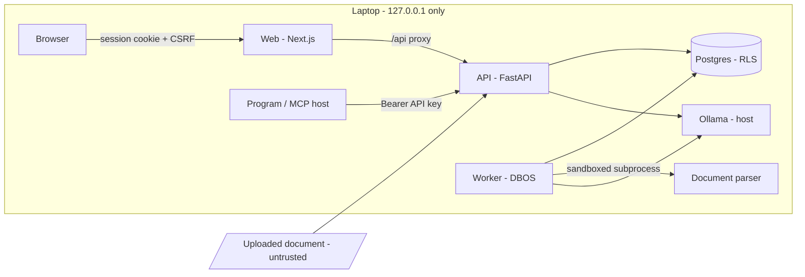

# Threat model: Release 1

**Scope:** AgentForge R1 as shipped. It runs on one machine through Docker Compose. Every port
is published on 127.0.0.1, and Ollama runs on the host. People use it through the web app;
programs use the REST API or `/mcp` with API keys. R1 is not meant to be exposed to the internet:
that needs the pre-public gate (architecture §13.8, R3).

## What we protect

| Asset | Why it matters |
|---|---|
| Uploaded documents and their chunks and embeddings | Customer-private policies and contracts |
| Answers, claims, reviews, exported questionnaires | What a customer is told; a wrong answer can create legal exposure |
| Accounts, sessions, API keys | Access to all of the above |
| Audit log | Proof of who did what |
| Model-call log (`app.llm_calls`) | Contains prompts, which contain document text |

## Who might attack, and from where

| Actor | Reach in R1 |
|---|---|
| A **malicious or careless document author** (the most likely in practice) | Text inside a document someone uploads |
| A **member of another organisation** on the same instance | A valid account, but a different tenant |
| A **signed-in member** exceeding their role | Their own session or API key |
| A **web page** the user visits while AgentForge runs | The browser: cross-site requests, DNS rebinding against `/mcp` |
| A **program holding a leaked API key** | Whatever the key's scopes and its creator's role allow, until the key is revoked |
| A **person on the local network** | Nothing, as long as ports stay on loopback (S1) |
| A **compromised dependency or image** | Code execution inside the containers |

## Trust boundaries

Untrusted inputs cross into the system as uploaded files, questionnaire files, document text
shown to models, model output, HTTP requests, and the `Origin` header.

## Threats, mitigations, and what is left

| # | Threat | Mitigation | Evidence | Residual risk |
|---|---|---|---|---|
| T1 | **Prompt injection** in a document makes the model act or lie | No agent tools. Evidence fenced as untrusted. Verbatim-quote verification. Screening flags AI-directed text. Low confidence plus human review | [prompt-injection.md](prompt-injection.md), S10 | False *statements* in a document are believed when quoted exactly; flagged only if the document also addresses an AI. Reviewers are the backstop |
| T2 | **Cross-tenant read or write** | Forced RLS on every `app` table; tenant set per transaction; one cross-org test per area | S4 | The dev container's schema owner is a superuser, which bypasses RLS. The app runs as `agentforge_app`, but production must use a non-superuser owner (deployment guide) |
| T3 | **Session theft or CSRF** | HttpOnly SameSite cookies (Secure and `__Host-` over TLS), CSRF token on unsafe methods, rotation on login, idle and absolute timeouts | S3 | Without TLS (local HTTP), cookies are not Secure: acceptable only on loopback |
| T4 | **Password guessing** | Argon2id, lockout per email, throttle per IP, same response for unknown email | S3, S8 | Behind the web proxy every login comes from the proxy's address, so the per-IP throttle counts all users together. Fine for one person, too coarse for a team |
| T5 | **Leaked API key** | Shown once, only SHA-256 stored, scopes, expiry of at most 365 days, revocation, acts within the creator's current role, audited with last use | S9, S13 | A key is valid until it expires or is revoked; there is no IP binding |
| T6 | **Browser attacks on `/mcp`** (cross-site requests, DNS rebinding) | Requests with an `Origin` are refused unless allowlisted; API keys only, no cookies | S9 | None known |
| T7 | **Malicious files** (zip bombs, parser crashes and hangs, macros) | Content sniffing, size and page limits, zip-container checks, documents parsed in a resource-limited subprocess, macro workbooks refused | S5 | The parser subprocess has no syscall or network isolation (R3: gVisor/nsjail). **Questionnaires are parsed in an API thread**, bounded by zip, row, column and cell limits but not process-isolated: a parser bug could hurt the API process |
| T8 | **Cross-site scripting** through document or model text | No raw HTML, sanitizer, images never loaded, safe links, `X-Frame-Options: DENY` | S7 | No Content-Security-Policy header yet (planned with the pre-public gate) |
| T9 | **Resource exhaustion** (uploads, questions, runs, MCP) | Body-size limits while streaming; per-caller rate limits; run budgets (model calls, time); worker concurrency cap | S5, S8, R1-36 | Limits are in memory per API process and reset on restart; several API replicas would each allow the full rate |
| T10 | **Data exfiltration through the model or tools** | No tools; the only egress is the configured model endpoint; remote images never loaded | S6, S7 | A remote OpenAI-compatible endpoint, if configured, receives document text by design: an operator choice |
| T11 | **Secrets leaking** to logs, the repo, or images | No secrets in logs (tested at DEBUG); gitleaks in pre-commit, `make check` and CI history; `.env` git-ignored; generated passwords | S11 | `app.llm_calls` stores prompts with document text (needed for traceability); readable within the tenant |
| T12 | **Supply chain** | Lockfiles, `exclude-newer` age gate, digest-pinned images, pip-audit, OSV-Scanner, Trivy, SBOMs, license allowlist | S12 | A malicious release older than the age gate would still get in |
| T13 | **Repudiation** (denying an action) | Append-only audit log (the app role cannot update or delete rows) for sign-in and sign-out, keys, reviews, deletions, downloads, MCP calls | S13 | The audit log lives in the same database a database superuser controls |
| T14 | **Exposure on the network** | Every port published on 127.0.0.1; the API refuses a non-local bind outside containers unless production | S1 | Ollama on the host listens wherever the user configured it, outside AgentForge's control; the install guide says to keep it off the network |

## Accepted for R1, revisit later

- Questionnaire parsing is not process-isolated (T7). Move it into the parser subprocess
  before any shared or hosted deployment.
- Rate limits are per process and in memory (T9); one API process in R1.
- No Content-Security-Policy (T8); part of the pre-public gate.
- Per-IP login throttling sees the proxy's address (T4); trusted forwarding headers come with TLS
  termination in a real deployment.
