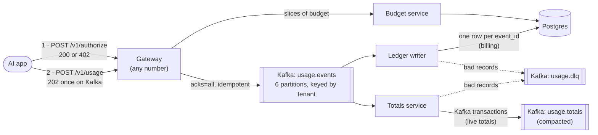

# Event Platform: AI usage metering and budget limits on Kafka

Every AI model call a tenant makes is metered, billed exactly once, and checked against the
tenant's daily token budget before it runs. Built on Kafka, Postgres and Python, and tested by
killing every part of it while it works.

- **Billed exactly once.** A usage record that got a `202` is in the ledger once: never lost,
  never counted twice, even when clients retry and brokers, workers and gateways are killed.
- **Order kept per tenant.** One tenant's records keep the order they were sent in.
- **Budgets enforced at the gateway.** A call that would go over the tenant's daily budget gets
  a `402` before it runs. Gateways approve calls from local slices of budget, so a check
  usually needs no network call, and the slices across all gateways never add up to more than
  the limit.
- **Recovers on its own.** Crashed services restart and rebuild their state; no step needs a
  person.
- **Measured, not claimed.** Every number below links to its raw results and the machine it ran
  on.

## How it works



1. **Before a model call,** the app asks a gateway to authorize it with the call's maximum
   tokens. The gateway reserves them from its local allowance for that tenant and tops up from
   the budget service when it runs low. The budget service grants slices with one SQL
   statement, so concurrent gateways can never be granted more than the limit in total.
2. **After the call,** the app sends the usage record with the same `event_id`. The gateway
   answers `202` only once the record is on every in-sync Kafka replica, and the record settles
   the reservation (unused tokens go back to the allowance). A retry with the same `event_id`
   can never count twice.
3. **The ledger writer** copies records into Postgres with `ON CONFLICT DO NOTHING`, then
   commits its Kafka offsets: at-least-once delivery plus an idempotent write gives each
   `event_id` exactly one row. The ledger is what gets billed.
4. **The totals service** keeps per-tenant, per-day totals with Kafka transactions and
   publishes every change to the compacted topic `usage.totals`, a live feed for dashboards and
   alerts ([ADR-0002](docs/adr/0002-exactly-once-totals.md) compares the two approaches).
5. Records that cannot be parsed go to a dead-letter topic with the reason; nothing is skipped
   without a trace.

## Results

Laptop: i7-1255U, WSL2 capped at 4 GB, everything (load generator included) on the one machine.

| What | Result | Evidence |
|---|---|---|
| **Correctness under crashes** (3 Kafka nodes) | 0 records lost, 0 counted twice, 0 out of order across 101,000+ records, while killing Kafka nodes, gateways and workers, forcing rebalances, and freezing Postgres for 30 s | [ADR-0004](docs/adr/0004-crash-testing.md) |
| Exactly-once totals | Database and Kafka totals exact to the token after 60,000 records with retries and 6 worker kills | [ADR-0002](docs/adr/0002-exactly-once-totals.md) |
| Budget never exceeded | 24 clients, 3 gateways, 8 gateway kills: 2,975,245 tokens used of a 3,000,000 limit; 0.8% of the budget stranded by the crashes; ledger exact | [results](bench/results/2026-10-27-Kingslee-budget-chaos/results.json) |
| Throughput, one gateway | 613-718 records/s acknowledged (`acks=all`) | [ADR-0005](docs/adr/0005-benchmarks-and-tuning.md) |
| Ack latency at half that rate | p50 8.7-9.6 ms, p99 83-112 ms | [results](bench/results/2026-11-08-Kingslee-load/results.json) |
| Gateway to ledger row, light load | p50 115 ms, p99 220 ms | [results](bench/results/2026-11-08-Kingslee-load/results.json) |
| Budget check | p50 1.8-4.3 ms from the local allowance; 6.7-17.7 ms when it tops up from the budget service | [results](bench/results/2026-11-08-Kingslee-load-3-gateways/results.json) |
| Recovery | Ledger caught up 2 s after a 30 s database freeze; workers restart in 1-2 s after `kill -9` | [ADR-0004](docs/adr/0004-crash-testing.md) |
| Replay | Ledger rebuilt from the Kafka log, identical row for row, at 13,219 records/s | [ADR-0004](docs/adr/0004-crash-testing.md) |
| Memory, whole stack | about 860 MiB idle, 1.0 GiB peak under load (one Kafka node) | [ADR-0005](docs/adr/0005-benchmarks-and-tuning.md) |

Throughput on this laptop varies 10-30% between identical runs, so ranges are from repeated
runs. Three gateways reached 881 records/s with the laptop 62-67% busy: gateways scale out,
but one laptop running the clients too cannot show how far.

## What testing found

The crash and load tests found real bugs, each fixed and written up with its evidence:

- The Kafka client's own committed-offset lookup failed once during a broker failover and was
  never retried, leaving partitions unread ([ADR-0004](docs/adr/0004-crash-testing.md)).
- A fenced consumer reported a fatal error that did not look fatal, so the service kept polling
  a dead client (ADR-0004).
- A client call blocked far past its own timeout; a watchdog now restarts the service (ADR-0004).
- The workers waited up to a second to fill each batch, so records took up to 1 s to reach the
  ledger; now 0.22 s at p99 under light load ([ADR-0005](docs/adr/0005-benchmarks-and-tuning.md)).
- Restoring all partitions at once after a restart held the totals service at its memory
  limit; now two at a time (ADR-0005).
- Readers rejected unknown fields, which would have dead-lettered every record during a rolling
  upgrade ([ADR-0003](docs/adr/0003-record-format.md)).

## Run it

Needs Docker (with about 2 GB free), [uv](https://docs.astral.sh/uv/) and `make`.

```bash
make setup      # Python dependencies from the lockfile
make up         # Kafka, Postgres and the services; waits until healthy
make check      # lint, types, unit tests (no services needed)
make e2e        # end-to-end tests against the running stack
make down       # stop (data is kept)
```

Try it:

```bash
# Give a tenant a daily budget of 50,000 tokens
curl -X PUT localhost:8110/v1/budgets/acme -H 'content-type: application/json' \
  -d '{"daily_limit": 50000}'

# Before a model call: may it use up to 4,000 tokens? (200, or 402 when over budget)
ID=$(uuidgen)
curl -X POST localhost:8100/v1/authorize -H 'content-type: application/json' \
  -d "{\"event_id\": \"$ID\", \"tenant_id\": \"acme\", \"max_tokens\": 4000}"

# After the call: record what it used (202 once stored on Kafka)
curl -X POST localhost:8100/v1/usage -H 'content-type: application/json' \
  -d "{\"event_id\": \"$ID\", \"tenant_id\": \"acme\", \"model\": \"claude-haiku-5-5\",
       \"input_tokens\": 1200, \"output_tokens\": 300,
       \"occurred_at\": \"$(date -u +%Y-%m-%dT%H:%M:%SZ)\"}"
```

API docs: gateway at <http://127.0.0.1:8100/docs>, budget service at
<http://127.0.0.1:8110/docs>.

Benchmarks (each writes its raw results to `bench/results/`):

```bash
make bench-load                         # throughput, latency, memory (dev stack)
make chaos-up && make bench-budget      # budget limit under gateway kills
make crash-stack-up && make bench-crash # crash harness on 3 Kafka nodes
make crash-stack-down
```

## Design decisions

| ADR | Decision |
|---|---|
| [0001](docs/adr/0001-kafka-client.md) | `confluent-kafka` over `aiokafka`: transaction fencing (KIP-447) and 3× faster producing |
| [0002](docs/adr/0002-exactly-once-totals.md) | Totals two ways: Postgres for billing, Kafka transactions for a live feed |
| [0003](docs/adr/0003-record-format.md) | JSON records checked by a schema snapshot in CI; no schema registry yet |
| [0004](docs/adr/0004-crash-testing.md) | Crash testing on three Kafka nodes: what held, what was tuned, what broke |
| [0005](docs/adr/0005-benchmarks-and-tuning.md) | Benchmarks on one laptop, and the changes they led to |

## Not built yet

- **Budget alerts** (for example at 80% of a budget), and anything that reads the live
  `usage.totals` feed: budgets are enforced at the gateway instead.
- **Request metrics** for the gateway, which no longer writes a log line per request.
- **CI** (lint, types, tests, security scans) is the next step.
- **Authentication:** the services listen only on `127.0.0.1` and trust their callers.
